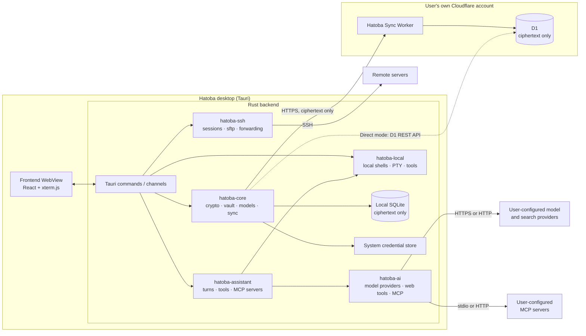

# Hatoba architecture and requirements

## 0. Scope and conventions

This document defines Hatoba's feature scope, architecture, data formats, sync protocol, and security model, and the implementation follows it.

The visuals come from the design tokens and shared components in `packages/ui` (`@hatoba/ui`), which the component gallery shows in each state ([development guide](development.md#run)). New pages and elements are built from them in the same style.

**Windows is the first platform.** §9.1 covers its title bar, fonts, shortcuts, and so on, and §9.2 what the macOS version (P1) does differently.

Priorities: **P0** is required for the MVP, **P1** for the first public release, and **P2** for later releases.

---

## 1. Product overview

Hatoba is an open-source desktop SSH client, similar in scope to Termius: it keeps hosts, keys, and terminal sessions in one place, with an AI assistant beside each terminal (§13). It differs from similar products in three ways:

1. **The sync backend runs in the user's own Cloudflare account** (Worker + D1), with no dependency on any official Hatoba server.
2. **End-to-end encryption.** All data is encrypted on the client before it leaves the device. A leak of the Worker, the D1 database, or even the whole Cloudflare account exposes no plaintext.
3. **A minimal, Apple-style interface** built for developers who use it heavily every day, with medium-to-high information density.

### 1.1 Target users

Individual developers, indie developers, and operators who manage several VPSs.

### 1.2 Out of scope

Team sharing and multi-user vaults, mobile apps (the architecture leaves room for them, §3.4), and a sync service hosted by Hatoba. Hosts connect only over SSH, and RDP, VNC, and FTP are not planned; [#60](https://github.com/scarletkc/Hatoba/issues/60) tracks Telnet, Serial, and Mosh.

---

## 2. Tech stack

| Layer | Choice | Notes |
|---|---|---|
| Desktop shell | Tauri 2 | **Windows first** (WebView2), then macOS and Linux |
| Frontend | React + TypeScript + Vite | Zustand for state management |
| Terminal rendering | `@xterm/xterm` | Addons: `addon-fit`, `addon-webgl`, `addon-search`, `addon-web-links` |
| IPC types | tauri-specta | Generates TypeScript bindings from Rust instead of hand-written types |
| Backend runtime | Rust stable + tokio | |
| SSH | `russh` | Connections, authentication, PTY, direct-tcpip (jump hosts and port forwarding) |
| SFTP | `russh-sftp` | |
| Local terminal | `portable-pty` | ConPTY on Windows (§7.5) |
| Key parsing and generation | russh's `keys` module (`ssh-key`) | OpenSSH and PEM formats, including passphrase-protected keys. `crates/hatoba-ssh/src/ppk.rs` parses PuTTY `.ppk` |
| Cryptography | `argon2`, `hkdf`, `sha2`, `aes-gcm`, `getrandom`, `subtle`, `zeroize` | All in Rust |
| Local storage | `rusqlite` (bundled) | |
| System credential store | `keyring` (Windows Credential Manager, macOS Keychain, Secret Service on Linux) | Windows Hello uses the `windows` crate, Touch ID `security-framework` and `objc2-local-authentication` |
| Windows window effects | `window-vibrancy` | Mica backdrop on Windows 11 |
| HTTP | `reqwest` (rustls) | |
| MCP client | `rmcp`, the official Rust SDK | Client features only, used inside `hatoba-ai` (§13.9) |
| Logging | `tracing` | |
| Sync service | Cloudflare Workers (TypeScript) + D1 | Hono for routing, wrangler for deployment |

---

## 3. Architecture

### 3.1 Overview



### 3.2 Core principles

1. **Secrets exist only inside the Rust process.** The WebView never receives the vault key, private keys, or host passwords in plaintext. The frontend receives only the metadata it displays (host names, addresses, tags, fingerprints, and booleans such as `has_password`). A password typed into a form goes one way to Rust and is never sent back to the frontend.
2. **Local first.** Every read and write goes to the local SQLite database first, and sync runs in the background. Without a network, or without sync configured, every feature works.
3. **Local and cloud data use the same ciphertext format.** The local database also stores only ciphertext, which is decrypted in memory after unlock.
4. **`hatoba-core` does not depend on Tauri**, so a future mobile app can reuse it.
5. **No Hatoba-only restrictions** ([#119](https://github.com/scarletkc/Hatoba/issues/119)). Defaults match comparable tools: Claude Code, Codex, and Cursor for the AI assistant, and OpenSSH, Termius, Tabby, Windows Terminal, 1Password, and Bitwarden for the rest of the app. Hatoba adds no safeguard, approval, confirmation, or limit that they don't have. Text shown up front stays only when the user needs it to finish a task or it prevents real data loss; requirements go into links, defaults, or error messages.

### 3.3 Repository layout

```
hatoba/
├── apps/desktop/
│   ├── src/                  # Frontend
│   │   ├── app/              # Layout, routing
│   │   ├── features/         # onboarding, unlock, hosts, dashboard, terminal, sftp, keys, sync, settings, ai
│   │   ├── session/          # Live sessions, connections, forwards, and transfers, shared by the features
│   │   ├── lib/              # Helpers and small components shared by the features
│   │   ├── styles/           # The app's own tokens: window chrome, terminal, server logos
│   │   ├── i18n/             # Message tables
│   │   └── ipc/              # tauri-specta bindings, frontend contract, browser mock backend
│   ├── src-tauri/            # Tauri shell: commands, channels, capabilities
│   └── e2e/                  # WebDriver end-to-end smoke test
├── apps/site/                # The website: product pages, downloads, and the docs from the built-in skill
├── packages/ui/              # @hatoba/ui: shared components and design tokens (CSS variables, light and dark)
├── crates/
│   ├── hatoba-ai/            # Model provider adapters, MCP client, web search, URL fetching
│   ├── hatoba-assistant/     # The AI assistant's runtime: turns, tools, MCP servers, skills, its DTOs
│   ├── hatoba-cli/           # The `hatoba` command's own commands (HOST-15)
│   ├── hatoba-core/          # Crypto, vault, data model, local store, sync engine
│   ├── hatoba-ipc/           # AppError and the DTOs the desktop app's crates share
│   ├── hatoba-local/         # Local terminal tabs: this computer's shells, PTY, the AI's tools here
│   └── hatoba-ssh/           # SSH sessions, PTY, SFTP, port forwarding, known_hosts
├── workers/sync/             # Cloudflare Worker source, D1 migrations, deployment guide
├── scripts/                  # CI, release, Worker bundle, and media scripts
├── skills/hatoba-cli/        # The coding agents' skill for the `hatoba` command (HOST-15)
└── docs/
```

### 3.4 Mobile readiness

There is no mobile app yet. A later one could use Tauri 2 mobile, or Flutter calling `hatoba-core` through flutter_rust_bridge. `hatoba-core` must therefore not take on desktop-only dependencies, and platform capabilities (keychain, biometrics) are injected through traits.

---

## 4. Security model and encryption

### 4.1 Key hierarchy

```
master password
 └─ Argon2id(kdf_salt, m=64 MiB, t=3, p=4) → master_key (32B)
     ├─ HKDF-SHA256(info="hatoba/enc/v1")  → enc_key  (32B)  used only on the client
     └─ HKDF-SHA256(info="hatoba/auth/v1") → auth_key (32B)  sent to the Worker to sign in

vault_key (32B, random)
 ├─ AES-256-GCM(enc_key)      → protected_vault_key   stored locally and in the cloud
 └─ AES-256-GCM(recovery_key) → recovery_vault_key    stored locally and in the cloud

recovery_code (128 random bits, shown to the user once)
 ├─ HKDF-SHA256(info="hatoba/recovery/v1")      → recovery_key
 └─ HKDF-SHA256(info="hatoba/recovery-auth/v1") → recovery_auth

each item → AES-256-GCM(vault_key)
```

- KDF parameters are stored as JSON in `kdf_params` (including the algorithm name and version), so the parameters can change later without old data getting stuck.
- The client enforces minimum KDF parameters and rejects anything below them, whether it comes from the Worker or the local database. `KdfFloor::PRODUCTION` in `crates/hatoba-core/src/crypto.rs` defines the minimums.
- The recovery code gets a 32-bit checksum and is shown as 8 groups of 4 Crockford Base32 characters, which is easy to write down and lets the app check what the user types. `crates/hatoba-core/src/recovery.rs` implements the format.
- Changing the master password only generates a new salt and re-encrypts `protected_vault_key`. **No data item is re-encrypted.**
- The server stores only `SHA-256(auth_key)` and `SHA-256(recovery_auth)`. Both inputs have high entropy, so SHA-256 is enough. Getting the master password back from them still means trying candidates through Argon2id one by one.

### 4.2 Encryption format (envelope)

```json
{ "v": 1, "n": "<base64, 12-byte random nonce>", "c": "<base64, ciphertext + GCM tag>" }
```

- Every encryption generates a new random nonce.
- The AAD is the UTF-8 string `hatoba/item/v1/{item_id}`, so ciphertext moved onto a different item fails to decrypt.
- The plaintext is the item's JSON (see §5.1), which includes the `type` field. **The item type never appears in plaintext in any storage.**

### 4.3 Runtime security

| ID | Requirement | Priority |
|---|---|---|
| SEC-01 | After unlock, vault_key and decrypted items live only in Rust memory and are cleared with zeroize on lock | P0 |
| SEC-02 | Auto-lock: after a time without keyboard or mouse input anywhere on the system (15 minutes by default; 1, 5, 15, or 30 minutes, 1, 4, or 8 hours, or never), when the system sleeps (on by default, can be turned off), and manual lock (Ctrl+Shift+L). Windows and macOS report the system's idle time; on Linux only input in Hatoba's window counts. The timeout and the sleep switch are kept per device in the device-local preferences | P0 |
| SEC-03 | By default, established SSH sessions and local terminals (§7.5) stay connected while locked, and the UI is covered: open dialogs are hidden, pending confirmations are cancelled, and sessions take no input until unlocked: no keystrokes, no SFTP commands, no resource usage readings (TERM-12), and the window ignores file drops. A device-local setting disconnects them, and ends the local shells, on lock instead | P0 |
| SEC-04 | Logs must never contain passwords, private keys, the vault key, session tokens, terminal content, AI provider API keys, MCP server environment and header values, MCP server stderr, or AI conversation content (messages, tool inputs, and tool results). Each SSH connection attempt is logged at the info level with its host, port, user name, and kind of authentication, and a failure with its error code and kind but not the error's text, so that a reported connection problem can be traced | P0 |
| SEC-05 | Tauri hardening: CSP `default-src 'self'`, no remote content, least-privilege capabilities, devtools disabled in release builds, and no shell plugin | P0 |
| SEC-06 | Increasing delay after repeated local unlock failures: no delay for the first 3, then doubling each time up to 1 minute (`unlock_delay_ms` in `crates/hatoba-core/src/vault.rs`). The failure count is persisted and survives an app restart. Argon2id does not run during the delay | P0 |
| SEC-07 | Windows Hello unlock: create a Hello credential with `KeyCredentialManager`, sign a fixed challenge, derive a wrapping key from the signature with HKDF, encrypt vault_key with it, and store the ciphertext in Credential Manager. A `UserConsentVerifier` prompt alone does not meet the requirement, because it has no cryptographic binding to vault_key. With Hello on, the lock screen asks for it on its own, once per lock, when the user comes back to the window: at once when the app starts with the window in front, when the window gets the focus, or after an idle or sleep lock at the first pointer movement in it. After a manual lock only the focus counts, so the window has to be left first and a face does not unlock it again at once. When the stored unlock no longer works (the Hello credential is gone, the ciphertext no longer opens, or it holds another vault's key), it is removed and the lock screen says that Windows Hello was turned off, never that the password is wrong | P1 |
| SEC-08 | Clear a copied password from the clipboard, if it still holds it, after a delay chosen per device: 30, 60, or 90 seconds (the default), 2 or 5 minutes, or never | P1 |
| SEC-09 | Show password strength (zxcvbn) when setting the master password, with a warning below a score of 2. Only the minimum of 8 characters blocks it | P1 |
| SEC-10 | Touch ID unlock (macOS): create a Secure Enclave P-256 key with `privateKeyUsage` and `biometryCurrentSet` access control that is not stored in the keychain, derive a wrapping key with HKDF from the ECDH of that key and an ephemeral P-256 key, encrypt vault_key with it, and keep the key blob, the ephemeral public key, and the ciphertext in one file (mode 0600) in the app data directory. Enrolling writes the file only after the blob has restored the same key. The lock screen asks on its own as in SEC-07; when the system cannot use Touch ID, for example while the lid is closed, that prompt fails without a message, and the reason shows only after a click on the button. A record that no longer opens, after the fingerprints change or on another Mac, is removed as in SEC-07. The ad-hoc signed build has no keychain access group, so the data protection keychain and its biometric access control are not available to it; once the build is signed with a Developer ID, move to a data protection keychain item with a biometric access control, with a one-time re-enroll. An `LAContext` prompt alone does not meet the requirement, because it has no cryptographic binding to vault_key | P2 |
| SEC-11 | PIN unlock, per device, on every platform: after the first unlock of a launch, the lock screen asks for the PIN instead of the master password. A PIN has at least 4 characters of any kind, and turning it on asks for the master password. Argon2id with the vault's KDF parameters and the PIN's own salt, then HKDF, gives the PIN key. `meta.pin` keeps the salt, the parameters, the PIN key sealed under vault_key, and the failure count; every unlock opens it and wraps vault_key with the PIN key again, held in memory across a lock and never written to SQLite. Five wrong PINs in a row drop that copy, and only a full unlock (master password, recovery code, Windows Hello, Touch ID) brings the PIN back. **Require the master password after a restart** is on by default; turned off, the wrapped vault_key also goes to the system credential store, so the PIN unlocks after a restart (`vault_pin` in `crates/hatoba-core`) | P1 |

### 4.4 Threat model

| Scenario | Outcome |
|---|---|
| The Cloudflare account, Worker, or D1 is stolen or exported | The attacker gets only ciphertext and KDF parameters and has to brute-force the master password through Argon2id |
| Network man-in-the-middle | Traffic uses HTTPS. Even if that is broken, the content is ciphertext |
| Maliciously modified Worker code | It cannot decrypt data, but it can delete data, roll it back to an older version, or deny service. Local copies are unaffected. Rollback detection is P2 |
| The Cloudflare API token used for in-app deployment leaks | It can change or delete every Worker and D1 database in the accounts it reaches, including the sync data, and can replace the Worker with modified code (the row above). The app holds it only in memory during a deployment (§6.7) and never stores it, so a stolen device or local database does not expose it. The token is safest with only the two permissions in §6.7, one account, and a short expiry, or deleted after the deployment |
| A malicious Worker reads `auth_key` during sign-in | `enc_key` and `vault_key` cannot be derived from `auth_key` (the one-way derivation in §4.1) |
| A malicious Worker returns weakened KDF parameters from `/v1/prelogin` | The client refuses to sign in, per the minimums in §4.1 |
| Someone holds a valid full session token | They can change the master password (`PUT /v1/vault/password` does not ask for the old one). After losing a device, revoke it from another device and consider changing the master password |
| Someone holds the recovery code | That equals holding the whole vault: the code decrypts `vault_key` and can reset the master password through `/v1/recover` |
| Text on the screen, in command output, or in a fetched page steers the AI assistant (prompt injection) | In manual approval mode, commands that only read, `read_file`, `grep`, `glob`, and what the user allowed (AI-19) run without asking, and every other command, terminal input, file change, and URL waits for the user; without asking, data leaves only in `web_search` queries, to the search provider the user chose or the model's provider, and in URLs on domains the user allowed. A command, terminal input, or URL that runs without the approval it needs, such as a command the read-only check (§13.5) wrongly lets through, is a bug, fixed like any other, not a breach of this model. In Auto mode, a call runs without asking when the judge (AI-47) finds that it only reads, or that it is a change the user asked for that deletes nothing, touches no credentials, sends nothing out, grants no access, weakens no security, and runs no code it cannot see; the judge reads the user's own words and the calls' arguments, the screen's last lines for terminal input, and MCP tools' descriptions and annotations, never command output or a page's content; injected text reaches it through those lines, descriptions, and annotations, which other programs and servers write, and through the arguments of a call it is steered to, and text written there to sway it can still move its answers. The hard rules of AI-47 and the card for every unsure answer bound this. In bypass mode the assistant can run what it is steered to on the tab's host, and `fetch_url` can carry data out in the URL it fetches. Auto and bypass are chosen per device and per conversation (§13.5) |
| The judge of Auto mode leaks or keeps what it receives | It holds what each judge request carried, which AI-47 lists. A judge that is a model of the conversation's own provider adds no recipient; a System One endpoint or another provider's model is one more, and so is its operator |
| The AI model provider leaks or keeps conversation data | It holds what the assistant sent it, which "What the provider receives" in [§13.1](ai-assistant.md#131-architecture) lists: messages and their attachments, screen text, tool results, and the few vault fields named there. The identification string the tab's SSH server sent names the server's software and often its OS |
| A `stdio` MCP server, or an imported skill, is malicious | A `stdio` server runs with the user's privileges, so adding one is like installing software. MCP tool descriptions and skill text reach the model as instructions, so the settings show them and skill import lists every file it saves, and MCP tool results are treated as data like terminal output (§13.8, §13.9) |
| Someone can run programs as the user while Touch ID is on (SEC-10) | The record only works on this Mac's Secure Enclave, but on the ad-hoc signed build a program that restores the key from the file can use it without Touch ID, so Touch ID protects the vault about as well as the user's OS account does. The keychain design for a Developer ID build closes this |
| Someone can read the system credential store as the user, while the PIN works after a restart (SEC-11) | The store holds vault_key wrapped by the PIN key, so they can try PINs offline without the limit of five; such a PIN protects the vault about as well as the user's OS account does. A PIN that needs the master password after a restart is only in memory, and is gone when the app quits |
| The device is compromised while unlocked | Out of scope |
| The master password is forgotten and the recovery code is lost | The data cannot be recovered. This is by design, and the UI must say so clearly |

### 4.5 Data visible to the server

The columns the server stores are defined by the migrations in §5.3, where items and device names are §4.2 envelopes.

**The server cannot see**: the master password, `master_key`, `enc_key`, `vault_key`, the recovery code, any item plaintext, or item types (the type is inside the encrypted plaintext).

**Metadata the server can see**: the number of items, their IDs, ciphertext sizes, modification times, the number of devices, sign-in and sync times, and the IP addresses Cloudflare sees anyway. AI conversations add items as they grow (§13.7), so these numbers also show when and how much the assistant is used.

---

## 5. Data model

### 5.1 Item types (plaintext before encryption)

All item IDs are UUIDv7. Reading plaintext tolerates unknown and missing fields, so different app versions can read each other's data. The Rust implementation is `Item` in `crates/hatoba-core/src/model.rs`.

```ts
type Item =
  | Host | Group | SshKey | KnownHost | PortForward | Snippet | Proxy
  | AiProvider | SearchProvider | AiConversation | AiMessage
  | Skill | SkillFile | McpServer | AiMemory
  | Settings;

interface Host {
  type: "host";
  name: string;                 // Display name, such as prod-api-tokyo
  address: string;              // Domain name or IP
  port: number;                 // 22 by default
  username: string;
  auth:
    | { kind: "password"; password: string }
    | { kind: "key"; key_id: string }
    | { kind: "agent" }         // P1
    | { kind: "ask" };          // Ask on every connection
  group_id: string | null;
  tags: string[];               // Such as ["production", "tokyo"]
  favorite: boolean;
  jump_host_id: string | null;  // P1, ProxyJump
  proxy?:                       // SSH-13; absent for the device's default proxy
    | { kind: "direct" }
    | { kind: "proxy"; proxy_id: string };
  note: string;
  ai_notes?: string;            // AI-37, at most 16 KB of UTF-8; absent while empty
  updated_at: number;           // Milliseconds since the epoch, used for conflict resolution
  env?: { name: string; value: string }[];  // SSH-14; absent while empty
}

interface Group {
  type: "group";
  name: string;
  parent_id: string | null;     // The MVP supports one level of nesting
  sort: number;
  updated_at: number;
}

interface SshKey {
  type: "key";
  name: string;
  algorithm: "ed25519" | "ecdsa" | "rsa";
  private_key: string;          // OpenSSH format
  passphrase: string | null;    // Key passphrase, if any
  public_key: string;
  fingerprint: string;          // SHA256:...
  comment: string;
  created_at: number;
  updated_at: number;
}

interface KnownHost {
  type: "known_host";
  host: string;
  port: number;
  key_type: string;
  public_key: string;
  fingerprint: string;
  first_seen_at: number;
  updated_at: number;
}

interface PortForward {          // P1
  type: "forward";
  host_id: string;
  name: string;                 // What it is for; "" for none (FWD-06)
  kind: "local" | "remote" | "dynamic";
  bind_address: string;
  bind_port: number;
  dest_host: string | null;     // null for dynamic
  dest_port: number | null;
  auto_start: boolean;
  updated_at: number;
}

interface Snippet {              // P2
  type: "snippet";
  name: string;
  command: string;
  tags: string[];
  updated_at: number;
}

interface Proxy {                // SSH-13
  type: "proxy";
  name: string;
  kind: "socks5" | "http";      // http: a proxy that supports CONNECT
  address: string;              // Domain name or IP of the proxy
  port: number;                 // 1080 by default
  username: string;             // Empty when the proxy needs no sign-in
  password: string;             // Used only with a username
  updated_at: number;
}

interface AiProvider {           // P1, §13.2
  type: "ai_provider";
  name: string;
  protocol: "chat_completions" | "responses" | "anthropic" | "system_one";  // Read as chat_completions when missing or unknown; system_one only serves as Auto's judge (AI-47)
  base_url: string;             // Such as https://api.openai.com/v1 or https://api.anthropic.com
  api_key: string;              // Empty when the server needs none
  auth_header: "x-api-key" | "authorization";  // anthropic only
  models: {
    id: string;                 // Model ID sent in requests
    name: string;               // Display name
    context_window: number | null;     // Tokens, null when unknown
    max_output_tokens: number | null;  // Tokens, null when unknown
    efforts?: ("low" | "medium" | "high" | "xhigh" | "max")[];  // AI-05, lowest first; absent when unknown
    adaptive_thinking?: boolean;       // AI-05, from Anthropic's model list or models.dev (AI-03); absent when unknown
  }[];
  chatgpt?: { client_id: string; subject: string; email: string };  // AI-52, the ChatGPT account it signs in with instead of a key; absent for a key provider
  updated_at: number;
}

interface SearchProvider {       // P1, the backend of web_search (§13.4)
  type: "search_provider";
  kind: "brave" | "tavily" | "searxng";
  base_url: string | null;      // The instance URL for searxng, null otherwise
  api_key: string;              // Empty for searxng
  updated_at: number;
}

interface AiConversation {       // P1, §13.7
  type: "ai_conversation";
  title: string;
  host_id: string | null;       // The host the conversation last worked on
  quick_target?: { username: string; address: string; port: number };  // AI-09, the quick-connect target (HOST-12) it last worked on, while host_id is null; the address in lowercase, IPv6 without brackets; none while absent
  origin?: string;              // AI-43, with neither, the name of the server a fork's copies came from when the fork could not tell which it is; none while absent
  local?: string;               // §7.5, with neither a host nor a target, the name of the computer whose local terminal tab it last worked on; none while absent
  pinned: boolean;
  context_start: string | null; // entry_id where the context sent to the model starts (AI-21)
  effort?: "low" | "medium" | "high" | "xhigh" | "max";  // AI-05, the level of its last message; Default while absent
  created_at: number;
  updated_at: number;
}

interface AiMessage {            // P1, one part of a conversation entry (§13.7)
  type: "ai_message";
  conversation_id: string;
  entry_id: string;             // UUIDv7, orders the entries of a conversation
  part: number;                 // 0-based
  part_count: number;
  data: string;                 // This part's slice of the entry's JSON
  updated_at: number;
}

interface Skill {                // P2, §13.8
  type: "skill";
  name: string;                 // 1 to 64 lowercase letters, digits, and hyphens
  description: string;          // At most 1,024 characters
  frontmatter: Record<string, unknown>;  // Other SKILL.md frontmatter fields, kept for export
  enabled: boolean;
  updated_at: number;
}

interface SkillFile {            // P2, one text file of a skill (§13.8)
  type: "skill_file";
  skill_id: string;
  path: string;                 // "SKILL.md" (its body, without frontmatter) or a relative path such as references/nginx.md
  content: string;              // UTF-8 text, at most 32 KB
  updated_at: number;
}

interface McpServer {            // P2, §13.9
  type: "mcp_server";
  name: string;                 // Used in tool names
  transport:
    | { kind: "stdio"; command: string; args: string[]; env: Record<string, string> }
    | { kind: "http"; url: string; headers: Record<string, string> };
  always_ask: boolean;          // Ask even in bypass mode (AI-31)
  updated_at: number;
}

interface AiMemory {             // P2, §13.12
  type: "ai_memory";
  name: string;                 // One line of at most 100 characters, unique among the memories of its scope
  content: string;              // The names and contents of a scope's memories together hold at most 16 KB of UTF-8
  host_id?: string;             // A host memory of this host; absent with local, a global memory
  local?: string;               // A host memory of this computer's local terminal (§7.5), while host_id is absent
  updated_at: number;
}

interface Settings {             // Fixed ID "settings", a single item
  type: "settings";
  terminal: {
    font_family: string;        // "Cascadia Mono" for a new vault, "Menlo" when created on macOS
    font_size: number;
    theme: "system" | "light" | "dark";
    dark_scheme?: string;       // TERM-06 colour scheme id for a dark terminal, "hatoba-dark" while absent or unknown
    light_scheme?: string;      // Same for a light terminal, "hatoba-light" while absent or unknown
    cursor_style: "block" | "bar" | "underline";
    scrollback: number;         // 10000 by default
    right_click?: "copy_paste" | "menu"; // WIN-05, "copy_paste" while absent ("menu" on macOS)
    confirm_multiline_paste?: boolean;   // TERM-04, true while absent
  };
  ai: {                         // P1, §13
    default_model: { provider_id: string; model_id: string } | null;
    default_effort?: "low" | "medium" | "high" | "xhigh" | "max";  // AI-05, Default while absent
    search_provider_id: string | null;
    native_search: boolean;             // AI-14, Native Search without a search provider; true while absent
    builtin_skill_enabled: boolean;     // AI-34, true while absent
    custom_instructions?: string;       // AI-36, at most 32 KB of UTF-8; absent while empty
    send_terminal_screen: boolean;      // AI-46, true while absent
    judge_model?: { provider_id: string; model_id: string };  // AI-47, the judge of Auto mode; none while absent
    memory: boolean;                    // AI-53, true while absent
    text_size: number;                  // TERM-13, 11 to 24 px; 13 while absent
  };
  updated_at: number;
}
```

`terminal.right_click` and `terminal.confirm_multiline_paste` were device-local in earlier versions, which do not write them. Each stays absent until it is set to a value other than its default (for `right_click`, the default of the platform the device runs on). After the upgrade, each device moves its own values into the fields that are still absent, under the same rule, and does this once. With sync off, the move happens right after unlock. With sync on, it waits for the first successful sync round after unlock, so it changes the latest `Settings` the server had: a value already set there is kept, and edits other devices had already uploaded are not outdated by the move's newer `updated_at` (§6.4). Until then the values stay in the device-local preferences. The move then uploads like any other edit.

Device-local data such as the last connection time and the window size is **not synced**. Otherwise every connection would cause a write and a potential conflict.

### 5.2 Local SQLite

The local database is `vault.db` in the app's local data directory, with SQLite's `vault.db-wal` and `vault.db-shm` beside it:

| Platform | Location |
|---|---|
| Windows | `%LOCALAPPDATA%\app.hatoba.desktop\vault.db`, next to the `logs` folder |
| macOS | `~/Library/Application Support/app.hatoba.desktop/vault.db` |
| Linux | `$XDG_DATA_HOME/app.hatoba.desktop/vault.db`, by default `~/.local/share/app.hatoba.desktop/vault.db` |

The database holds device-local data (the device ID, the sync cursor, the local preferences, and `local_state`), so it must not live in a directory that roams with the user profile. On Windows that rules out `%APPDATA%`: roaming profiles copy it to other machines, which would then share one device ID, and it is often redirected to a network share, where SQLite's WAL is unreliable.

`MIGRATIONS` in `crates/hatoba-core/src/store.rs` defines the tables, `LOCAL_COLUMNS` and `LOCAL_TABLES` in the same file add device-local columns and tables without changing the schema version (which the synced vault shares), and the `meta` module in the same file lists the keys of the `meta` table. The tables hold:

- `meta`: key-value pairs for the KDF parameters, the wrapped vault key, the device ID, the sync cursor, and so on. The recent quick-connect targets (HOST-12) and the AI approvals saved on this device (AI-19) are sealed under the vault key here, because they name hosts and the database holds no host name in plaintext (§12), and so are this device's ChatGPT sessions (AI-52), because they hold tokens. The logs do name the hosts connected to (SEC-04).
- `items`: one row per item. `envelope` holds only the §4.2 envelope and becomes NULL after deletion (a tombstone). `revision` is the version the server has confirmed, 0 for items that were never synced. `dirty` marks local changes that have not been pushed yet.
- `local_state`: device-local data that is not synced, such as the last connection time, the server's OS (HOST-11), whether the host's terminals show resource usage (TERM-12), and whether resource usage leaves a host or a group out (HOST-14).
- `conflict_log`: conflicts resolved automatically under §6.4, kept for item-by-item review and restore.
- `ai_file_snapshots`: what each `edit_file` or `write_file` call changed on a host, kept so the user can revert it (AI-41). Each row names its conversation, response, and call, seals the server, the path, and the file's content under the vault key, and says where the change stands: unfinished, written, reverted, or dropped by the size limit. Not synced.

The sync session token and the Cloudflare API token of D1 direct mode live in the system credential store (Windows Credential Manager, the macOS Keychain, or the Secret Service on Linux), and so does vault_key wrapped by the PIN key while the PIN works after a restart (SEC-11). They are never written to SQLite and never synced. The API token for in-app deployment and the setup token the app generates are not stored anywhere (§6.7). For a Worker the app deployed, the sync backend setting in `meta` also records the account ID and the Worker name, which are not secrets and only fill in the upgrade form.

### 5.3 D1 schema

One Worker deployment serves one user (a single vault). The migrations in `workers/sync/migrations/`, applied in file-name order starting with `0001_init.sql`, define the schema, which the Worker and D1 direct mode share:

- `meta`: a single row (`id = 1`) with the KDF parameters, `SHA-256(auth_key)`, `SHA-256(recovery_auth)`, the two wrapped vault keys, and the global `seq`.
- `items`: item envelopes, `revision`, `seq`, the deletion flag, and the update time. `seq` increases globally and drives incremental pulls.
- `sessions`: used only in Worker mode. It stores `SHA-256(session_token)`, the device ID, the device name encrypted with vault_key, and the session `scope` (full session or recovery session).

---

## 6. Sync

### 6.1 Two sync backends

The client abstracts the sync backend behind the `SyncBackend` trait, so the sync engine does not care which implementation it talks to.

```rust
#[async_trait]
pub trait SyncBackend: Send + Sync {
    async fn health(&self) -> Result<ServerInfo>;
    async fn prelogin(&self) -> Result<KdfInfo>;
    async fn setup(&self, init: VaultInit) -> Result<()>;
    async fn login(&self, auth_key: &[u8; 32], device: &DeviceLogin) -> Result<Session>;
    async fn recover(&self, recovery_auth: &[u8; 32], device: &DeviceLogin) -> Result<Recovered>;
    async fn fetch_vault(&self) -> Result<VaultMeta>;
    async fn pull(&self, since_seq: u64, limit: u32) -> Result<PullPage>;
    async fn push(&self, changes: Vec<Change>) -> Result<Vec<PushResult>>;
    async fn update_vault_meta(&self, update: VaultMetaUpdate) -> Result<()>;
    async fn devices(&self) -> Result<Vec<RemoteDevice>>;
    async fn revoke_device(&self, device_id: &str) -> Result<()>;
    fn set_session(&self, session: Option<Session>);
    fn forget_credentials(&self);
}
```

**Worker mode (P0, recommended)**: the user deploys `workers/sync` to their own Cloudflare account, and the client calls the §6.2 API over HTTPS.

**D1 direct mode (P1)**: the user enters an Account ID and an API token and picks one of the account's D1 databases. The client runs SQL directly through `POST https://api.cloudflare.com/client/v4/accounts/{account_id}/d1/database/{database_id}/query`. The schema is the same as in Worker mode (without the `sessions` table), and concurrent writes are detected by running `UPDATE ... WHERE revision = ?` and checking the affected row count. In this mode the API token usually has edit access to every D1 database in the account, which the D1 step of the setup states, and the token is stored only in the device's credential store.

### 6.2 Worker API

All endpoints live under `/v1`. Requests and responses are JSON (`Content-Type: application/json`, anything else gets `415`). Endpoints that need a session take `Authorization: Bearer <session_token>`.

#### Conventions

- All timestamps are Unix milliseconds (matching `updated_at` in item plaintext), including `created_at`, `last_seen`, and `expires_at`.
- `auth_key`, `recovery_auth`: 32 bytes in **standard base64 (with `=` padding)**. The client sends the raw value, and the server stores its `SHA-256` (hex).
- `kdf_params`: a **JSON string** (the client serializes the parameter object to a string). The server stores and returns it unchanged without interpreting it. It must be a JSON object of at most 1 KB.
- `kdf_salt`: an opaque string of 16 to 256 characters (`A-Za-z0-9+/_=-`). The server does not decode it.
- `protected_vault_key`, `recovery_vault_key`, `device_name`, and item `envelope`: opaque strings stored as is, at most 4 KB, 4 KB, 4 KB, and 64 KB respectively (in UTF-8 bytes).
- `device_id` and item `id`: `[A-Za-z0-9_-]`, 1 to 64 characters (UUIDs and the literal `settings` both qualify).
- Error responses: `{ "error": "<code>", "message": "..." }`. `message` may be omitted and never echoes submitted values.

#### Endpoints

| Method | Path | Auth | Description |
|---|---|---|---|
| GET | `/v1/health` | None | `{ service: "hatoba-sync", version, api: 1, initialized }`, used by **Test Connection** in the wizard. `503 database_unavailable` when D1 is unavailable or not migrated |
| GET | `/v1/prelogin` | None | `{ kdf_salt, kdf_params }`. `404 not_initialized` before setup |
| POST | `/v1/setup` | Setup token | Initializes meta for the first time. `201 { initialized: true }` on success, `409 already_initialized` if already set up, `401 invalid_setup_token` for a wrong token, `503 setup_token_not_configured` when none is configured |
| POST | `/v1/login` | None | `{ auth_key, device_id, device_name }` → `{ session_token, expires_at }` |
| POST | `/v1/recover` | None | `{ recovery_auth, device_id, device_name }` → `{ recovery_vault_key, kdf_salt, kdf_params, session_token, expires_at }` (recovery session) |
| GET | `/v1/vault` | Full session | `{ schema_version, kdf_salt, kdf_params, protected_vault_key, recovery_vault_key, seq }` |
| GET | `/v1/items?since=&limit=` | Full session | Incremental pull: `{ items, next_since, has_more }` |
| POST | `/v1/items` | Full session | Batch push: `{ changes: [...] }` → `{ results: [...] }` |
| PUT | `/v1/vault/password` | Full or recovery session | Changes the master password: atomically updates meta and revokes sessions. `200 { ok, relogin_required }` on success |
| GET | `/v1/devices` | Full session | `{ devices: [{ device_id, device_name, created_at, last_seen, expires_at, current }] }` |
| DELETE | `/v1/devices/:device_id` | Full session | Revokes that device's session with `204`. A device can revoke itself, and an unknown device also gets `204` |

#### Server requirements

- **Setup token**: set at deployment as the Worker secret `SETUP_TOKEN`, with `wrangler secret put SETUP_TOKEN` or by the app (§6.7). It stops someone else from initializing a freshly deployed, unconfigured Worker before you do. Without the token, `/v1/setup` always refuses (`401`), and it returns `503` when the secret is not configured. The secret can be deleted after initialization. The comparison runs in constant time, and so does the `auth_hash` comparison.
- **Sessions**: a token is 32 random bytes (base64url), and D1 stores only its SHA-256. It is valid for 30 days and slides forward on use (the renewal is written at most once a minute). Each device (`device_id`) keeps only one session of each kind. The insert checks again, in the same transaction, that the credential the session is issued for still matches `meta`, so a sign-in or recovery that overlaps a password change gets `401` instead of a session that outlives the change.
- **Recovery sessions**: a session issued by `/v1/recover` is valid for 15 minutes and can call only `PUT /v1/vault/password`. Other endpoints return `403`.
- **Rate limits**: `/v1/setup`, `/v1/login`, and `/v1/recover` allow 10 requests per minute for each source IP and endpoint, through the Workers Rate Limiting binding, and return `429` beyond that. Each Cloudflare data center counts separately.
- **Size limits**: at most 100 changes per push, and at most 64 KB per envelope.
- **No CORS headers**: client requests come from Rust, not a browser, so third-party web pages in a browser cannot call the Worker cross-origin.
- **No secrets in logs**: tokens, `auth_key`, envelopes, and request bodies are never logged. Every response carries `Cache-Control: no-store`.

#### POST /v1/setup

```http
POST /v1/setup
Authorization: Bearer <SETUP_TOKEN>
Content-Type: application/json

{
  "schema_version": 1,
  "kdf_salt": "<opaque salt>",
  "kdf_params": "{\"alg\":\"argon2id\",\"version\":19,\"m_kib\":65536,\"t\":3,\"p\":4}",
  "auth_key": "<base64, 32 bytes>",
  "protected_vault_key": "<envelope>",
  "recovery_vault_key": "<envelope>",
  "recovery_auth": "<base64, 32 bytes>"
}
```

#### GET /v1/items

Incremental pull by `seq`: `SELECT * FROM items WHERE seq > :since ORDER BY seq LIMIT :limit`. `since` defaults to 0. `limit` defaults to 500 with a maximum of 1000 (larger values are capped at 1000). Invalid values return `400`.

```json
{
  "items": [
    { "id": "0192...", "envelope": "{\"v\":1,...}", "revision": 4, "seq": 1207, "deleted": false, "updated_at": 1790000000000 }
  ],
  "next_since": 1207,
  "has_more": false
}
```

`next_since` is the `seq` of the last item on the page (the given `since` for an empty page). Deleted items are tombstones: `deleted: true, envelope: null`.

#### POST /v1/items

```json
{ "changes": [
  { "id": "0192...", "base_revision": 3, "deleted": false, "envelope": "{\"v\":1,...}", "updated_at": 1790000000000 }
]}
```

- `base_revision = 0` means create. Otherwise it must equal the item's revision on the server (optimistic concurrency).
- Delete: `deleted: true` with `envelope` set to `null` (or omitted). A change that is not a deletion needs a non-empty `envelope` string.
- `updated_at` is optional. The server time is used when it is omitted.
- At most 100 changes per request, and more return `413 too_many_changes`. The same `id` cannot appear twice in one request.

The server runs one D1 batch per change (D1 executes a batch as a transaction):

1. `UPDATE meta SET seq = MAX(seq, (SELECT COALESCE(MAX(seq), 0) FROM items)) + 1 WHERE id = 1`
2. If `base_revision = 0`, run `INSERT ... ON CONFLICT(id) DO NOTHING`, and the new item gets `revision = 1`. Otherwise run `UPDATE items SET envelope = ?, deleted = ?, revision = revision + 1, seq = (SELECT seq FROM meta WHERE id = 1), updated_at = ? WHERE id = ? AND revision = ?`
3. Zero affected rows means a conflict, and the server reads the item's row and returns it to the client.

`results` follow the request order:

```json
{ "results": [
  { "id": "0192...", "status": "ok", "revision": 4, "seq": 1207 },
  { "id": "0193...", "status": "conflict",
    "server": { "revision": 6, "seq": 1190, "deleted": false, "envelope": "...", "updated_at": 1790000000000 } },
  { "id": "0194...", "status": "error", "error": "too_large" },
  { "id": "0195...", "status": "error", "error": "not_found" }
]}
```

| status | Meaning |
|---|---|
| `ok` | Written. Returns the new `revision` and `seq` |
| `conflict` | `base_revision` does not match the server (including a create whose ID already exists). `server` is the item's state on the server (`envelope` is `null` for a tombstone). The client resolves it per §6.4 and retries |
| `error` / `too_large` | A single envelope exceeds 64 KB. **Only this change is affected.** The other changes are processed as usual, so one oversized item does not block the whole push queue |
| `error` / `not_found` | `base_revision > 0`, but the server has no such item (for example after a database reset). The client can upload it again as a new item (`base_revision = 0`) |

`seq` increases monotonically across the vault but may have gaps (a conflicting attempt also uses up a seq). The client relies only on it increasing.

D1 direct mode writes the same tables without the Worker, assigning `seq` inside each `INSERT` or `UPDATE` statement and catching `meta.seq` up after the push. Both modes therefore allocate the next `seq` as one more than the larger of `meta.seq` and the highest item `seq`, so that devices on the two modes can share one database without two changes getting the same `seq`. A change that shares its `seq` with another one can be missed by a device whose pull cursor already passed that number; turning sync off and on again on that device resets its cursor, and the next sync pulls every item again.

Structural errors (missing fields, wrong types, invalid IDs, `deleted` inconsistent with `envelope`, duplicate IDs) make the **whole request** return `400`, and nothing is written.

#### PUT /v1/vault/password

```json
{
  "kdf_salt": "...", "kdf_params": "{...}",
  "auth_key": "<base64, 32 bytes>",
  "protected_vault_key": "<envelope>",
  "recovery_vault_key": "<envelope>", "recovery_auth": "<base64, 32 bytes>"
}
```

`recovery_vault_key` and `recovery_auth` are either both present (rotating the recovery code) or both absent. Updating `meta` and revoking sessions happen in one transaction:

- Full session: revokes **all other** sessions, and the caller stays signed in (`relogin_required: false`).
- Recovery session: revokes **all** sessions, including the caller's (`relogin_required: true`), and the client must sign in again with the new password.

When the caller's session no longer exists by the time the transaction runs, for example because another password change revoked it, the transaction changes nothing and the request gets `401`.

#### Error codes

| HTTP | `error` | When |
|---|---|---|
| 400 | `invalid_request` / `invalid_json` | Missing field, wrong type or format / JSON that cannot be parsed |
| 401 | `unauthorized` / `invalid_session` | No token / unknown or expired token |
| 401 | `invalid_credentials` | Wrong `auth_key` or `recovery_auth` |
| 401 | `invalid_setup_token` | Missing or wrong setup token |
| 403 | `insufficient_scope` | A recovery session called an endpoint other than `PUT /v1/vault/password` |
| 404 | `not_initialized` / `not_found` | Not set up yet / unknown path |
| 409 | `already_initialized` | Setup called again |
| 413 | `too_many_changes` / `payload_too_large` | More than 100 changes / request body too large |
| 415 | `unsupported_media_type` | The request body is not JSON |
| 429 | `rate_limited` | Rate limit hit (with `Retry-After: 60`) |
| 500 | `internal_error` | Unexpected error (details are not returned to the client) |
| 503 | `setup_token_not_configured` / `database_unavailable` | Secret not set / D1 unavailable or not migrated |

### 6.3 Client sync flow

**When sync runs**: after unlock, after a local change (2-second debounce), every 60 seconds, when the window regains focus, and when the user starts it manually.

**One sync round**:

1. Pull pages starting at `sync_cursor` until `has_more = false`. For each remote item, overwrite the local item if it is not dirty, and resolve the conflict per §6.4 if it is.
2. Push all dirty items. Successful items have dirty cleared and their revision updated. Conflicting items are handled per §6.4 and retried at most once.
3. Update `sync_cursor` and broadcast the sync status to the frontend.

A failed sync does not affect local use. The UI shows **Offline** or **Signed out**, and the next trigger retries automatically with exponential backoff.

**An item too large to sync**: a host or the settings saved while sync was off can be larger than sync accepts (SSH-14, AI-36). The client does not send an envelope over 64 KB: the server would refuse it with `too_large` (§6.2), and a few of them in one request could pass the Worker's request body limit and fail the whole push. The item stays dirty, so it counts as pending and every round checks it again, while the other items sync as usual. The client keeps the items too large in the last finished round of the current connection, and the status page shows a notice for each one still in the vault: a host by name, with its notes, AI notes, and environment variables to shorten and **Edit Host**, and the settings with the custom instructions to shorten and **Open Settings → AI**. A notice goes once a round uploads the item or the item is deleted.

**When a connection ends**: every backend the client installs (after unlock, sign-in, setup, or restore) starts a new connection. Locking the vault, **Disconnect**, and installing another backend end the current one. Its rounds are cancelled: a cancelled round drops the request in flight, sends no further request, and no longer changes the local vault or the sync status. The backend it used forgets its credentials in memory, so it cannot authenticate again. **Disconnect** waits until the running round has stopped, and only then deletes the session, the API token, and the sync configuration, so no round writes `sync_cursor`, revisions, or the last sync time after it, or into a connection set up later. A request already sent may still be applied by the server. The client then handles it like a lost response: the next round on that remote adopts the result without a conflict.

### 6.4 Conflict resolution

1. Default rule: decrypt both versions and keep the one with the newer `updated_at` in the plaintext (last writer wins).
2. **Key items (`type = "key"`) are never dropped silently.** The losing version is saved as a new item, with a localized conflict-copy suffix added to its name.
3. When one side deletes an item and the other modifies it, the modification wins (the item comes back), to avoid accidental deletion.
4. Every automatic resolution is written to the local conflict log, and the sync status page shows the number of conflicts, with item-by-item review: keep the automatic result, or restore the other version.

### 6.5 Tombstones

In the MVP, deleted items keep their tombstones forever (`envelope = NULL, deleted = 1`), which costs little space. P2 may purge tombstones older than 180 days, and a device offline for longer than that would then need a full resync.

### 6.6 Key flows

**Flow A: enable sync on the first device**

1. On first launch, create the local vault: set the master password, generate the recovery code, and have the user confirm it is saved. From here on the app works fully offline.
2. Open **Sync** in the home tab's navigation rail, choose Worker mode, enter the Worker URL and the setup token, and select **Test Connection** (which calls `/v1/health`). An in-app deployment (§6.7) supplies the URL and the setup token itself.
3. Call `/v1/setup` to upload meta, then sign in and push all items.

A failure after `/v1/setup` succeeded, including a lost response, leaves the remote initialized while sync is not yet configured locally. Retrying the step resumes it: when `/v1/prelogin` returns this vault's salt and parameters, the client skips `/v1/setup`, signs in, checks that the remote's wrapped vault keys are the local ones, and finishes the upload. A remote that holds any other vault stops the step with `remote_initialized`; the wizard then offers Flow C.

**Flow B: add a new device**

1. On first launch, choose **Restore from Cloud** and enter the Worker URL.
2. Call `/v1/prelogin` for the salt and parameters. The user enters the master password, and the client derives the keys and signs in.
3. Pull the vault meta and decrypt vault_key. Then page through the cloud vault once to read its settings item: settings are a single item that conflicts resolve as a whole (§6.4), so a settings edit made before the first pull would otherwise start from the defaults and, being newer, replace the cloud's settings on every device. Save the local vault, that settings item (clean and at the cloud's revision), and the sync configuration in one transaction, then store the session; a cloud that has no settings item yet (its first device stopped right after setup) leaves none to save. A failure before the save leaves no local vault, and a retry signs in under the same device id, so the server replaces the session the failed attempt left instead of listing another device. From here on the device is a configured sync device, and it shows the cloud's settings even before the first pull, so an edit builds on them.
4. Pull every item in an ordinary sync round. If the pull is interrupted, the next round, including one after a restart, resumes from the saved cursor; the restore does not need to run again.

**Flow C: connect an existing local vault to an initialized cloud vault (P1)**

1. In the sync wizard, step 2 finds that the Worker or D1 database already holds a vault (`/v1/health` reports `initialized`, or §6.7 step 2 plans `has_vault`). It offers to join that vault instead of setting it up, and needs no setup token.
2. The master password step asks for the cloud vault's master password and says that this device's data is merged into the cloud vault, that the device then unlocks with that password, and that the cloud vault's recovery code replaces this device's. Its submit button is the explicit confirmation: once submitted, the join runs to its end even if the user leaves the wizard, as Flow A's setup does. Only a lock or a disconnect ends it (step 3). Only one sync setup runs at a time, so a Flow A or C started while another is still running is refused (`sync_setup_busy`). The join also needs sync to be off on this device, checked again in its commit (step 4), so it never moves a vault that another setup has meanwhile connected (`sync_already_configured`).
3. With the local vault unlocked, the client signs in as in Flow B step 2, under this device's id, and unwraps the cloud vault_key. It then pages through the cloud vault once to read its settings item: settings are a single item that conflicts resolve as a whole (§6.4), so another vault's settings cannot be merged with this device's, and the join takes the cloud's as they stand. It stores the session (and, in D1 mode, the API token) before anything local changes, so a credential store that fails leaves the local vault as it was. A failure up to here changes nothing local.
4. In one local transaction:
   - **Same vault** (the cloud vault_key opens the local vault check, for example on a device that synced before and was disconnected): every item is marked dirty with revision 0, so the next round reconciles each one per §6.4. Identical items converge without a conflict entry.
   - **Another vault**: every live item is decrypted with the local vault_key and re-encrypted with the cloud vault_key under the same id, revision 0 and dirty, so it is pushed as a new item. The settings are the exception: the cloud's settings item from step 3 replaces the local one as it is, clean and at the cloud's revision, so the app shows the cloud's settings from the moment the join commits and a later edit builds on them. Only when the cloud has no settings item that the cloud vault_key opens (none yet, as on a cloud whose first device stopped right after setup, or a damaged one, which could not win a conflict either) is the local one queued, dated at the epoch (`updated_at` 0): it is older than the settings of any of the cloud vault's own devices, so under §6.4 theirs win over it whether they arrive before or after it, while an edit made on this device after the join is dated as usual. From then on the settings sync like any other item. Tombstones and items that cannot be decrypted are dropped. The conflict log is cleared. Device-local data sealed with the vault_key (the recent quick-connect targets, the AI approvals saved on this device, this device's ChatGPT sessions, and the AI file snapshots) is sealed again with the cloud vault_key.
   - Either way the local meta takes the cloud's salt, KDF parameters, `protected_vault_key`, and `recovery_vault_key`, so the master password and recovery code become the cloud's. `recovery_auth_sealed` stays only when the cloud's `recovery_vault_key` is the one stored here (the same vault and recovery code, as on a device that reconnects), and is deleted otherwise. The sync configuration is recorded, and `sync_cursor` is reset.
5. The client runs an ordinary round, which pulls the cloud's items and pushes the local ones. An interrupted round resumes like any other. When the vault_key changed, biometric unlock and the PIN, which wrap the old key, are turned off. Once the transaction has committed the join counts as done: if reloading the items then fails, the vault locks instead of keeping the old key, and unlocking with the cloud's master password starts sync.

**Worker deployment**: the steps are in [Deploy the sync Worker](../workers/sync/README.md), and the in-app sync wizard links to it. The wizard can also deploy the Worker itself through the Cloudflare API (§6.7), or open the Deploy to Cloudflare page.

### 6.7 In-app deployment

The app can deploy `workers/sync` to the user's Cloudflare account through the Cloudflare API, initialize it, and upgrade it later, so the user needs neither a Git account nor a command line. The user provides only an API token, and the account ID when the app cannot fill it in. The deployment uses the same names, bindings, and migration records as the wrangler path in the [deployment guide](../workers/sync/README.md), so wrangler can maintain an in-app deployment and the app can upgrade a deployment made with wrangler.

| ID | Requirement | Priority |
|---|---|---|
| DEPLOY-01 | Release builds embed the Worker bundle, the migrations, and their manifest, generated from `workers/sync` at build time ([Worker bundle](#worker-bundle)) | P1 |
| DEPLOY-02 | A link opens Cloudflare's token form with the required permissions filled in. The app checks the token and fills in the account ID when the token reveals it, before anything is written ([API token](#api-token)) | P1 |
| DEPLOY-03 | Run the [deployment steps](#deployment-steps) in order with progress for each step, and finish on a Worker that answers `/v1/health` with the bundled version | P1 |
| DEPLOY-04 | Never overwrite a Worker the app does not recognize or a database that holds data ([existing Workers and databases](#existing-workers-and-databases)) | P1 |
| DEPLOY-05 | A retry after a failure at any step continues the deployment, and cleanup removes only what the deployment created ([failures and cleanup](#failures-and-cleanup)) | P1 |
| DEPLOY-06 | The app generates the setup token, passes it to `/v1/setup` itself, and deletes the `SETUP_TOKEN` secret once setup succeeds | P1 |
| DEPLOY-07 | The API token and the setup token live only in Rust memory for the length of the deployment. They are never stored, logged, or sent to the WebView ([token handling](#token-handling)) | P1 |
| DEPLOY-08 | Detect an older Worker through `/v1/health` and offer or require an upgrade through the same steps ([upgrades](#upgrades)) | P1 |

#### Worker bundle

The release build runs `npx wrangler deploy --dry-run --outdir <dir>` in `workers/sync` after `npm ci`. This is the bundling step Cloudflare documents for uploads through the API, and it produces a single ES module, `index.js`. `scripts/worker/bundle.mjs` (`pnpm worker:bundle`) runs both and packages that module with:

- Every `.sql` file in `workers/sync/migrations/`, in file-name order. The file name is the migration's name in `d1_migrations`.
- A manifest with the Worker version, the `name`, `compatibility_date`, and `compatibility_flags` from `workers/sync/wrangler.toml`, and the settings of its `DB` and `AUTH_LIMITER` bindings (the database name, and the rate limit's namespace, limit, and period).

The Rust shell embeds the package in the binary. The package is generated and never committed, and `tauri build` creates it through `beforeBuildCommand`. A build without it, such as `cargo test`, still compiles, and the deploy commands then return an error saying that the build has no Worker bundle.

**Versions.** The Worker version is `version` in `workers/sync/package.json`, which a test keeps equal to `VERSION` in `workers/sync/src/config.ts`, and `/v1/health` reports it as `version`. It is separate from the app version, so an app release that does not touch the Worker asks nobody to redeploy. Any change that alters the bundle or adds a migration (the source, its dependencies, `wrangler.toml`, or `migrations/`) raises the Worker version in the same pull request, and CI fails a change to these files that leaves the Worker version unchanged. The app knows two Worker versions: the bundled version, which is the newest it can deploy, and the minimum version it can sync with, `MIN_WORKER_VERSION` in `crates/hatoba-core/src/sync/compat.rs`.

**Compatibility.** Within one `api` number, Worker changes are additive. A new Worker version still serves apps built against older Worker versions, and a new migration works with the previous Worker code, because an upgrade applies migrations before it uploads the new code.

#### API token

The user creates an API token in the Cloudflare dashboard and pastes it into the wizard. The token needs two permissions:

| Permission in the dashboard | Name in the API reference | Used for |
|---|---|---|
| Account · Workers Scripts · Edit | Workers Scripts Write | Reading the workers.dev subdomain and an existing Worker's settings, creating a workers.dev subdomain, uploading the Worker, setting and deleting its secret, enabling its workers.dev route, and deleting it during cleanup |
| Account · D1 · Edit | D1 Write | Listing, creating, and querying databases (checks and migrations), and deleting a database during cleanup |

The wizard's **Create token** link opens the dashboard's token form with both permissions and a token name filled in. It follows Cloudflare's template URL format for user tokens:

```text
https://dash.cloudflare.com/profile/api-tokens?permissionGroupKeys=%5B%7B%22key%22%3A%22workers_scripts%22%2C%22type%22%3A%22edit%22%7D%2C%7B%22key%22%3A%22d1%22%2C%22type%22%3A%22edit%22%7D%5D&accountId=%2A&zoneId=all&name=Hatoba%20Sync%20Deploy
```

The template allows every account, so narrowing **Account Resources** to one account and setting a short expiry, or deleting the token after deploying, keeps a leaked token's reach small (§4.4). An account-owned token with the same permissions also works.

The token check calls `GET /user/tokens/verify` and, when that rejects the token, `GET /accounts/{account_id}/tokens/verify` for an account-owned token, as D1 direct mode does. An account-owned token therefore needs the account ID entered first. For a user token the app then calls `GET /accounts`. When the token reaches exactly one account, the wizard fills in its ID, and when it reaches several, the user picks one. Otherwise the user pastes the ID from the dashboard (**Workers & Pages** → **Account Details**). Step 2 below reads from both Workers and D1, so a missing permission shows up before anything is written, and the error names the permission.

#### Deployment steps

Paths are relative to `https://api.cloudflare.com/client/v4`. `{name}` and `{db}` are the Worker and database names, `hatoba-sync` and `hatoba` by default (the names in `wrangler.toml`), and the wizard lets the user change both in an expandable section.

| # | Step | Cloudflare API | When repeated |
|---|---|---|---|
| 1 | Check the token and the account | `GET /user/tokens/verify` or `GET /accounts/{account_id}/tokens/verify`, then `GET /accounts` | Read only |
| 2 | Inspect the account | `GET /accounts/{account_id}/workers/subdomain`, `GET /accounts/{account_id}/workers/scripts/{name}/settings`, `GET /accounts/{account_id}/d1/database?name={db}`, and read-only queries on any database found | Read only. Picks the plan in [existing Workers and databases](#existing-workers-and-databases) |
| 3 | Create the database | `POST /accounts/{account_id}/d1/database` with `{ "name": "{db}" }` | Skipped when step 2 found a database to use |
| 4 | Apply the migrations | `POST /accounts/{account_id}/d1/database/{database_id}/query` | Applies only the migrations that `d1_migrations` does not list |
| 5 | Upload the Worker | `PUT /accounts/{account_id}/workers/scripts/{name}` (multipart) | Replaces the code and the bindings |
| 6 | Set the setup token | `PUT /accounts/{account_id}/workers/scripts/{name}/secrets` | Runs only while the vault is not initialized, with a new token each time |
| 7 | Enable workers.dev | `POST /accounts/{account_id}/workers/scripts/{name}/subdomain` with `{ "enabled": true, "previews_enabled": false }` | No change when already enabled |
| 8 | Wait for the Worker | `GET https://{name}.{subdomain}.workers.dev/v1/health` | Read only |

- **Step 2**: when the account has no workers.dev subdomain yet, the wizard asks the user to choose one, because it appears in the URL of every Worker in the account, and creates it with `PUT /accounts/{account_id}/workers/subdomain` (`{ "subdomain": "<name>" }`) before step 3. The `name` filter of the database list is a search, so the app uses only an exact match.
- **Step 4**: one query call per missing migration, whose `sql` is the file's content followed by `INSERT INTO d1_migrations (name) VALUES ('<file name>');`. The endpoint runs the statements of one call as a batch, so a migration and its record are applied together. `wrangler d1 migrations apply` uses the same table and the same statement, and the app creates the table with wrangler's columns (`id`, a unique `name`, and `applied_at`) when it is missing, so both tools agree on what has been applied.
- **Step 5**: a `multipart/form-data` upload with a `metadata` part and one module part, `index.js`, of type `application/javascript+module`. The metadata sets `main_module` to `index.js`, the `compatibility_date` and `compatibility_flags` from the manifest, and `keep_bindings: ["secret_text"]`, which keeps any secret the Worker already has. Its `bindings` are `{ "type": "d1", "name": "DB", "database_id": "<database ID>" }` and `{ "type": "ratelimit", "name": "AUTH_LIMITER", "namespace_id": "<namespace>", "simple": { "limit": <limit>, "period": <period> } }`, with the values from the manifest.
- **Step 6**: the body is `{ "name": "SETUP_TOKEN", "text": "<setup token>", "type": "secret_text" }`. The setup token is 32 random bytes from the operating system's generator, encoded as base64url like a session token (§6.2).
- **Step 8**: the app polls until the response has `service: "hatoba-sync"`, the bundled `version`, and `initialized: false`. The first Worker on a new workers.dev subdomain can answer with errors for a minute or so while DNS propagates, so the app keeps polling for up to two minutes and then shows a waiting state with **Check again**.

After step 8 the wizard moves to the master password step, which runs step 3 of Flow A (§6.6) with the Worker URL and the setup token from Rust. Once `/v1/setup` returns `201`, the app deletes the secret with `DELETE /accounts/{account_id}/workers/scripts/{name}/secrets/SETUP_TOKEN`, so `/v1/setup` answers `503 setup_token_not_configured` from then on, as after the optional hardening in the deployment guide. A failed delete does not fail the setup, because `/v1/setup` cannot change an initialized vault, and the app logs the failure without the token. The sync settings then record the Worker URL, the account ID, and the Worker name (§5.2).

#### Existing Workers and databases

Step 2 decides what to do with resources that already have the chosen names, before anything is written. A Worker counts as a Hatoba Worker when its settings show a `d1` binding named `DB` and a `ratelimit` binding named `AUTH_LIMITER`. A database holds a vault when its `meta` table has the row `id = 1`.

| Worker `{name}` | Plan |
|---|---|
| Not found | Create it |
| A Hatoba Worker whose database holds no vault | Deploy over it and use the database bound as `DB`, whatever its name. This is what an earlier attempt leaves when it stops before `/v1/setup` |
| A Hatoba Worker whose database holds a vault | Deploy nothing. The wizard offers **Connect**, which joins that vault through its workers.dev URL (Flow C, §6.6), or a different Worker name. When the account has no workers.dev subdomain or the Worker's workers.dev route is off (`GET /accounts/{account_id}/workers/scripts/{name}/subdomain`), there is no URL to join, so **Connect** is off and the wizard points to connecting the Worker by its URL. The sync settings record no deployment for a joined Worker, because the app did not deploy it, so an update treats it as deployed by hand |
| Any other Worker | Stop and ask for a different Worker name. The app never overwrites a Worker it does not recognize |

When the database bound to a Hatoba Worker no longer exists, the Worker gets a database through the table below, as a new Worker does.

When the plan needs a new database:

| Database `{db}` | Plan |
|---|---|
| Not found | Create it |
| Empty (no tables apart from SQLite's and D1's internal ones), or migrated by Hatoba without a vault (`d1_migrations` lists only bundled migrations, every other table is one the bundled migrations create, and `meta` has no row) | Use it and apply the missing migrations. This is what an earlier attempt leaves when it stops at step 3 or 4 |
| Anything else, such as a vault, a D1 direct mode database, or other tables | Leave it alone and use the first free name of `{db}-2`, `{db}-3`, and so on. The wizard shows the name before deploying |

#### Failures and cleanup

Every step checks the current state before it writes, so **Retry** after a failure runs the steps again and continues where the last attempt stopped. Step 2 finds what the attempt created and picks it up through the tables above, step 4 skips recorded migrations, steps 5 and 6 replace what is there, and step 7 changes nothing the second time.

| Failed at | Left in the account |
|---|---|
| Step 1 or 2 | Nothing |
| Step 3 or 4 | A database with some or all migrations applied |
| Steps 5 to 7 | The database, and a Worker without its setup token or its workers.dev route |
| Step 8, or before `/v1/setup` finishes | A working Worker with no vault, whose setup token exists only in the app's memory |

None of these hold user data, because nothing from the vault is uploaded before `/v1/setup` succeeds. Next to **Retry**, the failure state offers **Remove what Hatoba created**, which deletes, in reverse order, only what the deployment created, in this attempt or in an earlier one that a **Retry** continued: the Worker with `DELETE /accounts/{account_id}/workers/scripts/{name}` and the database with `DELETE /accounts/{account_id}/d1/database/{database_id}`. It never deletes a Worker or database that existed before the deployment. Once the app quits, it no longer knows what a deployment created. Deploying again picks the leftovers up, and the user can also delete them in the Cloudflare dashboard under **Workers & Pages** and **D1**.

If the user leaves the wizard between step 8 and the end of the setup, the Worker stays without a vault, and nobody holds its setup token. The next in-app deployment finds a Hatoba Worker with no vault and sets a new setup token, so the deployment cannot get stuck.

#### Token handling

- The token field sends the API token one way to Rust (§3.2), and the WebView clears the field once Rust accepts it. Every later call (deploy, retry, cleanup, and the setup in the master password step) refers to the deployment by an opaque handle.
- Rust holds the API token and the setup token in zeroizing memory inside the deployment session. It drops the session when the setup finishes, when the user cancels or leaves the wizard, and when the vault locks (SEC-01, SEC-02).
- Neither token is written to SQLite, the credential store, or any file (§5.2), and neither appears in a DTO, an event, or an error sent to the WebView. As with the secrets in SEC-04, neither appears in logs. Deployment logs record the step, the HTTP status, and Cloudflare's numeric error codes, never request bodies.
- The API token goes only to `https://api.cloudflare.com`. The setup token goes only to the Cloudflare API (step 6) and to the new Worker's `/v1/setup`.

#### Upgrades

In Worker mode the app reads `/v1/health` on the first sync round after unlock, on every round while sync is paused, and whenever the sync status page opens, and compares `api` and `version` with what it supports:

| `/v1/health` reports | What the app does |
|---|---|
| A higher `api` than the app speaks | Sync pauses, with a message to update Hatoba |
| The app's `api`, and a version at or above the bundled one | Nothing. The app never deploys its bundle over a newer Worker, which another device's newer app may have deployed |
| The app's `api`, and a version below the bundled one but at or above the minimum | Sync continues. The sync status page shows **Worker update available**, which the user can dismiss until the next bundled version |
| A lower `api`, or a version below the minimum | Sync pauses with **Worker update required**, which cannot be dismissed. Local use continues (§3.2), and local changes are pushed after the upgrade |

**Update Worker** asks for an API token with the same permissions and runs the deployment steps with these differences:

- The account ID and the Worker name come from the sync settings when the app deployed the Worker. For a Worker deployed another way, the app fills in the account ID as in step 1 or the user enters it, and the Worker name is the first label of the workers.dev URL. With a custom domain the user enters the name.
- Step 2 requires a Hatoba Worker whose database holds a vault and uses the database bound as `DB`, whatever its name. Step 3 never runs.
- Step 4 applies only the new migrations, before step 5 uploads the new code. The compatibility rule in [Worker bundle](#worker-bundle) keeps the old code working in between.
- Step 6 never runs, and `keep_bindings` keeps whatever secrets the Worker has. Step 7 runs only when the configured URL is the workers.dev URL. Step 8 polls the configured URL and waits for the bundled version with `initialized: true`.
- A failed upgrade leaves the old code with some or all of the new migrations, or the new code, and each of these works. **Retry** continues it.

When the app did not deploy the Worker, the dialog warns that a Worker deployed with the Deploy to Cloudflare button is deployed again from the user's repository on its next push, which replaces the upgrade.

Without a token, nothing changes on the Worker. While it is at or above the minimum version, sync keeps working and the notice stays. Below the minimum, sync stays paused until the Worker is upgraded, in the app or with the upgrade steps in the deployment guide.

---

## 7. SSH requirements

### 7.1 Connection and authentication

| ID | Requirement | Priority |
|---|---|---|
| SSH-01 | Password authentication | P0 |
| SSH-02 | Private key authentication with ed25519, ecdsa, and rsa keys, including passphrase-protected keys | P0 |
| SSH-03 | Ask-every-time mode: prompt for the password when connecting, without saving it | P0 |
| SSH-04 | Host key verification: prefer the key types already saved for each host:port, including each ProxyJump hop. On first connect, show the fingerprint for confirmation (TOFU), then save it as a `known_host` item that syncs. A key of a type not yet saved requires the same explicit trust confirmation, showing any saved key of another type as context and keeping it when the new type is accepted. When a key of a saved type changes, **block the connection** with a prominent warning showing the previous key of that type, and continue only when the user explicitly chooses to update that type's fingerprint; other types remain saved | P0 |
| SSH-05 | Connection timeout (15 seconds by default), with readable error messages that tell DNS failure, refused connection, authentication failure, and timeout apart | P0 |
| SSH-06 | Keepalive (30 seconds by default) and disconnect detection | P0 |
| SSH-07 | After a disconnect, show a **Reconnect** button in the tab instead of reconnecting on its own forever | P0 |
| SSH-08 | keyboard-interactive authentication (including 2FA and OTP) | P1 |
| SSH-09 | ssh-agent: on Windows the OpenSSH agent named pipe `\\.\pipe\openssh-ssh-agent`, or the pipe `SSH_AUTH_SOCK` names. On macOS and Linux each hop uses the agent `ssh` would use for it: the `IdentityAgent` that `~/.ssh/config` gives the hop's address, read as `ssh` reads it except that `Match` blocks and `Include` are not followed (`$NAME` reads that variable, and `none` or `SSH_AUTH_SOCK` leave the hop to `SSH_AUTH_SOCK`), or else `SSH_AUTH_SOCK`. When the login shell exports an `SSH_AUTH_SOCK` other than the one the app inherited, as it does when `~/.zshrc` sets one and the app was started from Finder or a desktop launcher, that socket is tried first and the inherited one after it, and an agent that answers with no keys gives way to a later one that has keys. The shell runs once, on the first connection that signs in with the agent (MAC-07). A socket that does not answer fails the connection with its path named. Pageant compatibility is P2 | P1 |
| SSH-10 | Multi-hop ProxyJump: open a direct-tcpip channel over the previous hop's connection and start the next hop's session over that channel | P1 |
| SSH-11 | Import `%USERPROFILE%\.ssh\config` (`~/.ssh/config` on macOS and Linux), from **SSH Config** in the **Import** menu of the host list's header and of the empty host list, with Host, HostName, User, Port, IdentityFile, ProxyJump, and SetEnv. A `ProxyCommand` is not imported; the preview marks the entry and the import warns. The preview shows each host's IdentityFile. Private keys are imported only when the user ticks a separate option that lists the files it reads, and only from those files: a host whose identity file was not listed, for example because the config changed after the preview, uses **Ask Each Time** with a warning. Without the option, the hosts use **Ask Each Time** and no key file is read. Key files are read with the same limits as KEY-01 and outside the vault lock, and a key already in the vault (by fingerprint) is reused. The imports of SSH-12 and SSH-15 preview and import other clients' sessions the same way, with their key files | P1 |
| SSH-12 | Import PuTTY's saved sessions, from **PuTTY** in the **Import** menu: on Windows from the registry key `HKCU\Software\SimonTatham\PuTTY\Sessions`, on macOS and Linux from `~/.putty/sessions` (or `~/.config/putty/sessions`, or `$PUTTYDIR/sessions`), or from a `.reg` file of that key exported in Registry Editor. SSH sessions bring their host name (a `user@` in it gives the user), port, user name, and `.ppk` key file (WIN-09); `Default Settings` is left out. A SOCKS5 or HTTP proxy, with its username and password, and an SSH proxy (PuTTY 0.77 and later), which becomes the jump host, are imported as in SSH-15; other proxy types are not, with a warning. PuTTY does not save passwords | P1 |
| SSH-13 | SOCKS5 (RFC 1928, with RFC 1929 username and password) and HTTP CONNECT (with Basic authentication) proxies for the TCP connection of the first hop: the host, or its outermost jump host, whose own choice applies. The server's name goes to the proxy unresolved. Proxies are `proxy` items (§5.1) that sync. A host uses the device default, no proxy, or a saved proxy; the device default is chosen per device in **Settings → Proxies** and kept in the device-local preferences, because a proxy such as one on `127.0.0.1` exists only on some devices. Quick connect (HOST-12) uses the device default. A proxy that was deleted fails the connection instead of connecting around it, and deleting a proxy moves the hosts that named it to the device default. Proxy failures have their own error kinds: the proxy cannot be reached, it rejects the sign-in, it does not open the connection, or it was deleted. Through a proxy the latency is the round trip of an SSH keepalive to the first hop | P1 |
| SSH-14 | Per-host environment variables, like OpenSSH's `SetEnv`: the host editor lists `NAME=value` pairs, stored on the host as `env` so they sync with it. When a terminal opens, each one is sent as an `env` request before the shell starts, after the default `LANG=C.UTF-8`; a host variable with the same name replaces the default, and `TERM` sets the terminal type of the PTY request instead. The server sets only the names its `AcceptEnv` allows, and a refused variable is ignored. Only the terminal's shell gets them, not the commands Hatoba runs itself (TERM-12, the AI's `run_command`) or SFTP. A name is ASCII letters, digits, and `_`, not starting with a digit, and appears once per host; a value has no control character other than tab. A host has at most 64 variables, names of at most 128 characters, values of at most 4,096, and at most 16 KiB of names and values together. While sync is on, saving refuses a host whose item would be larger than sync accepts (§6.2); one saved while sync was off fails to upload while the other items sync, and the Cloud Sync page names it (§6.3). SSH config import (SSH-11) takes the first `SetEnv` line that applies and reads its quotes and backslash escapes as OpenSSH does, and leaves out variables that break these rules with a warning | P1 |
| SSH-15 | Import the saved sessions of Xshell, FinalShell, MobaXterm, SecureCRT, and Tabby, from the **Import** menu, where each client keeps them on this device or from a file or folder the user chooses: Xshell's sessions folder (by default `Documents\NetSarang Computer\<version>\Xshell\Sessions`, `.xsh` files in UTF-16) or an `.xts` export; FinalShell's data folder, whose `conn` folder holds `*_connect_config.json` and `folder.json` files; MobaXterm's `MobaXterm.ini` (in `%APPDATA%\MobaXterm`, in the Windows ANSI code page) or a `.mxtsessions` export; SecureCRT's configuration folder (by default `%APPDATA%\VanDyke\Config`, `~/Library/Application Support/VanDyke/SecureCRT/Config` on macOS, and `~/.vandyke/SecureCRT/Config` on Linux) or its `Sessions` folder, with an `.ini` file per session, whose key file is its own or, when it uses the global setting, the one in the folder's `SSH2.ini`, or the XML file that SecureCRT's **Tools → Export Settings** writes, with the same settings and the key files they name, which are imported from that file; and Tabby's `config.yaml`, whose profiles take the defaults of their group and of SSH profiles. Only SSH sessions are listed. Each brings its name, address, port, user (the local user when it has none; `root` for Tabby, as there), description as the note, key files, and folder, which becomes a group named after the folder's path with ` / ` between its folders, such as `Prod / DB`, as the host list shows groups flat (HOST-02); a group with that name is reused. A jump host that names another session (in SecureCRT, a session used as its firewall) links to the host imported from it, or to a host with its name. An SSH gateway given by address (MobaXterm, and PuTTY's SSH proxy) links to the saved host with that address, port, and user that goes through the gateway before it, or to a new one that signs in with the SSH agent, as a jump host can't ask for a password. A SOCKS5 or HTTP proxy links to the saved proxy with the same protocol, address, port, username, and password, or to a new one (SSH-13). Other proxy settings (SOCKS4, Telnet, a local command, Xshell's named proxies, SecureCRT's global firewalls) are left out, marked in the preview, with a warning. Saved passwords are not imported, nor keys the client keeps itself (Xshell's and FinalShell's, and those in Tabby's vault): the preview marks such a host, which uses **Ask Each Time**, and the import warns. A Tabby config encrypted with its vault passphrase can't be read, and the dialog says so | P1 |
| SSH-16 | One connection per saved host on this device, which its terminal tabs and port forwards share (FWD-05). The first tab or forward connects, or takes over the connection that resource usage reads over (HOST-14), and the host's later tabs and forwards open on it without signing in again, so a password asked every time (SSH-03) or a second factor (SSH-08) is asked once. A further connection opens for every four tabs, since OpenSSH allows 10 sessions on a connection by default (`MaxSessions`) and each tab may also hold SFTP and the resource usage readout on it, and for a tab whose shell the server refused on the connection. A connection made before the host's connection settings changed takes no new tabs or forwards; one kept open behind the lock screen (SEC-03) still does after the unlock. A tab or forward that a connection open before it does not serve within 10 seconds, as when the network dropped the connection unnoticed (SSH-06), marks it so that nothing more joins it and opens another. Closing a tab closes only its shell, and the connection closes once no tab and no forward is left on it. When it drops, every tab on it shows the disconnect (SSH-07) and its forwards stop. A quick connection (HOST-12) keeps a connection of its own per tab | P1 |

### 7.2 Terminal

| ID | Requirement | Priority |
|---|---|---|
| TERM-01 | Multiple tabs, one session per tab, and several tabs for the same host at once, which share its connection (SSH-16). Dragging a tab along the tab bar moves it, as in browsers: it comes to the front, the other tabs slide aside, and Escape puts it back. The home tab stays first. Clicking a session tab, or Enter on it, leaves the focus in its terminal; in the tab bar, Left and Right select the tab beside, and Tab stops only at the selected tab | P0 |
| TERM-02 | `xterm-256color` and truecolor, UTF-8. **Chinese and Japanese wide characters must render correctly, and Windows input methods such as Microsoft Pinyin and the Microsoft Japanese IME must place the candidate window and commit text correctly** | P0 |
| TERM-03 | Sync the PTY size when the window or a panel resizes | P0 |
| TERM-04 | Copy and paste. A single-line paste drops its trailing line breaks, so the command does not run, and needs no confirmation. Multi-line text is pasted unchanged after a confirmation, which the user can turn off | P0 |
| TERM-05 | Scrollback of 10,000 lines by default, configurable | P0 |
| TERM-06 | Font, font size, and theme (light, dark, or system), with built-in color schemes for dark and light terminals | P0 |
| TERM-13 | Three sizes, each in Settings and each changed by the zoom keys while what it sizes has focus: the interface zoom (Settings → Appearance → **Zoom**, 67% to 200% in the browsers' steps), kept per device in the device-local preferences because the right size depends on the screen; the AI panel's text (Settings → Appearance → AI Panel → **Text Size**, 11 to 24 px, synced as `settings.ai.text_size`), which sizes the conversation, the input and the approval cards; and the terminal font size (TERM-06), which every terminal tab takes. The keys are Ctrl+= or Ctrl++, Ctrl+- and Ctrl+0, the number pad's too (⌘ on macOS, MAC-03), and the default sizes are 100%, 13 px and 13 px. Ctrl+wheel over a terminal changes its font size, also while a program there reads the mouse, as in Windows Terminal; it zooms nothing else, since a stray Ctrl+wheel or touchpad pinch would resize the whole window, and macOS has no wheel zoom. The terminal takes the keys too, as Windows Terminal does: they are not Ctrl+letter (WIN-04), and Ctrl+Shift+- still sends `^_`. Each change shows the new value for a moment at the center of what changed. The interface zoom is the WebView's own (`Webview::set_zoom`), which scales the terminal with the window. The window's minimum size grows with it, so the layout keeps its 860 x 540 at every zoom, and zooming in stops at the largest step whose minimum window fits the screen's work area. Chrome that lines up with the native window stays in window pixels: the painted margin on Linux, and on macOS the room the traffic lights need, in the title bar's height and the rail's width, neither of which shrinks below it (MAC-01) | P1 |
| TERM-07 | Search in the terminal | P1 |
| TERM-08 | HTTP and HTTPS links open in the system browser on Ctrl+click (Cmd+click on macOS); other URL schemes are not opened | P1 |
| TERM-09 | Split panes | P2 |
| TERM-10 | Save session logs to local files | P2 |
| TERM-11 | Snippets (saved commands) | P2 |
| TERM-12 | The resource usage of a Linux or macOS server in the status bar: CPU, memory, and network rates, which open a popover with CPU and network over the last 3 minutes, memory and swap, the root filesystem, the load averages, and uptime. Pointing at a chart shows every value as it was at that reading. Off until turned on; the choice is remembered per host as device-local data like HOST-06, and a quick connection (HOST-12) keeps it for the tab. The readings come from `/proc` over the session's own connection: `SshSession::open_stats` (`crates/hatoba-ssh/src/session.rs`, with the script in `stats.rs`) runs `sh -s` on an exec channel and sends it the script `stats.sh` on stdin, which prints a block every 2 seconds, so nothing is installed on the server and the login shell only has to start `sh`. On macOS the script prints the same readings in the same format from `iostat` (CPU and load), `vm_stat` and `sysctl` (memory and swap, with memory in use counted as Activity Monitor does: app memory, wired and compressed), `netstat` and `route`, and `df`, where the space used on an APFS volume is its size less what is available, its container's use as Finder shows it. Each block also carries the traffic totals of the counted interfaces. For resource usage on the hosts page (HOST-14), the script also lists every filesystem every fifth block: `df -kP`, bounded by `timeout` where the server has it (on a Mac without it, by perl's `alarm`), with each filesystem's type from `/proc/self/mounts`. The list leaves out memory-backed and kernel filesystems, container layers, read-only images, and the files a container runtime mounts, and names each device, each ZFS pool and each APFS container once; on macOS it lists the filesystems Finder shows (not those mounted `nobrowse`, such as the system's other volumes) and `/`, without the read-only ones; the terminal's readout does not ask for it, so a network filesystem that stopped answering cannot slow it down. The script runs as a process on the server while the readout is sampled, which is while the tab is in front and the vault is unlocked, also while the window is minimized or hidden to the tray (WIN-10). A server whose identification string names another system (HOST-11) is not asked; any other server that runs neither Linux nor macOS or has no `sh` shows that resource usage needs Linux or macOS | P2 |

### 7.3 SFTP

| ID | Requirement | Priority |
|---|---|---|
| SFTP-01 | A file panel that expands to the right of the terminal, browses remote directories, and opens in the user's home directory | P0 |
| SFTP-02 | Upload (including drag and drop) and download, with progress and cancel | P0 |
| SFTP-03 | Rename, delete (with confirmation), and create folders | P1 |
| SFTP-04 | Show permissions, size, and modification time | P1 |
| SFTP-05 | **Edit** in a file's menu in the SFTP panel opens the file in an editor on this computer; double-click still downloads. Hatoba downloads it into a folder of its own under `edits` in the app's local data directory (§5.2), a folder per tab and per file, keeping the name it was opened as (characters Windows refuses become `_`) so the editor picks the syntax by its extension, and opens it with Settings → Terminal → SFTP → **Editor**, kept in the device-local preferences (`sftp_editor`) since programs exist only on some devices: the app the system opens that kind of file with (the default), or a program the user picks (on macOS an app, which opens through LaunchServices). A file the system has no app for (`nginx.conf`, `.bashrc`) opens in the platform's text editor: Notepad on Windows, where whether an app opens a kind of file is `AssocQueryStringW` without the Unknown handler, `open -t` on macOS, and on Linux, where `xdg-open` failed, the desktop's app for `text/plain` through `gio launch`. Scripts, programs, installers, shortcuts and web pages (`.sh`, `.py`, `.bat`, `.ps1`, `.js`, `.exe`, `.desktop`, `.command`, `.html`, `.svg` and the like) always open in that text editor, since the system's app for them would run the copy. A worker checks the copy four times a second and, once a save has stayed unchanged for half a second (editors write in steps) and its content differs from what the server has, uploads it over the tab's connection, shown in the transfer list. Before each upload it compares the remote file's size and modification time with those of its last download or upload; when they differ, or the file is gone, it asks: **Overwrite**, or **Discard My Changes**, which downloads the server's file into the copy again. Esc leaves the question on the file's row, and the next save asks again. The upload writes the content it read through a temporary `.part` file as SFTP-02 does, which gets the owner, group and permission bits the file has on the server as the upload starts, before any content goes in (no permission bits when the server reports none; a server that refuses to set them keeps the new file's own mode only when that grants nothing more, and fails the upload otherwise; setuid and setgid, which writing clears, are set again after it), and then replaces the file, so a script keeps its execute bit, a file a service reads through its group stays readable, and a `chmod` made on the server meanwhile stays. When the `.part` file cannot be created (a folder the login user cannot write) or cannot get the file's owner and group (another user's file, without root), the content is written into the file itself, which keeps them, once the open file is checked to be the one the upload compared (not a symlink put in its place); a connection dropped during that write leaves it partly written until the next upload, which writes it again without asking about the change. Overwrite on a file deleted on the server makes it again with the mode it had. A symlink is resolved when the file opens and its target is written, so the link stays a link. A file the login user cannot write shows the server's error. The panel lists the tab's edited files with their state (saved, waiting to upload, uploading, the server's error, or changed on the server), **Upload Again** for a failed one, and **Stop Editing**; a click on one opens it in the editor again. While the tab is disconnected, saves wait and upload once it connects again, as does a save whose upload failed while the connection was dying. The lock pauses editing: nothing uploads behind the lock screen, and after the unlock a copy whose last save did not upload, which may have been made while locked, asks **Upload** or **Discard Changes**, which downloads the server's file into the copy again (or ends editing while the tab is disconnected); editing goes on. Editing ends, and the copy is deleted, with Stop Editing, when the tab closes, and when Hatoba quits; a copy whose last save did not upload asks first, Upload or Discard Changes, or Cancel. Quitting while locked asks without naming the files and can only discard them. Copies a crash left are deleted at the next start | P2 |

### 7.4 Port forwarding

| ID | Requirement | Priority |
|---|---|---|
| FWD-01 | Local forwarding (`-L`) | P1 |
| FWD-02 | Forwarding rules start automatically when the host's connection opens (SSH-16), for a terminal tab or for a rule started on the **Port Forwarding** page (FWD-05) | P1 |
| FWD-03 | Remote forwarding (`-R`): the server listens on a bind address and port, and each connection it accepts there is connected to a destination as this computer reaches it; the channel opens only once the destination answers. The bind address defaults to `localhost`, the server's `GatewayPorts` decides whether another one is honored, and the dialog says so for an address beyond loopback. Port 0 lets the server pick, and the port it picked is shown. Stopping asks the server to stop listening (`cancel-tcpip-forward`). The forward's address is on the server, so nothing offers to copy it | P2 |
| FWD-04 | Dynamic SOCKS forwarding (`-D`): a SOCKS proxy on this computer (SOCKS5 `CONNECT` without authentication, SOCKS4 and SOCKS4a) that opens a `direct-tcpip` channel for each request, so the server resolves names and makes the connections. A refused or unreachable destination gets the matching SOCKS reply. It listens like a local forward, with the same warning for an address beyond loopback | P2 |
| FWD-05 | A **Port Forwarding** page, opened from the home tab's navigation rail, lists every saved host's forwarding rules, a section per host, where they are added, edited and deleted (a new one chooses its host), and started and stopped. A local rule's loopback destination (`127.0.0.1`, `localhost`, `::1`) is named as on the server, as a remote rule's listening address is, and a running one is named as it started, before any edit to its rule; a rule that is starting says so beside its address. A rule runs on the host's connection (SSH-16), so it runs or is stopped alike on the page, in the status bar popover of the host's terminal tabs, which shows only for a host with rules, and in the tray menu. With nothing open on the host, starting one connects without a terminal, and signing in asks what a terminal tab asks (SSH-03, SSH-04, SSH-08). Closing a tab leaves the host's forwards running. They keep running with the window in the tray and behind the lock screen (unless the lock disconnects sessions, SEC-03) until stopped, the connection ends, or Hatoba quits; the tray menu lists them with **Stop**, and **Copy Address** for those listening on this computer (WIN-10). A rule that failed to start, also one that started with the connection (FWD-02), shows why with **Retry**. Deleting a rule stops it, also when the deletion comes from another device by sync. A connection that ends on its own with forwards on it stops them and says so: a message while the window has the focus, otherwise a system notification whose click opens the page at the host's rules. Nothing reconnects on its own (SSH-07) | P1 |
| FWD-06 | A rule can have a name, one line of at most 128 characters, that says what it is for. Where rules are listed, on the **Port Forwarding** page, in the status bar popover and in the tray menu, a named rule shows its name with its rule as the detail; one without a name shows its rule as before. A running rule takes a new name at once, also one given on another device and synced, while its addresses stay as it started. The delete confirmation and the sync conflict view name it too | P2 |

### 7.5 Local terminal

A local terminal tab runs a shell of this computer, next to the SSH tabs, so local work (`git`, `ssh-keygen`, a deploy script, checking why a host does not connect) needs no second terminal app, and the AI assistant can help with it. `crates/hatoba-local` finds the shells, runs one in a PTY through `portable-pty` (ConPTY on Windows), and holds the assistant's tools on this computer; the desktop app keeps the tabs' sessions by id like SSH sessions (§10.3).

| ID | Requirement | Priority |
|---|---|---|
| LOCAL-01 | A local terminal tab runs a shell in a PTY, opened from the menu beside **New Tab** in the tab bar, which lists the shells (LOCAL-02), or with Ctrl+Shift+` (⌃⇧` on macOS), which opens the shell chosen for new tabs. It uses the terminal settings, search, links, copy and paste, and paste confirmation of SSH tabs (TERM-02…08); its status bar shows **This Computer** and the shell, without resource usage, port forwarding or SFTP, and its tab shows a terminal icon. The shell starts in the home directory with `TERM=xterm-256color`, `COLORTERM=truecolor` and `TERM_PROGRAM=Hatoba`, and on macOS and Linux with a UTF-8 `LANG` from the system's language when none is set, since an app started from the Dock or a launcher may have none; on macOS it is a login shell, as Terminal and VS Code start it. A shell that exits with status 0 closes its tab, as in other terminals; one that exits otherwise leaves the tab with its exit status and **Restart**, and one that cannot start shows why with **Retry**. Like SSH sessions (SEC-03), local shells take no input while the vault is locked, end on lock when the user chose to disconnect sessions then, and end when Hatoba quits; closing a tab ends its shell and the console programs it started | P1 |
| LOCAL-02 | The shells: on Windows PowerShell 7 (`pwsh`, from its installer's folder or `PATH`), Windows PowerShell, Command Prompt, Git Bash (the `bash.exe` of Git for Windows, from the folder its installer records or the usual ones) and each installed WSL distribution (`wsl.exe -d <name>`, from the registry key `wsl.exe` keeps them in, without Docker Desktop's and Rancher Desktop's own, as Windows Terminal leaves them out); on macOS and Linux the login shell (`$SHELL`) and the shells `/etc/shells` lists that exist, each name once, without `nologin`, `false`, `true`, `rbash` and `git-shell`. The system default is PowerShell 7, else Windows PowerShell, on Windows, and the login shell elsewhere. They are found each time the menu or Settings opens, so a shell installed meanwhile shows up. **Settings → Terminal → Local Terminal Shell** chooses the shell new local tabs run; it is kept in the device-local preferences (`local_shell`), since shells exist only on some devices, and a shell that is gone means the system default | P1 |
| LOCAL-03 | The AI assistant works in local tabs as in SSH tabs (AI-07…13, AI-38…41, AI-46, AI-48…51), in every permission mode, with the same approvals: approval cards name **This Computer** and the shell, and **Always allow** on a local tab covers this computer's local tabs, saved under the target `local`. How the tools run on this computer is below the table | P1 |

**The assistant's tools on this computer (LOCAL-03).** "The tab's host" of §13.4 is this computer. A tab whose shell has `sh` behind it runs the hosts' own exec scripts with it, so the tools behave as on a host: on macOS and Linux with `/bin/sh`, `run_command` running commands with the tab's shell as `$SHELL` (on macOS with the login shell's `PATH`, as MCP servers get it, AI-32), and for a WSL distribution with its `sh` through `wsl.exe -d <name> -e sh`, so the tools act inside the distribution, on its Linux paths. A Windows shell (PowerShell, Command Prompt, Git Bash) cannot run them, so the file tools, `glob` and `grep` run in Hatoba on Windows paths: `~`, `~/` and a relative path from the home directory, and a Git Bash path such as `/c/Users` as `C:/Users`; results show paths with forward slashes and the drive letter in capitals, which Windows accepts too. They give the results and refusals of the scripts: a write replaces an existing file's content in place, checked against what the card read right before it, a file it creates gets owner-only permission bits until its mode where the system has them, `grep` reads patterns with rg's own regex engine (so `multiline` and Unicode classes always work), a `multiline` search whose pattern can span lines reads each file whole, as rg does, and reports a file larger than 256 MiB as not searched, binary files and `.git` are skipped, and a glob that starts with a drive, such as `C:/Projects/**/*.json`, searches from there. `run_command` runs in the tab's shell, without its profile and without a console window, in `workdir` read as the file tools read paths; a missing directory, or in Command Prompt a network path, which it cannot start in, is refused before anything runs: PowerShell through `-EncodedCommand` with UTF-8 output and no progress bars, ending with a failed last command's own exit status, else 1; Command Prompt one line after `chcp 65001`; Git Bash with the command on stdin, read before the command runs, so the command's own stdin is empty as on a host. The command runs in a Job Object, so a stop or the timeout ends it and every process it started, and the result says they ended; processes a command that ends on its own leaves in the background keep running until Hatoba quits. The system prompt says that the tab is the user's own computer, names the computer, its system, the shell and the user, and for a Windows shell or a WSL distribution where the tools act and which paths they take; the tool definitions say "on this computer" for the tab's host, without the SSH server's identification string.

---

## 8. Vault, host, and key management requirements

### 8.1 Vault

| ID | Requirement | Priority |
|---|---|---|
| VAULT-01 | Create the master password on first launch | P0 |
| VAULT-02 | Generate a recovery code, and continue only after the user confirms it is saved | P0 |
| VAULT-03 | Unlock screen, with an increasing delay after repeated wrong passwords | P0 |
| VAULT-04 | Auto-lock (see SEC-02) | P0 |
| VAULT-05 | Change the master password | P1 |
| VAULT-06 | Reset the master password with the recovery code | P1 |
| VAULT-07 | Export an encrypted backup: a single file that uses the same envelope format | P1 |
| VAULT-08 | Plaintext export (asks for the master password again and shows a warning) | P2 |

### 8.2 Hosts

| ID | Requirement | Priority |
|---|---|---|
| HOST-01 | Create, edit, and delete hosts. The address is required, a host saved without a name is named after its address (its first 128 characters, the longest a name can be), and the port defaults to 22 | P0 |
| HOST-02 | Groups (one level of nesting in the MVP) | P0 |
| HOST-03 | Groups and tags, with filtering on the hosts page by group and by tags (a host shows when it has every tag picked) | P0 |
| HOST-04 | Favorites | P0 |
| HOST-05 | Search: fuzzy matching on name, address, user name, and tags. See WIN-04 for the shortcut | P0 |
| HOST-06 | Show the last connection time (device-local data) | P0 |
| HOST-11 | Show the server's operating system as an icon before the host name, in the host list and on session tabs, with a status badge in its bottom-right corner: the online and session status in the list (HOST-10), the session state on a tab. The OS comes only from the identification string the server sends in the SSH version exchange, such as `SSH-2.0-OpenSSH_9.6p1 Ubuntu-3ubuntu13.5`; no command is run on the server. It is recorded each time a terminal session connects, as device-local data like HOST-06, so it never changes the host's `updated_at` or syncs. `ServerOs` in `crates/hatoba-ssh/src/server_os.rs` lists the systems recognized; any other server gets a generic server icon | P1 |
| HOST-07 | Connect with a double-click or Enter | P0 |
| HOST-08 | On the host edit page, a saved password shows only **Saved** and can be replaced but not viewed | P0 |
| HOST-09 | Duplicate a host | P1 |
| HOST-10 | Online status dots: probe the TCP port of the hosts visible in the list (TCP connect only, no authentication), with a 3-second timeout, once every 60 seconds. A setting turns it off. The probe goes through the proxy the connection would use (SSH-13) and then waits for the first byte of the server's identification string, because some proxies confirm a connection before they reach the server | P1 |
| HOST-12 | Quick connect from the search box. Input that contains `@` or starts with `ssh ` is also read as a target: `user@host[:port]`, `ssh://user@host[:port]`, or `ssh [-p port] [-l user] [user@]host`, with an IPv6 address in brackets. A **Connect** row for it heads the list and is selected, so Enter connects it. Options that change nothing in Hatoba (`-4`, `-6`, `-a`, `-C`, `-k`, `-q`, `-t`, `-T`, `-v`, and `-x`, also grouped as in `-4v`) are ignored. So are agent and X11 forwarding (`-A`, `-X`, `-Y`), which Hatoba does not do: it connects without forwarding, as ssh does when forwarding is not possible, and a note above the **Connect** row says so. Other ssh options and remote commands show the row disabled with the reason. A saved host with the same address, port, and user is selected instead, so its key and jump host are used. Without a user name, it logs in as the local user, as OpenSSH does, and asks for one only when the local user name is unknown. Authentication works like the `ssh` command: ssh-agent first (SSH-09), then the server's keyboard-interactive prompts (SSH-08), or else (also when those fail) a password asked as in SSH-03 and never stored; saved keys are not tried. A server that hangs up after rejecting too many agent keys is connected to again without the agent. The host key, timeouts, and reconnecting work as in SSH-04, SSH-05, and SSH-07. Nothing is saved as a host unless the user picks **Save as Host** in the tab's menu, which opens the host editor filled in with the address, port, and user; after that, **Reconnect** connects the tab as the saved host. Features that belong to a saved host, such as port forwarding, are not offered on these tabs. The AI assistant names the target where it would name the host, and a conversation moves onto the target and off it as it would between hosts (AI-09). Targets that connected are kept as device-local recent targets (at most 8, only `user@host:port`, never synced), each removable. They show under the search box while it is focused and empty, and as extra **Connect** rows when they match the query. A conversation that worked on a target records it on its own item (AI-09, §5.1), which syncs with the conversation and goes with it when it is deleted | P1 |
| HOST-13 | Open from the command line. Only one Hatoba runs at a time: launching it again brings its window to the front and hands it the arguments. `hatoba <name>` connects the saved host with that name, unless several hosts have it. Other arguments are read as those of `ssh` (HOST-12), with or without the word, so `hatoba user@host`, `hatoba -p 2222 host`, and `hatoba ssh://user@host` connect as quick connect does, as the saved host they match when there is one. A command line that cannot connect fills the hosts page's search box, which says why. A launch while the vault is locked waits for the unlock. A switch in Settings → General, off by default and kept per device, adds the `hatoba` command: on Windows, `hatoba.exe` (and `hatoba` for Git Bash and WSL) in a `bin` folder beside the executable, which goes on the user's `PATH` and comes off again when Hatoba is uninstalled, but not when it updates; on Linux, `~/.local/bin/hatoba`, which starts the executable or the AppImage, with a note while `~/.local/bin` is not on the `PATH`; on macOS, `/usr/local/bin/hatoba`, which opens the app bundle after macOS asks for an administrator's password. A launcher already at that path that is not Hatoba's is left alone. While the switch is on, Windows and Linux put the command back at startup when it is missing or out of date, for example after a reinstall, an update, or a moved AppImage | P1 |
| HOST-15 | Other programs use the saved hosts through the `hatoba` command (HOST-13): `hatoba hosts` lists them without credentials (`--json` for programs), `hatoba exec <host> <command>` runs a command with the host's login shell on an exec channel, without a PTY and with an empty stdin, passes its stdout and stderr as they come and exits with its exit status (255 when Hatoba could not run it), in `--cwd` when given, which a Windows host without `sh` refuses, and `hatoba cp` copies one file to or from a host over SFTP. A host is named by its id or its name, as HOST-13 finds it. A switch below HOST-13's, off by default and kept per device, turns it on; while both are on, the running app listens on a named pipe only the user can open (Windows) or a Unix socket in its data folder that only the user can connect to, and `hatoba` checks that the pipe's server runs as the same user. On Windows the command is a console program installed beside the app, copied into the `bin` folder as `hatoba.exe`; elsewhere the app's executable runs these commands before the app would start. From Git Bash they get their arguments as typed, not turned into Windows paths, and `hatoba cp` turns a local path that starts with `/` into a Windows one with `cygpath`. The vault has to be unlocked; the app signs in with the saved host's credentials, jump host and proxy, over the host's open connection (SSH-16) when there is one, otherwise over one it keeps per host until it is unused for 10 minutes or the host connects another way. A host key not trusted yet, a password not saved, and a server's prompts are asked in the window as for a terminal, which comes to the front while the command says what it waits for; `--no-prompt` fails instead. A command that ends, or is killed, stops what it started (AI-18). The lock stops every command and copy and closes their connections. Below the switch, while it is on, **Skill for coding agents** shows the command that installs `skills/hatoba-cli`, an Agent Skills skill that tells coding agents to use these commands, with **Copy Command**. Settings counts the 20 latest uses until the lock and lists them (host, command or paths, how it ended) under **Details** | P1 |
| HOST-14 | Resource usage on the hosts page: a switch, kept per device and off by default, shows the online status and resource usage of every host the page lists (every host or a group's, narrowed to favorites and tags; the search does not change which), on the cards or as columns of the list. A card has the name, `user@address:port`, tags, the OS and online status (HOST-10, HOST-11), CPU, memory, and disk as bars, network rates, load averages, and uptime; every card is as tall as the others, and one without readings shows its status, the reason, and **Retry** in their place. Disk is the root filesystem, or the fullest one once it is over the disk threshold, on a card and in the list alike, and pointing at it lists the filesystems; the list has a column per value that can be turned off. The page also sorts by status, CPU, memory, disk (the fullest filesystem), network, or uptime. CPU, memory, and disk use over a threshold (90% by default, a device-local setting, 0 turns one off) show in red. A host that stops answering keeps its last readings, dimmed, with the time they were read. **Show Details** in a host's menu, or Space on the selected host, shows CPU and network over the last 3 minutes, memory and swap, the filesystems, the traffic totals of the counted interfaces (since each came up, usually at boot), the load, and uptime, with **Open Terminal**, which brings the host's tab to the front or opens one. **Readings**: while the switch is on, the page is shown, and the vault is unlocked, also while the window is minimized or hidden to the tray (WIN-10), each host it lists is read every 3 seconds (a device-local setting, 1 to 60) with `stats.sh` (TERM-12), which for the hosts page also lists every filesystem that stores files (at most 32, `/` always) every fifth reading, over the host's connection (SSH-16) or else over a background connection of its own. At most 8 background connections are being set up at once, from the TCP connection to the end of sign-in, which keeps 30 hosts behind one jump host under OpenSSH's default `MaxStartups` of 10. Until a jump host has let a connection through as it connects now, the hosts behind it try it one at a time, so its rejected password is not sent for each of them before the first rejection is known. Before signing in, the host's first hop (the host, or its outermost jump host) is probed as in HOST-10, once per 30 seconds for all hosts that share it, and a host whose first hop does not answer is not signed in to; offline and failed hosts are looked at again every minute, and **Retry** probes again at once. Leaving the page stops the readings and closes the background connections a minute later; the lock closes them at once. A connection made before the host's connection settings changed (a sync pull, say) is replaced, and the readings made over it are dropped. A server that runs neither Linux nor macOS shows its online status only, and is not signed in to again until the lock or a change to how the host connects; the system HOST-11 recorded does not decide this, as the host may since name another server. **No prompts**: the background accepts only trusted host keys and answers no keyboard-interactive prompt. A host that asks for a password on every connection (on any hop), a key whose passphrase is not saved, a password or verification code the server asks for (a rejected key and a second factor look the same to the client), a host key that is new or changed (SSH-04), or a failed sign-in (also a server that hangs up once signing in began, as with too many keys from the agent) shows the reason with **Connect**, which opens a tab, and is not signed in to again until **Retry**, a change to how the host or a jump host connects (address, port, user, credentials, jump host, the first hop's proxy; not the name, notes, tags, or favorite), a change to the trusted keys of its hops, a connected tab, over which it is then read at once, or the lock; so a failed sign-in is not repeated on its own before the next unlock, as tools like fail2ban watch for. The settings are compared by keyed hashes of the credentials, never stored, with a salt that the lock replaces so that no hash made while the vault was unlocked stays useful after it locks; holds end at the lock for the same reason. When the failure is at a jump host, also on the jump host's own connection when the page shows it, every host behind that jump host waits with it, also those already waiting for a connection slot, until a change to how the jump host or the hops outwards of it connect, or until **Retry** on one of them gets that host past the jump host; meanwhile only that host tries it. A tab's connection is read over only while the host connects the way it did when it connected (SSH-16); after an edit, the reading connects again. **Reusing connections**: opening a tab or starting a forward on a host that is being read takes over that connection, made for the host as it is now, as the host's connection (SSH-16): the shell opens on it without signing in, then sends the environment variables (SSH-14), and the forwards set to start with the connection start on it (FWD-02). Once no tab and no forward is left on it, it closes, after which the reading connects again. **Leaving out**: a host's or a group's switch, device-local data in `local_state` like HOST-06, leaves it out of the readings; left-out hosts stay listed, dimmed, are not signed in to, and each has the switch that brings it back (its own, or its group's). Readings stay in memory on this device and are never stored or synced | P1 |

### 8.3 Keys

| ID | Requirement | Priority |
|---|---|---|
| KEY-01 | Import a private key (pick a file or paste text). When parsing fails, give a clear reason (unsupported format, wrong passphrase, and so on) | P0 |
| KEY-02 | Generate ed25519 keys, with RSA 4096 as an option | P0 |
| KEY-03 | The list shows the name, type, SHA256 fingerprint, creation time, and the hosts that use the key | P0 |
| KEY-04 | Copy the public key with one click | P0 |
| KEY-05 | Before deleting, show which hosts use the key | P0 |
| KEY-06 | Deploy the public key to a chosen host (like `ssh-copy-id`) | P1 |
| KEY-07 | View the private key (asks for the master password again) | P2 |

---

## 9. UI requirements

The design tokens and shared components define the visuals (§0). This section only specifies the behavior and states each page must have.

| Page | Key behavior | Required states |
|---|---|---|
| Unlock | Enter the master password, with a button that shows it until the window loses focus, Windows Hello (P1) or Touch ID (P2), and a forgotten-password link into the recovery code flow. While the PIN can unlock (SEC-11), the field takes the PIN, with a link to the master password and back | Wrong password, throttled, wrong PIN with the tries left, PIN out of tries (the field asks for the master password), Touch ID unavailable, Windows Hello or Touch ID turned off because it no longer opens |
| First launch | Choose between **Create a New Vault** and **Restore from Cloud** | None |
| Window | The tab bar spans the window's width, with **Lock**, **Settings**, and the AI panel's button at its right (§9.1 for the window buttons). The home tab has a navigation rail at its left, an icon over each name: **Hosts**, **Forwards** (the Port Forwarding page), and **Keys**, and **Sync** (the Cloud Sync page) at the bottom, whose icon shows the sync status (§6) and whose tooltip says it. Session tabs have no rail. The home tab is a house icon, **Home** on hover, centered over the rail's items: a way back to the pages, as Termius's Vaults button. The tab bar and the rail are one surface around the page or terminal, whose top left corner is rounded beside the rail. A card keeps a line for tags while any listed host has some | None |
| Hosts | Every saved host (HOST-03). The header has a search box, an import menu, and **New Host**, with **New Group** in the menu beside it. Under it, **Favorites**, **Tags** (several may be picked, each removable beside it), the sort order, the resource usage switch (HOST-14), and **List** or **Cards**, which are kept per device. The groups show as buttons, each with its number of hosts, that open the group's hosts; a group's page names the group after the way back, with its menu (**Rename Group**, **Delete Group**) beside it, which a group's button also has on right-click. Rows and cards show the name, `user@host:port`, tags, online status, and last connection time; a click selects, Ctrl+click (⌘-click on macOS) adds a host to the selection or takes it out, Shift+click selects the hosts from the one last clicked, Ctrl+A (⌘A) selects every listed host, and a click beside the rows or Esc selects none; a search selects its best match. A double-click or Enter connects, Enter every selected host. The right-click menu of one of several selected hosts has **Connect**, **Add to Favorites** (or **Remove from Favorites** when all are favorites), and **Delete**, which asks once for all of them; Delete (⌘⌫) deletes the selected hosts too. The search box also takes an SSH target to connect to without saving it (HOST-12) | Empty (suggesting a new host or an import), no hosts matching the favorites and tags (with **Clear Filters**), an empty group (with **New Host**), no search results, a typed target (a **Connect** row in place of no results), an ssh command quick connect cannot run (the row disabled with the reason), a typed target with `-A`, `-X`, or `-Y` (a note that it connects without forwarding), recent targets under the focused, empty search box. With resource usage on: a host waiting, connecting, reading (over its own connection or a tab's), offline, failed (with **Retry**), neither Linux nor macOS, needing the user (a password asked every time, a passphrase, a password or verification code, a new or changed host key, a failed sign-in with the server's answer; with **Connect**, and **Retry** where it applies), a value over its threshold, readings from before the host stopped answering (dimmed, with their time), a left-out host listed dimmed with **Read Usage**, or **Read the Group’s Usage** when its group is left out |
| Host edit | Fields as in §5.1, password field rules as in HOST-08 | Field validation errors |
| Terminal | Tab bar at the top, connection status, resource usage (TERM-12), and an expandable SFTP panel | Connecting, connection failed (with a retry button), fingerprint confirmation dialog, fingerprint mismatch warning, disconnected. Resource usage: reading, a server that runs neither Linux nor macOS, sampling stopped (with the reason and **Retry**) |
| Keys | See §8.3 | Empty |
| Cloud Sync | A three-step wizard: choose a method → enter connection details → set or enter the master password. The methods are deploying the Worker from the app (recommended, §6.7), connecting a Worker deployed with the Deploy to Cloudflare button or wrangler (Worker URL and setup token), and D1 direct mode (Account ID and API token plus a database). When the Worker or database already holds a vault, the last step asks for that vault's master password and joins it (Flow C, §6.6). A status page follows | Synced, syncing, conflicts, offline, signed out, Worker update available, Worker update required, Hatoba update required (the Worker speaks a newer `api`, §6.7), an item too large to sync (§6.3). Device list and revocation |
| Cloud Sync: in-app deployment | The connection step of the in-app method: the API token field with the **Create token** link, the Account ID (filled in when possible, or a list when the token reaches several accounts), and the Worker and database names in an expandable section. After the token check, the page lists what it will create or reuse and the Worker URL, and **Deploy** runs the steps of §6.7 with a progress row for each. On success it shows the Worker URL and continues to the master password step. **Update Worker** on the status page opens the same form with the known values filled in | Token rejected or missing a permission (naming the permission, with a link to edit the token), no workers.dev subdomain (choose one), name taken (per §6.7), a Worker that already holds a vault (**Connect**), each step pending, running, done, skipped, or failed, a failed step (the error, **Retry**, **Remove what Hatoba created**), waiting for workers.dev (**Check again**), offline, a build without the Worker bundle |
| AI panel | A resizable panel at the right edge of the window, toggled with the shortcut in §9.1. The header has the conversation title, the tab's host, history, and **New Conversation**. Messages render as Markdown with no raw HTML and no remote images, and links open in the system browser. **Copy** next to each of the user's messages copies what was typed, without the attachments, and **Copy** under each finished reply copies the Markdown of the reply's text, every assistant message between two of the user's included, without reasoning or tool calls. Each of the user's messages shows the time it was sent, and each finished reply the time it ended, with the full date and time on hover. Each tool call is a collapsible block with its input, output, and exit status, and **Auto** when Auto ran it on a judge's verdict (AI-47), and approval cards appear in place. The input area has the queued message's card (§13.1), a line that names the MCP servers the conversation uses that failed (AI-32), a multi-line box (Enter sends, or queues the message while a turn runs; Ctrl+Enter, ⌘↩ on macOS, sends at once, stopping a running turn; Shift+Enter adds a line; `/` and `@` open the menu of AI-50 and AI-51 above it) and, under it, a + menu and the permission mode switch (AI-16) on the left, and the context meter, the model selector, **Ask a Side Question** (AI-42), and **Send (Enter)**, which becomes **Stop** during a turn, on the right. The + menu has **Add Text Files** (AI-35), **Slash Commands**, which starts the box with `/` and so opens the menu of AI-50, **Send Terminal Screen** (AI-46), and two lists that take its place, each with a first row that goes back: **Skills**, whose skills start the box with their command (AI-50), and **MCP Tools**, the MCP servers with their state and a switch that turns each off for the conversation (AI-30), which `/mcp` shows too. The + button and **MCP Tools** show a dot while a server the conversation uses has failed (AI-32). §13 defines the behavior | No provider configured (with a link to **Settings → AI**), no terminal tab (AI-09), a conversation on another host or quick-connect target (AI-09), a new conversation in a terminal tab offering to continue the home tab's (AI-09), streaming, a call being checked by Auto's judge (AI-47), waiting for approval, tool running, a side question's answer (AI-42), a queued message (§13.1), tab disconnected, response cut off at the output limit, response declined by the model, response without an answer (with **Retry**), provider error (the HTTP status and the provider's message, with **Retry**), context nearly full, empty history |
| Settings | Terminal appearance, language, and, kept per device, the auto-lock timeout, locking on sleep, whether locking disconnects sessions, the clipboard delay, what the close button does on Windows and Linux (WIN-10), the AI assistant's system notifications (AI-07), the `hatoba` command (HOST-13) and whether other programs may use the saved hosts through it, with what they did (HOST-15), and resource usage's refresh interval and thresholds (HOST-14). **Proxies**: the saved proxies and the default proxy of this device (SSH-13). **AI**: providers and their models, with **Continue with ChatGPT** (AI-52), search provider, default model and thinking level, custom instructions, memory (AI-53), whether messages send the terminal's screen by default (AI-46), Auto mode's judge with **Test** (AI-47), default permission mode, the approvals saved on this device, skills, and MCP servers (§13). **About**: the app version and the update check from §11, with a switch for the automatic check, and **Report a Problem**, which opens the GitHub bug report form with the app version and the operating system filled in. When a check finds a newer release, the settings button in the title bar shows a dot and opens the About page. Each change saves only the fields it changes, over the stored settings, so values that a sync pull brought in while the window was open stay (§6.4). After each sync round the window shows the stored settings again, except in a field the user is typing in | AI provider test passed or failed (AI-04), judge test running, finished (how many samples came out as expected, and each sample's decision under **Details**), or failed (AI-47), model list failed to load, skill import rejected (naming the file or field), MCP server starting, running, or failed (with its stderr). Update check: checking, up to date (also when nothing has been released yet), update available (with a link to the release page), offline, failed |
| Star prompt | A card in the home tab's lower right corner, over the page, asks for a star on GitHub, with **Star**, which opens the repository, and **Report a Problem** as in Settings → About. It waits a day from the first unlock on this device. After that it shows on the home tab once a session has connected since launch, and stays hidden while the settings button shows the update dot. Either button or closing the card ends the prompt for good | None |

**Global requirements**:

- Shortcuts: see WIN-04 in §9.1, and MAC-03 in §9.2 for macOS.
- Input methods: the Enter that commits an input method candidate never submits, saves, or sends.
- The theme follows the system by default, and every token has a light and a dark value.
- Narrow pages: a page in the main area is at its narrowest in the smallest window (`MIN_SIZE` in [`platform/window.rs`](../apps/desktop/src-tauri/src/platform/window.rs)) with the navigation rail and the AI panel open, and nothing on it may run under the AI panel or make the page scroll sideways at that width. Its controls go in `PageHeader`, which moves them under the title and then wraps them onto more rows; controls that would take several rows can show only their icons in a narrow page, as the hosts page's view switch does. A table drops its last columns instead of scrolling sideways: with container queries when its columns are fixed, as in `HostsPage.module.css`, or with `fitColumns` in `features/dashboard/logic.ts` when the user picks them.
- Internationalization: **all copy is externalized from day one, with no hard-coded strings** (P0). Simplified Chinese, Traditional Chinese, Japanese, and English translations are P1, and the default follows the system language. MCP server errors (AI-29) are the exception: their messages stay in English under a translated label.
- §9.1 covers the Windows title bar, fonts, and backdrop, and §9.2 the macOS ones.

### 9.1 Windows adaptation

Windows has its own title bar, fonts, backdrop, and shortcuts, as below. The rest of the interface, its whitespace, hierarchy, corner radii, and colors, is the same on every platform.

| ID | Requirement | Priority |
|---|---|---|
| WIN-01 | Custom title bar (Tauri `decorations: false`): the tab bar and the title bar are one, with Windows-style minimize, maximize, and close buttons at the top right. It supports dragging, double-click to maximize, and Windows 11 Snap Layouts on hovering the maximize button | P0 |
| WIN-02 | Font mapping: the UI font SF Pro becomes `Segoe UI Variable`, falling back to `Segoe UI` on Windows 10. The terminal font SF Mono becomes `Cascadia Mono`, falling back to `Consolas`. Chinese falls back to `Microsoft YaHei UI` (`Microsoft JhengHei UI` for Traditional Chinese), and Japanese to `Yu Gothic UI` | P0 |
| WIN-03 | High DPI and multiple monitors: sharp at 100%, 125%, 150%, and 200% scaling, with no blur or misplacement when the window moves between monitors with different scaling | P0 |
| WIN-04 | Shortcuts (see the table below). While the terminal has focus, Ctrl+letter must reach the remote side unchanged (Ctrl+L clears the screen, Ctrl+W deletes a word, Ctrl+K deletes to the end of the line, and so on), so every app-level shortcut adds Shift. The zoom keys (TERM-13) are not Ctrl+letter and need none | P0 |
| WIN-05 | Terminal copy and paste: Ctrl+C copies when text is selected and sends `^C` otherwise. Ctrl+V and Ctrl+Shift+V both paste. Right-click can be set to copy if text is selected and paste otherwise (the PuTTY habit), or to open a menu. The default is the PuTTY habit (macOS: MAC-04) | P0 |
| WIN-06 | WebView2 runtime: the installer embeds the bootstrapper and installs the runtime automatically when Windows 10 lacks it | P0 |
| WIN-07 | Backdrop: the translucent tab bar and the home tab's navigation rail use Mica on Windows 11 and falls back to a solid color on Windows 10 | P1 |
| WIN-08 | Follow the system light or dark mode and update live when it changes | P0 |
| WIN-09 | Import PuTTY `.ppk` private keys (v2 and v3) | P1 |
| WIN-10 | System tray and the close button, on Windows and Linux. A tray icon shows while Hatoba runs, with **Open Hatoba**, **Lock** (while the vault is unlocked), **Update to vX.Y.Z** (while an update check has found a newer release, §11), the running forwards (FWD-05), and **Quit Hatoba** in the app's language; a left click opens the window, and Linux panels show the menu instead. The window's close button, Alt+F4, and the taskbar's **Close** ask whether to minimize Hatoba to the tray, where SSH sessions, forwards, and sync keep running, or to quit, with **Remember my choice**. The answer is kept per device in the device-local preferences, and Settings → General changes it: ask every time (the default), minimize to the tray, or quit. Without a tray, on a Linux desktop with no StatusNotifier host such as GNOME without an extension, the close button quits. macOS keeps MAC-06 and has no tray | P1 |

| Action | Windows / Linux | macOS (P1) |
|---|---|---|
| Search hosts | Ctrl+Shift+K (Ctrl+K also works when the terminal does not have focus) | ⌘⇧K (⌘K also works when the terminal does not have focus, and clears the terminal while it has) |
| New tab | Ctrl+Shift+T | ⌘T |
| Close tab | Ctrl+Shift+W | ⌘W |
| Switch tabs | Ctrl+Tab / Ctrl+Shift+Tab | ⌃Tab / ⌃⇧Tab |
| New local terminal tab (LOCAL-01) | Ctrl+Shift+` | ⌃⇧` |
| Open settings | Ctrl+, | ⌘, |
| Lock | Ctrl+Shift+L | ⌘L |
| Larger, by focus: the terminal font, the AI panel's text, or else the interface zoom (TERM-13) | Ctrl+= or Ctrl++ (over a terminal also Ctrl+wheel up) | ⌘= or ⌘+ |
| Smaller | Ctrl+- (over a terminal also Ctrl+wheel down) | ⌘- |
| Default size | Ctrl+0 | ⌘0 |
| Show or hide the AI panel | Ctrl+Shift+A | ⌘⇧A |
| Send a message in the AI panel at once, stopping a running turn (Enter queues it while a turn runs, §13.1) | Ctrl+Enter | ⌘↩ |
| Copy | Ctrl+Shift+C, Ctrl+Insert, or Ctrl+C with text selected | ⌘C |
| Paste | Ctrl+Shift+V, Ctrl+V, or Shift+Insert | ⌘V |
| Find in the terminal (TERM-07) | Ctrl+Shift+F | ⌘F |

### 9.2 macOS

The macOS version (P1, §11) keeps the native macOS elements: the traffic-light buttons, the system fonts, and the translucent tab bar and navigation rail. It adapts the rest as below.

| ID | Requirement | Priority |
|---|---|---|
| MAC-01 | Title bar: the native traffic-light buttons over the window content (Tauri `TitleBarStyle::Overlay`, no title), centered on the row of the 44 pt title bar, where the tab bar centers its tabs, and over the home tab's navigation rail, which is 96 pt wide on macOS so they keep 18 pt from both its edges. They stay put as the interface zooms in (TERM-13): the rail grows with what it holds above 100%, and the title bar with its tabs from 150%, so the lights keep to their left and top, as by a wider Finder sidebar. The tab bar starts past the rail on every tab | P1 |
| MAC-02 | Fonts: the UI uses the system font, falling back to `PingFang SC` for Chinese (`PingFang TC` for Traditional Chinese) and `Hiragino Sans` for Japanese. A vault created on macOS starts with the terminal font `Menlo`, because WebKit cannot use SF Mono by name, and the terminal falls back to the same CJK fonts | P1 |
| MAC-03 | Shortcuts: the macOS column of the table in §9.1. App shortcuts use ⌘, so Ctrl+letter always reaches the remote side unchanged. The zoom keys (TERM-13) have no wheel zoom on macOS | P1 |
| MAC-04 | Secondary click in the terminal opens the menu by default, and **Right-Click in Terminal** can switch it to copy and paste (WIN-05). The default applies only while the setting is unset, so an explicit choice still syncs between devices (§5.1) | P1 |
| MAC-05 | Retina displays: sharp at every scale, and a file dropped from Finder on the SFTP panel or the AI panel lands where it is released | P1 |
| MAC-06 | Window: the close button hides the window and keeps the app running, with its sessions and the unlocked vault, and the idle auto-lock (SEC-02) still applies. A fullscreen window leaves fullscreen before it hides. Clicking the Dock icon shows the window again, and ⌘Q quits | P1 |
| MAC-07 | An app opened from Finder or the Dock has no shell environment. The sync device list shows the Computer Name from System Settings, conflict copies are named in the system's preferred language while the app language follows the system, MCP `stdio` servers get the login shell's `PATH` (AI-32), and signing in with the agent uses the `SSH_AUTH_SOCK` it exports (SSH-09) | P1 |
| MAC-08 | Auto-lock on sleep (SEC-02, unless the user turned it off): the vault locks when macOS announces sleep, before the Mac sleeps, as on Windows | P1 |

---

## 10. IPC conventions

### 10.1 Commands (frontend calls Rust)

tauri-specta generates the full list of commands and their signatures into the `commands` object in `apps/desktop/src/ipc/bindings.ts`, and the frontend calls them through `HatobaApi` (`apps/desktop/src/ipc/api.ts`), which is derived from that object: each command under the name of its Rust function, with a callback in place of each channel. The Rust implementations are grouped by area in the modules that `apps/desktop/src-tauri/src/commands/mod.rs` declares.

DTOs returned to the frontend never contain secret fields. For example, `HostView` has only `has_password: bool`, and `KeyView` has only the public key and the fingerprint.

### 10.2 Events (Rust pushes to the frontend)

tauri-specta generates the full list of events into the `events` object in `apps/desktop/src/ipc/bindings.ts`. Event names come from `#[tauri_specta(event_name = ...)]` on each event type in `apps/desktop/src-tauri/src/dto.rs`, grouped by prefixes such as `vault://`, `sync://`, `ssh://`, and `ai://`.

### 10.3 Terminal data flow

- **Output**: each session has its own Tauri `Channel`. The Rust side buffers SSH output and pushes it every 8 ms or once 32 KB has accumulated, whichever comes first. Each frame (`TermFrame` in `commands/ssh.rs`) is a tag byte and its payload: the session id, sent before connecting, then the data, and at the end the reason it closed or an error message. Local terminal tabs use the same frames.
- Output bytes take the raw binary path of Tauri 2 channels (an `ArrayBuffer` in the WebView). Serializing them as JSON arrays would ruin throughput.
- **Input**: `ssh_write` sends typed text to Rust, and `ssh_write_bytes` raw bytes such as mouse reports; local tabs use `local_write` and `local_write_bytes`.
- **Backpressure (P1)**: when the frontend cannot keep up, the Rust side buffers up to 4 MB and then stops reading from the SSH channel.

---

## 11. Non-functional requirements

| Category | Requirement |
|---|---|
| Performance | Cold start to the unlock screen under 1 second (on a mainstream Windows laptop). Unlock (Argon2id) under 1.5 seconds. The UI does not freeze during sustained heavy output (such as `cat` on a 50 MB file). Keystroke echo latency under 50 ms. Search results appear instantly with 1,000 hosts |
| Reliability | A failed sync does not affect local use. Sync must never lose a private key, under any circumstances |
| Platforms | Windows 10 (21H2+) and Windows 11 x64 are P0. Windows arm64, macOS 13+, and Linux (AppImage, deb) are P1 |
| Distribution | Windows: an NSIS installer (per-user, no administrator rights), published as a GitHub Release, is P0. The installer is not code-signed, and code signing is not planned: a certificate is impractical to obtain for this project, because Azure Artifact Signing offers its individual tier only in the US and Canada and the other options need an HSM or a third-party publisher. Windows SmartScreen therefore warns on the first install; an update that the app downloads and installs itself usually does not trigger it. Linux: a deb package and an AppImage for x86_64, in the same GitHub Release. Updates go through the Tauri updater and are signed (P1): each release carries the installer, its minisign signature from the update signing key, and a `latest.json` with the version and the release notes ([Release Hatoba](releasing.md#set-up-update-signing)). The About page in Settings reads `latest.json` when the user clicks **Check for Updates** and, unless the user turns the automatic check off (it is on by default), after the first unlock of each launch and again 24 hours after the last check that succeeded for as long as Hatoba runs, including hidden in the tray (WIN-10); a failed automatic check is tried again an hour later. It shows a newer version with its notes, and on Windows and Linux the tray menu offers **Update to vX.Y.Z**, which opens the About page and starts **Download and Install**. A stable version reads it from the latest stable release, so it is offered only stable releases. A prerelease version (`-alpha`, `-beta`, or `-rc`) finds the newest release that carries a `latest.json` through the GitHub API, prereleases included, so it moves on to the next prerelease or to the final release. **Download and Install** asks first when SSH sessions are connected or file transfers are running, and says how many will stop; then it downloads the installer and runs it only when its signature matches the public key built into the app and names the announced version. Hatoba then closes, which ends every session, and the installer opens the new version. On Linux, `latest.json` lists the deb package and the AppImage separately, so each installation updates with its own kind: the updater replaces the AppImage, or installs the deb package with `dpkg` after asking for an administrator password, and Hatoba restarts into the new version. A copy that a package manager installed leaves updates to it: the package writes `managed-by-package-manager`, holding the package manager's name, to Hatoba's resource folder (beside `Hatoba.exe` on Windows, `/usr/lib/Hatoba` on Linux), as the Scoop manifest (`scoop`) and the AUR package `hatoba-bin` (`aur`) do. Then the About page says how to update with that package manager where **Download and Install** would be (for Scoop, `scoop update hatoba`, with **Copy Command** once a newer version is found), **Check for Updates** still shows a newer version and its notes, the automatic check never runs and its switch is hidden, and neither the dot on the settings button nor **Update to vX.Y.Z** in the tray appears. winget runs the NSIS installer from the release, so its installs update like the installer's. macOS: an experimental app bundle for Apple Silicon in a DMG, in the same GitHub Release. It is ad-hoc signed and not notarized, since the project has no Apple Developer ID, so Gatekeeper blocks the first open until the user chooses **Open Anyway** in **System Settings → Privacy & Security**. The updater installs the app bundle from a signed tarball |
| Privacy | No telemetry. The automatic update check (on by default) asks GitHub for the latest release after the first unlock of each launch and then once a day while Hatoba runs, and sends no identifiers. The star prompt (§9) decides when to show from device-local state only, and **Report a Problem** puts only the app version and the operating system in the link it opens, in a form the user submits themselves. Local logs roll daily, are kept for 7 days, and name the SSH servers the app connected to (SEC-04) |
| Open source | Public repository under the MIT license ([LICENSE](../LICENSE)) |

---

## 12. Testing

The [development guide](development.md#testing) has the commands that run each test suite.

- **Unit tests**: the crypto module uses fixed test vectors. The tests cover envelope encryption round trips, require decryption to fail when the AAD or the ciphertext is tampered with, and cover each conflict resolution rule.
- **SSH integration tests**: the tests start a throwaway local OpenSSH `sshd` and cover passwords, each key type, passphrase-protected keys, PPK, host key verification and key changes, keyboard-interactive, multi-hop ProxyJump, ssh-agent, SFTP, port forwarding, environment variables, reading, writing, and searching files over an exec channel (AI-38…40, AI-48, AI-49), commands that a stop or a timeout ends with every process they started (AI-12, AI-18), commands run at once on a server whose `MaxSessions` refuses some of their channels (§13.1), 50 MB output throughput and backpressure, and error classification. `hatoba-ssh` is platform independent, so these tests run on the Linux runner in CI.
- **Windows tests**: CI builds and runs the unit tests on `windows-latest`. Before a release, installation, the title bar, input methods, high DPI, and Windows Hello are checked by hand on real Windows 10 and Windows 11 machines.
- **Linux tests**: CI runs the unit and integration tests on `ubuntu-latest` and builds the deb package and the AppImage on Ubuntu 22.04. Before a release, the deb package is installed on Ubuntu and the AppImage is run on another distribution, checking the title bar, window resizing, input methods, the clipboard, and that sync stores its credentials in the Secret Service.
- **macOS tests**: CI runs the unit tests on `macos-latest` (the SSH integration tests need Linux) and builds the app bundle and the DMG on pushes to `main`.
- **Worker tests**: Vitest with `@cloudflare/vitest-plugin` tests every API on local workerd and a local D1, including the setup token, sessions and expiry, concurrent conflicts, pagination, size limits, session revocation on password change, the recovery flow, device management, and rate limiting.
- **Sync tests**: two simulated clients modify the same item concurrently through a simulated server, and the network drops in the middle of a sync. Request mapping is tested for both the Worker and the D1 direct backends.
- **Deployment tests**: the in-app deployment (§6.7) runs against a mock of the Cloudflare API. The tests cover each step, every row of the existing Workers and databases tables, a failure at each step followed by a retry, cleanup, and an upgrade with a new migration, and check that the API token and the setup token never reach a log or a DTO.
- **Client and Worker integration**: `crates/hatoba-core/tests/worker_live.rs` syncs two devices through a real Worker running in `wrangler dev` (setup, restoring on a second device, edits on both sides, conflicts, deletion, the device list, revocation).
- **Frontend**: TypeScript strict mode. The frontend's IPC types and command signatures come from the tauri-specta bindings, so type checking catches frontend or browser-mock code that no longer matches Rust. Vitest unit tests. The [end-to-end smoke test](../apps/desktop/e2e/README.md) walks the main path with the real Rust backend and a throwaway `sshd`.
- **AI assistant**: each `hatoba-ai` adapter runs against a mock server that replays recorded Chat Completions, Anthropic Messages, and Responses streams, covering streamed text, reasoning, and tool calls, the assembly of `raw` with unknown fields kept, `raw` replay to the same model and the rebuilt message after a switch, usage with and without `stream_options` and with cached tokens, cut-off and declined responses, failed and interrupted Responses streams, and provider errors. The turn tests cover approval, edit, rejection, stop, lock, a stop that waits for a running command, and cancelled results for calls left without one. The script of `run_command` (AI-12) runs with the local `sh` in its tests, which end commands that ignore TERM and check what a host without `setsid` does. The tests of the read-only command check and of AI-19's prefixes cover redirection, substitution, `sudo`, quoting, and the options that write files or run programs. The side question tests cover the results that a running turn's calls without one get, where the attachments go, the output limit, the retry without tools, stops that name their question, the refusal during every kind of compaction, and that nothing is stored. Storage tests split large entries into parts under the envelope limit and merge entries that two devices added to one conversation. `fetch_url` tests refuse private addresses, including after a redirect and behind a proxy on loopback. File tool tests cover paging, exact matches, line endings, the record of what the model has seen, and the scripts of AI-38…40, run with the local `sh` on Linux and macOS, including a write whose text stops on its way. Search tool tests cover globs, the check of patterns and their translation for `grep -E`, the reading and paging of `find`, `rg`, and `grep` output, and the scripts of AI-48 and AI-49, run with the local `sh`, `find`, and `grep`, with and without `-xtype`, and `rg` where it is installed, on Linux and macOS, including a search that ends when its output is closed and one that ends at its time limit, with and without a process group of its own, while the shell that started it, in the same process group, lives on. MCP tests run a mock `stdio` server and a mock Streamable HTTP server, covering tool listing and calls, name and schema cleaning, `tools/list_changed`, approvals with **Always allow** and **Always ask**, and shutdown on lock. The deferred MCP tool tests (AI-45) run turns against mock Chat Completions and Anthropic Messages servers on both sides of the threshold, and cover search by keyword and by name, calls through `call_mcp_tool` with their approvals mapped to the tool they name, argument checks, servers that go away, the search after `tools/list_changed`, the `mcp_tools` notes, and that the tool definitions and the system prompt stay byte for byte the same before and after a tool is searched and called. Skill import tests reject invalid names and oversized files and skip binary files. API keys and MCP environment and header values never reach a log or a DTO, and conversation content and MCP stderr never reach a log.
- **Security checks**: scan the local database file, the D1 export, and the log files for plaintext, and confirm that none of the passwords or private keys from the test data appear in them, and none of the host names in the database file or the D1 export. The logs name the hosts that were connected to (SEC-04).

---

## 13. AI assistant

§13.1 to §13.12 are in [AI assistant architecture and requirements](ai-assistant.md).
