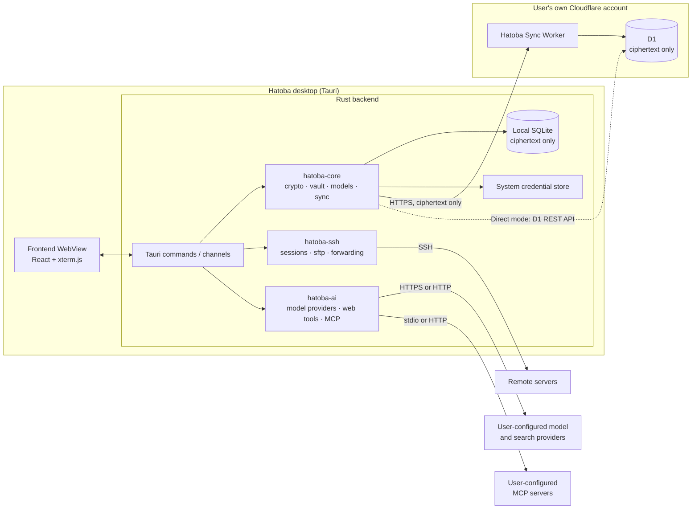

# Hatoba architecture and requirements

## 0. Scope and conventions

This document defines Hatoba's feature scope, architecture, data formats, sync protocol, and security model, and the implementation follows it. Progress on each requirement is tracked in [Implementation status](status.md).

Visuals and interaction follow the Claude Design files, which the [design notes](design/README.md) describe along with the porting conventions. When the design and this document disagree, the design wins on visuals, layout, and copy, and this document wins on behavior, data, and security. When the design lacks an element this document requires (for example the setup token field, the sync conflict states, or the settings pages), add it in the design's visual style.

**Windows is the first platform.** The design has a macOS look. The Windows version adapts it as described in §9.1 (title bar, fonts, shortcuts, and so on) and keeps the overall style. The macOS version (P1) follows the design as is.

Priorities: **P0** is required for the MVP, **P1** for the first public release, and **P2** for later releases.

---

## 1. Product overview

Hatoba is an open-source desktop SSH client, similar in scope to Termius: it keeps hosts, keys, and terminal sessions in one place, with an AI assistant beside each terminal (§13). It differs from similar products in three ways:

1. **The sync backend runs in the user's own Cloudflare account** (Worker + D1), with no dependency on any official Hatoba server.
2. **End-to-end encryption.** All data is encrypted on the client before it leaves the device. A leak of the Worker, the D1 database, or even the whole Cloudflare account exposes no plaintext.
3. **A minimal, Apple-style interface** built for developers who use it heavily every day, with medium-to-high information density.

### 1.1 Target users

Individual developers, indie developers, and operators who manage several VPSs.

---

## 2. Tech stack

| Layer | Choice | Notes |
|---|---|---|
| Desktop shell | Tauri 2 | **Windows first** (WebView2), then macOS and Linux |
| Frontend | React + TypeScript + Vite | Zustand for state management |
| Terminal rendering | `@xterm/xterm` | Addons: `addon-fit`, `addon-webgl`, `addon-search`, `addon-web-links` |
| IPC types | tauri-specta | Generates TypeScript bindings from Rust instead of hand-written types |
| Backend runtime | Rust stable + tokio | |
| SSH | `russh` | Connections, authentication, PTY, direct-tcpip (jump hosts and port forwarding) |
| SFTP | `russh-sftp` | |
| Key parsing and generation | russh's `keys` module (`ssh-key`) | OpenSSH and PEM formats, including passphrase-protected keys. `crates/hatoba-ssh/src/ppk.rs` parses PuTTY `.ppk` |
| Cryptography | `argon2`, `hkdf`, `sha2`, `aes-gcm`, `rand`, `zeroize` | All in Rust |
| Local storage | `rusqlite` (bundled) | |
| System credential store | `keyring` (Windows Credential Manager, macOS Keychain) | Windows Hello uses the `windows` crate. Touch ID on macOS will use `security-framework` |
| Windows window effects | `window-vibrancy` | Mica backdrop on Windows 11 |
| HTTP | `reqwest` (rustls) | |
| MCP client | `rmcp`, the official Rust SDK | Client features only, used inside `hatoba-ai` (§13.9) |
| Logging | `tracing` | |
| Sync service | Cloudflare Workers (TypeScript) + D1 | Hono for routing, wrangler for deployment |

---

## 3. Architecture

### 3.1 Overview



### 3.2 Core principles

1. **Secrets exist only inside the Rust process.** The WebView never receives the vault key, private keys, or host passwords in plaintext. The frontend receives only the metadata it displays (host names, addresses, tags, fingerprints, and booleans such as `has_password`). A password typed into a form goes one way to Rust and is never sent back to the frontend.
2. **Local first.** Every read and write goes to the local SQLite database first, and sync runs in the background. Without a network, or without sync configured, every feature works.
3. **Local and cloud data use the same ciphertext format.** The local database also stores only ciphertext, which is decrypted in memory after unlock.
4. **`hatoba-core` does not depend on Tauri**, so a future mobile app can reuse it.

### 3.3 Repository layout

```
hatoba/
├── apps/desktop/
│   ├── src/                  # Frontend
│   │   ├── app/              # Layout, routing
│   │   ├── features/         # onboarding, unlock, hosts, terminal, sftp, keys, sync, settings, ai
│   │   ├── components/       # Shared components ported from the design
│   │   ├── styles/           # Design tokens (CSS variables, light and dark)
│   │   ├── i18n/             # Message tables
│   │   └── ipc/              # tauri-specta bindings, frontend contract, browser mock backend
│   ├── src-tauri/            # Tauri shell: commands, channels, capabilities
│   └── e2e/                  # WebDriver end-to-end smoke test
├── crates/
│   ├── hatoba-ai/            # Model provider adapters, MCP client, web search, URL fetching
│   ├── hatoba-core/          # Crypto, vault, data model, local store, sync engine
│   ├── hatoba-local/         # Local terminal tabs: this computer's shells, PTY, the AI's tools here
│   └── hatoba-ssh/           # SSH sessions, PTY, SFTP, port forwarding, known_hosts
├── workers/sync/             # Cloudflare Worker source, D1 migrations, deployment guide
└── docs/
```

### 3.4 Mobile readiness

There is no mobile app yet. A later one could use Tauri 2 mobile, or Flutter calling `hatoba-core` through flutter_rust_bridge. `hatoba-core` must therefore not take on desktop-only dependencies, and platform capabilities (keychain, biometrics) are injected through traits.

---

## 4. Security model and encryption

### 4.1 Key hierarchy

```
master password
 └─ Argon2id(kdf_salt, m=64 MiB, t=3, p=4) → master_key (32B)
     ├─ HKDF-SHA256(info="hatoba/enc/v1")  → enc_key  (32B)  used only on the client
     └─ HKDF-SHA256(info="hatoba/auth/v1") → auth_key (32B)  sent to the Worker to sign in

vault_key (32B, random)
 ├─ AES-256-GCM(enc_key)      → protected_vault_key   stored locally and in the cloud
 └─ AES-256-GCM(recovery_key) → recovery_vault_key    stored locally and in the cloud

recovery_code (128 random bits, shown to the user once)
 ├─ HKDF-SHA256(info="hatoba/recovery/v1")      → recovery_key
 └─ HKDF-SHA256(info="hatoba/recovery-auth/v1") → recovery_auth

each item → AES-256-GCM(vault_key)
```

- KDF parameters are stored as JSON in `kdf_params` (including the algorithm name and version), so the parameters can change later without old data getting stuck.
- The client enforces minimum KDF parameters and rejects anything below them, whether it comes from the Worker or the local database. `KdfFloor::PRODUCTION` in `crates/hatoba-core/src/crypto.rs` defines the minimums.
- The recovery code gets a 32-bit checksum and is shown as 8 groups of 4 Crockford Base32 characters, which is easy to write down and lets the app check what the user types. `crates/hatoba-core/src/recovery.rs` implements the format.
- Changing the master password only generates a new salt and re-encrypts `protected_vault_key`. **No data item is re-encrypted.**
- The server stores only `SHA-256(auth_key)` and `SHA-256(recovery_auth)`. Both inputs have high entropy, so SHA-256 is enough. Getting the master password back from them still means trying candidates through Argon2id one by one.

### 4.2 Encryption format (envelope)

```json
{ "v": 1, "n": "<base64, 12-byte random nonce>", "c": "<base64, ciphertext + GCM tag>" }
```

- Every encryption generates a new random nonce.
- The AAD is the UTF-8 string `hatoba/item/v1/{item_id}`, so ciphertext moved onto a different item fails to decrypt.
- The plaintext is the item's JSON (see §5.1), which includes the `type` field. **The item type never appears in plaintext in any storage.**

### 4.3 Runtime security

| ID | Requirement | Priority |
|---|---|---|
| SEC-01 | After unlock, vault_key and decrypted items live only in Rust memory and are cleared with zeroize on lock | P0 |
| SEC-02 | Auto-lock: after a time without keyboard or mouse input anywhere on the system (15 minutes by default; 1, 5, 15, or 30 minutes, 1, 4, or 8 hours, or never), when the system sleeps (on by default, can be turned off), and manual lock (Ctrl+Shift+L). Windows and macOS report the system's idle time; on Linux only input in Hatoba's window counts. The timeout and the sleep switch are kept per device in the device-local preferences | P0 |
| SEC-03 | By default, established SSH sessions and local terminals (§7.5) stay connected while locked, and the UI is covered: open dialogs are hidden, pending confirmations are cancelled, and sessions take no input until unlocked. A device-local setting disconnects them, and ends the local shells, on lock instead | P0 |
| SEC-04 | Logs must never contain passwords, private keys, the vault key, session tokens, terminal content, AI provider API keys, MCP server environment and header values, MCP server stderr, or AI conversation content (messages, tool inputs, and tool results). Each SSH connection attempt is logged at the info level with its host, port, user name, and kind of authentication, and a failure with its error code and kind but not the error's text, so that a reported connection problem can be traced | P0 |
| SEC-05 | Tauri hardening: CSP `default-src 'self'`, no remote content, least-privilege capabilities, devtools disabled in release builds, and no shell plugin | P0 |
| SEC-06 | Increasing delay after repeated local unlock failures: no delay for the first 3, then doubling each time up to 1 minute (`unlock_delay_ms` in `crates/hatoba-core/src/vault.rs`). The failure count is persisted and survives an app restart. Argon2id does not run during the delay | P0 |
| SEC-07 | Windows Hello unlock: create a Hello credential with `KeyCredentialManager`, sign a fixed challenge, derive a wrapping key from the signature with HKDF, encrypt vault_key with it, and store the ciphertext in Credential Manager. A `UserConsentVerifier` prompt alone does not meet the requirement, because it has no cryptographic binding to vault_key. With Hello on, the lock screen asks for it on its own, once per lock, when the user comes back to the window: at once when the app starts with the window in front, when the window gets the focus, or after an idle or sleep lock at the first pointer movement in it. After a manual lock only the focus counts, so the window has to be left first and a face does not unlock it again at once | P1 |
| SEC-08 | Clear a copied password from the clipboard, if it still holds it, after a delay chosen per device: 30, 60, or 90 seconds (the default), 2 or 5 minutes, or never | P1 |
| SEC-09 | Show password strength (zxcvbn) when setting the master password, with a warning below a score of 2. Only the minimum of 8 characters blocks it | P1 |
| SEC-10 | Touch ID unlock (macOS): create a Secure Enclave P-256 key with `privateKeyUsage` and `biometryCurrentSet` access control that is not stored in the keychain, derive a wrapping key with HKDF from the ECDH of that key and an ephemeral P-256 key, encrypt vault_key with it, and keep the key blob, the ephemeral public key, and the ciphertext in one file (mode 0600) in the app data directory. Enrolling writes the file only after the new record has unlocked once. The ad-hoc signed build has no keychain access group, so the data protection keychain and its biometric access control are not available to it; once the build is signed with a Developer ID, move to a data protection keychain item with a biometric access control, with a one-time re-enroll. An `LAContext` prompt alone does not meet the requirement, because it has no cryptographic binding to vault_key | P2 |
| SEC-11 | PIN unlock, per device, on every platform: after the first unlock of a launch, the lock screen asks for the PIN instead of the master password. A PIN has at least 4 characters of any kind, and turning it on asks for the master password. Argon2id with the vault's KDF parameters and the PIN's own salt, then HKDF, gives the PIN key. `meta.pin` keeps the salt, the parameters, the PIN key sealed under vault_key, and the failure count; every unlock opens it and wraps vault_key with the PIN key again, held in memory across a lock and never written to SQLite. Five wrong PINs in a row drop that copy, and only a full unlock (master password, recovery code, Windows Hello) brings the PIN back. **Require the master password after a restart** is on by default; turned off, the wrapped vault_key also goes to the system credential store, so the PIN unlocks after a restart (`vault_pin` in `crates/hatoba-core`) | P1 |

### 4.4 Threat model

| Scenario | Outcome |
|---|---|
| The Cloudflare account, Worker, or D1 is stolen or exported | The attacker gets only ciphertext and KDF parameters and has to brute-force the master password through Argon2id |
| Network man-in-the-middle | Traffic uses HTTPS. Even if that is broken, the content is ciphertext |
| Maliciously modified Worker code | It cannot decrypt data, but it can delete data, roll it back to an older version, or deny service. Local copies are unaffected. Rollback detection is P2 |
| The Cloudflare API token used for in-app deployment leaks | It can change or delete every Worker and D1 database in the accounts it reaches, including the sync data, and can replace the Worker with modified code (the row above). The app holds it only in memory during a deployment (§6.7) and never stores it, so a stolen device or local database does not expose it. The token is safest with only the two permissions in §6.7, one account, and a short expiry, or deleted after the deployment |
| A malicious Worker reads `auth_key` during sign-in | `enc_key` and `vault_key` cannot be derived from `auth_key` (the one-way derivation in §4.1) |
| A malicious Worker returns weakened KDF parameters from `/v1/prelogin` | The client refuses to sign in, per the minimums in §4.1 |
| Someone holds a valid full session token | They can change the master password (`PUT /v1/vault/password` does not ask for the old one). After losing a device, revoke it from another device and consider changing the master password |
| Someone holds the recovery code | That equals holding the whole vault: the code decrypts `vault_key` and can reset the master password through `/v1/recover` |
| Text on the screen, in command output, or in a fetched page steers the AI assistant (prompt injection) | In manual approval mode, commands that only read, `read_file`, `grep`, `glob`, and what the user allowed (AI-19) run without asking, and every other command, terminal input, file change, and URL waits for the user; without asking, data leaves only in `web_search` queries, to the search provider the user chose or the model's provider, and in URLs on domains the user allowed. In Auto mode, a call runs without asking when the judge (AI-47) finds that it only reads, or that it is a change the user asked for that deletes nothing, touches no credentials, sends nothing out, grants no access, weakens no security, and runs no code it cannot see; the judge reads the user's own words and the calls' arguments, the screen's last lines for terminal input, and MCP tools' descriptions and annotations, never command output or a page's content; injected text reaches it through those lines, descriptions, and annotations, which other programs and servers write, and through the arguments of a call it is steered to, and text written there to sway it can still move its answers. The hard rules of AI-47 and the card for every unsure answer bound this. In bypass mode the assistant can run what it is steered to on the tab's host, and `fetch_url` can carry data out in the URL it fetches. Auto and bypass are chosen per device and per conversation (§13.5) |
| The judge of Auto mode leaks or keeps what it receives | It holds what each judge request carried (AI-47): the text the user typed in the conversation's messages (attachments only named), the custom instructions and the host's AI notes, the host's display name, the arguments of the conversation's calls, and for `send_input` the screen's last lines. A judge that is a model of the conversation's own provider adds no recipient; a System One endpoint or another provider's model is one more, and so is its operator |
| The AI model provider leaks or keeps conversation data | It holds what the assistant sent it: messages, including the pasted text and files the user attaches to them (AI-35), screen text, and tool results (§13.1). Of the vault, only the tab host's display name and user name reach it (for a quick-connect tab, its target `user@host:port` in place of the display name, HOST-12), the model's name and ID and its provider's name, the user's custom instructions and the host's AI notes (AI-36, AI-37), the skills the assistant lists or reads (§13.8), and a host's address and connection details when the user attaches a connection error's diagnostics (AI-10). It also gets the identification string the tab's SSH server sent, which names the server's software and often its OS |
| A `stdio` MCP server, or an imported skill, is malicious | A `stdio` server runs with the user's privileges, so adding one is like installing software. MCP tool descriptions and skill text reach the model as instructions, so the settings show them and skill import lists every file it saves, and MCP tool results are treated as data like terminal output (§13.8, §13.9) |
| Someone can read the system credential store as the user, while the PIN works after a restart (SEC-11) | The store holds vault_key wrapped by the PIN key, so they can try PINs offline without the limit of five; such a PIN protects the vault about as well as the user's OS account does. A PIN that needs the master password after a restart is only in memory, and is gone when the app quits |
| The device is compromised while unlocked | Out of scope |
| The master password is forgotten and the recovery code is lost | The data cannot be recovered. This is by design, and the UI must say so clearly |

### 4.5 Data visible to the server

The columns the server stores are defined by the migrations in §5.3, where items and device names are §4.2 envelopes.

**The server cannot see**: the master password, `master_key`, `enc_key`, `vault_key`, the recovery code, any item plaintext, or item types (the type is inside the encrypted plaintext).

**Metadata the server can see**: the number of items, their IDs, ciphertext sizes, modification times, the number of devices, sign-in and sync times, and the IP addresses Cloudflare sees anyway. AI conversations add items as they grow (§13.7), so these numbers also show when and how much the assistant is used.

---

## 5. Data model

### 5.1 Item types (plaintext before encryption)

All item IDs are UUIDv7. Reading plaintext tolerates unknown and missing fields, so different app versions can read each other's data. The Rust implementation is `Item` in `crates/hatoba-core/src/model.rs`.

```ts
type Item =
  | Host | Group | SshKey | KnownHost | PortForward | Snippet | Proxy
  | AiProvider | SearchProvider | AiConversation | AiMessage
  | Skill | SkillFile | McpServer
  | Settings;

interface Host {
  type: "host";
  name: string;                 // Display name, such as prod-api-tokyo
  address: string;              // Domain name or IP
  port: number;                 // 22 by default
  username: string;
  auth:
    | { kind: "password"; password: string }
    | { kind: "key"; key_id: string }
    | { kind: "agent" }         // P1
    | { kind: "ask" };          // Ask on every connection
  group_id: string | null;
  tags: string[];               // Such as ["production", "tokyo"]
  favorite: boolean;
  jump_host_id: string | null;  // P1, ProxyJump
  proxy?:                       // SSH-13; absent for the device's default proxy
    | { kind: "direct" }
    | { kind: "proxy"; proxy_id: string };
  note: string;
  ai_notes?: string;            // AI-37, at most 16 KB of UTF-8; absent while empty
  updated_at: number;           // Milliseconds since the epoch, used for conflict resolution
  env?: { name: string; value: string }[];  // SSH-14; absent while empty
}

interface Group {
  type: "group";
  name: string;
  parent_id: string | null;     // The MVP supports one level of nesting
  sort: number;
  updated_at: number;
}

interface SshKey {
  type: "key";
  name: string;
  algorithm: "ed25519" | "ecdsa" | "rsa";
  private_key: string;          // OpenSSH format
  passphrase: string | null;    // Key passphrase, if any
  public_key: string;
  fingerprint: string;          // SHA256:...
  comment: string;
  created_at: number;
  updated_at: number;
}

interface KnownHost {
  type: "known_host";
  host: string;
  port: number;
  key_type: string;
  public_key: string;
  fingerprint: string;
  first_seen_at: number;
  updated_at: number;
}

interface PortForward {          // P1
  type: "forward";
  host_id: string;
  kind: "local" | "remote" | "dynamic";
  bind_address: string;
  bind_port: number;
  dest_host: string | null;     // null for dynamic
  dest_port: number | null;
  auto_start: boolean;
  updated_at: number;
}

interface Snippet {              // P2
  type: "snippet";
  name: string;
  command: string;
  tags: string[];
  updated_at: number;
}

interface Proxy {                // SSH-13
  type: "proxy";
  name: string;
  kind: "socks5" | "http";      // http: a proxy that supports CONNECT
  address: string;              // Domain name or IP of the proxy
  port: number;                 // 1080 by default
  username: string;             // Empty when the proxy needs no sign-in
  password: string;             // Used only with a username
  updated_at: number;
}

interface AiProvider {           // P1, §13.2
  type: "ai_provider";
  name: string;
  protocol: "chat_completions" | "responses" | "anthropic" | "system_one";  // Read as chat_completions when missing or unknown; system_one only serves as Auto's judge (AI-47)
  base_url: string;             // Such as https://api.openai.com/v1 or https://api.anthropic.com
  api_key: string;              // Empty when the server needs none
  auth_header: "x-api-key" | "authorization";  // anthropic only
  models: {
    id: string;                 // Model ID sent in requests
    name: string;               // Display name
    context_window: number | null;     // Tokens, null when unknown
    max_output_tokens: number | null;  // Tokens, null when unknown
    efforts?: ("low" | "medium" | "high" | "xhigh" | "max")[];  // AI-05, lowest first; absent when unknown
    adaptive_thinking?: boolean;       // From Anthropic's model list (AI-05); absent when unknown
  }[];
  updated_at: number;
}

interface SearchProvider {       // P1, the backend of web_search (§13.4)
  type: "search_provider";
  kind: "brave" | "tavily" | "searxng";
  base_url: string | null;      // The instance URL for searxng, null otherwise
  api_key: string;              // Empty for searxng
  updated_at: number;
}

interface AiConversation {       // P1, §13.7
  type: "ai_conversation";
  title: string;
  host_id: string | null;       // The host the conversation last worked on
  quick_target?: { username: string; address: string; port: number };  // AI-09, the quick-connect target (HOST-12) it last worked on, while host_id is null; the address in lowercase, IPv6 without brackets; none while absent
  origin?: string;              // AI-43, with neither, the name of the server a fork's copies came from when the fork could not tell which it is; none while absent
  local?: string;               // §7.5, with neither a host nor a target, the name of the computer whose local terminal tab it last worked on; none while absent
  pinned: boolean;
  context_start: string | null; // entry_id where the context sent to the model starts (AI-21)
  effort?: "low" | "medium" | "high" | "xhigh" | "max";  // AI-05, the level of its last message; Default while absent
  created_at: number;
  updated_at: number;
}

interface AiMessage {            // P1, one part of a conversation entry (§13.7)
  type: "ai_message";
  conversation_id: string;
  entry_id: string;             // UUIDv7, orders the entries of a conversation
  part: number;                 // 0-based
  part_count: number;
  data: string;                 // This part's slice of the entry's JSON
  updated_at: number;
}

interface Skill {                // P2, §13.8
  type: "skill";
  name: string;                 // 1 to 64 lowercase letters, digits, and hyphens
  description: string;          // At most 1,024 characters
  frontmatter: Record<string, unknown>;  // Other SKILL.md frontmatter fields, kept for export
  enabled: boolean;
  updated_at: number;
}

interface SkillFile {            // P2, one text file of a skill (§13.8)
  type: "skill_file";
  skill_id: string;
  path: string;                 // "SKILL.md" (its body, without frontmatter) or a relative path such as references/nginx.md
  content: string;              // UTF-8 text, at most 32 KB
  updated_at: number;
}

interface McpServer {            // P2, §13.9
  type: "mcp_server";
  name: string;                 // Used in tool names
  transport:
    | { kind: "stdio"; command: string; args: string[]; env: Record<string, string> }
    | { kind: "http"; url: string; headers: Record<string, string> };
  always_ask: boolean;          // Ask even in bypass mode (AI-31)
  updated_at: number;
}

interface AiMemory {             // P2, §13.12
  type: "ai_memory";
  name: string;                 // One line of at most 100 characters, unique among memories
  content: string;              // All memories' names and contents together hold at most 16 KB of UTF-8
  updated_at: number;
}

interface Settings {             // Fixed ID "settings", a single item
  type: "settings";
  terminal: {
    font_family: string;        // "Cascadia Mono" for a new vault, "Menlo" when created on macOS
    font_size: number;
    theme: "system" | "light" | "dark";
    dark_scheme?: string;       // TERM-06 colour scheme id for a dark terminal, "hatoba-dark" while absent or unknown
    light_scheme?: string;      // Same for a light terminal, "hatoba-light" while absent or unknown
    cursor_style: "block" | "bar" | "underline";
    scrollback: number;         // 10000 by default
    right_click?: "copy_paste" | "menu"; // WIN-05, "copy_paste" while absent ("menu" on macOS)
    confirm_multiline_paste?: boolean;   // TERM-04, true while absent
  };
  ai: {                         // P1, §13
    default_model: { provider_id: string; model_id: string } | null;
    default_effort?: "low" | "medium" | "high" | "xhigh" | "max";  // AI-05, Default while absent
    search_provider_id: string | null;
    native_search: boolean;             // AI-14, Native Search without a search provider; true while absent
    builtin_skill_enabled: boolean;     // AI-34, true while absent
    custom_instructions?: string;       // AI-36, at most 32 KB of UTF-8; absent while empty
    send_terminal_screen: boolean;      // AI-46, true while absent
    judge_model?: { provider_id: string; model_id: string };  // AI-47, the judge of Auto mode; none while absent
    memory: boolean;                    // AI-53, true while absent
  };
  updated_at: number;
}
```

`terminal.right_click` and `terminal.confirm_multiline_paste` were device-local in earlier versions, which do not write them. Each stays absent until it is set to a value other than its default (for `right_click`, the default of the platform the device runs on). After the upgrade, each device moves its own values into the fields that are still absent, under the same rule, and does this once. With sync off, the move happens right after unlock. With sync on, it waits for the first successful sync round after unlock, so it changes the latest `Settings` the server had: a value already set there is kept, and edits other devices had already uploaded are not outdated by the move's newer `updated_at` (§6.4). Until then the values stay in the device-local preferences. The move then uploads like any other edit.

Device-local data such as the last connection time and the window size is **not synced**. Otherwise every connection would cause a write and a potential conflict.

### 5.2 Local SQLite

The local database is `vault.db` in the app's local data directory, with SQLite's `vault.db-wal` and `vault.db-shm` beside it:

| Platform | Location |
|---|---|
| Windows | `%LOCALAPPDATA%\app.hatoba.desktop\vault.db`, next to the `logs` folder |
| macOS | `~/Library/Application Support/app.hatoba.desktop/vault.db` |
| Linux | `$XDG_DATA_HOME/app.hatoba.desktop/vault.db`, by default `~/.local/share/app.hatoba.desktop/vault.db` |

The database holds device-local data (the device ID, the sync cursor, the local preferences, and `local_state`), so it must not live in a directory that roams with the user profile. On Windows that rules out `%APPDATA%`: roaming profiles copy it to other machines, which would then share one device ID, and it is often redirected to a network share, where SQLite's WAL is unreliable.

`MIGRATIONS` in `crates/hatoba-core/src/store.rs` defines the tables, `LOCAL_COLUMNS` and `LOCAL_TABLES` in the same file add device-local columns and tables without changing the schema version (which the synced vault shares), and the `meta` module in the same file lists the keys of the `meta` table. The tables hold:

- `meta`: key-value pairs for the KDF parameters, the wrapped vault key, the device ID, the sync cursor, and so on. The recent quick-connect targets (HOST-12) and the AI approvals saved on this device (AI-19) are sealed under the vault key here, because they name hosts and the database holds no host name in plaintext (§12). The logs do name the hosts connected to (SEC-04).
- `items`: one row per item. `envelope` holds only the §4.2 envelope and becomes NULL after deletion (a tombstone). `revision` is the version the server has confirmed, 0 for items that were never synced. `dirty` marks local changes that have not been pushed yet.
- `local_state`: device-local data that is not synced, such as the last connection time, the server's OS (HOST-11), whether the host's terminals show resource usage (TERM-12), and whether the dashboard leaves a host or a group out (HOST-14).
- `conflict_log`: conflicts resolved automatically under §6.4, kept for item-by-item review and restore.
- `ai_file_snapshots`: what each `edit_file` or `write_file` call changed on a host, kept so the user can revert it (AI-41). Each row names its conversation, response, and call, seals the server, the path, and the file's content under the vault key, and says where the change stands: unfinished, written, reverted, or dropped by the size limit. Not synced.

The sync session token and the Cloudflare API token of D1 direct mode live in the system credential store (Windows Credential Manager, the macOS Keychain, or the Secret Service on Linux), and so does vault_key wrapped by the PIN key while the PIN works after a restart (SEC-11). They are never written to SQLite and never synced. The API token for in-app deployment and the setup token the app generates are not stored anywhere (§6.7). For a Worker the app deployed, the sync backend setting in `meta` also records the account ID and the Worker name, which are not secrets and only fill in the upgrade form.

### 5.3 D1 schema

One Worker deployment serves one user (a single vault). The migrations in `workers/sync/migrations/`, applied in file-name order starting with `0001_init.sql`, define the schema, which the Worker and D1 direct mode share:

- `meta`: a single row (`id = 1`) with the KDF parameters, `SHA-256(auth_key)`, `SHA-256(recovery_auth)`, the two wrapped vault keys, and the global `seq`.
- `items`: item envelopes, `revision`, `seq`, the deletion flag, and the update time. `seq` increases globally and drives incremental pulls.
- `sessions`: used only in Worker mode. It stores `SHA-256(session_token)`, the device ID, the device name encrypted with vault_key, and the session `scope` (full session or recovery session).

---

## 6. Sync

### 6.1 Two sync backends

The client abstracts the sync backend behind the `SyncBackend` trait, so the sync engine does not care which implementation it talks to.

```rust
#[async_trait]
pub trait SyncBackend {
    async fn health(&self) -> Result<ServerInfo>;
    async fn prelogin(&self) -> Result<KdfInfo>;
    async fn setup(&self, init: VaultInit) -> Result<()>;
    async fn login(&self, auth_key: &[u8], device: DeviceInfo) -> Result<Session>;
    async fn fetch_vault(&self) -> Result<VaultMeta>;
    async fn pull(&self, since_seq: u64, limit: u32) -> Result<PullPage>;
    async fn push(&self, changes: Vec<Change>) -> Result<Vec<PushResult>>;
    async fn update_vault_meta(&self, update: VaultMetaUpdate) -> Result<()>;
}
```

**Worker mode (P0, recommended)**: the user deploys `workers/sync` to their own Cloudflare account, and the client calls the §6.2 API over HTTPS.

**D1 direct mode (P1)**: the user enters an Account ID and an API token and picks one of the account's D1 databases. The client runs SQL directly through `POST https://api.cloudflare.com/client/v4/accounts/{account_id}/d1/database/{database_id}/query`. The schema is the same as in Worker mode (without the `sessions` table), and concurrent writes are detected by running `UPDATE ... WHERE revision = ?` and checking the affected row count. In this mode the API token usually has edit access to every D1 database in the account, which the D1 step of the setup states, and the token is stored only in the device's credential store.

### 6.2 Worker API

All endpoints live under `/v1`. Requests and responses are JSON (`Content-Type: application/json`, anything else gets `415`). Endpoints that need a session take `Authorization: Bearer <session_token>`.

#### Conventions

- All timestamps are Unix milliseconds (matching `updated_at` in item plaintext), including `created_at`, `last_seen`, and `expires_at`.
- `auth_key`, `recovery_auth`: 32 bytes in **standard base64 (with `=` padding)**. The client sends the raw value, and the server stores its `SHA-256` (hex).
- `kdf_params`: a **JSON string** (the client serializes the parameter object to a string). The server stores and returns it unchanged without interpreting it. It must be a JSON object of at most 1 KB.
- `kdf_salt`: an opaque string of 16 to 256 characters (`A-Za-z0-9+/_=-`). The server does not decode it.
- `protected_vault_key`, `recovery_vault_key`, `device_name`, and item `envelope`: opaque strings stored as is, at most 4 KB, 4 KB, 4 KB, and 64 KB respectively (in UTF-8 bytes).
- `device_id` and item `id`: `[A-Za-z0-9_-]`, 1 to 64 characters (UUIDs and the literal `settings` both qualify).
- Error responses: `{ "error": "<code>", "message": "..." }`. `message` may be omitted and never echoes submitted values.

#### Endpoints

| Method | Path | Auth | Description |
|---|---|---|---|
| GET | `/v1/health` | None | `{ service: "hatoba-sync", version, api: 1, initialized }`, used by **Test Connection** in the wizard. `503 database_unavailable` when D1 is unavailable or not migrated |
| GET | `/v1/prelogin` | None | `{ kdf_salt, kdf_params }`. `404 not_initialized` before setup |
| POST | `/v1/setup` | Setup token | Initializes meta for the first time. `201 { initialized: true }` on success, `409 already_initialized` if already set up, `401 invalid_setup_token` for a wrong token, `503 setup_token_not_configured` when none is configured |
| POST | `/v1/login` | None | `{ auth_key, device_id, device_name }` → `{ session_token, expires_at }` |
| POST | `/v1/recover` | None | `{ recovery_auth, device_id, device_name }` → `{ recovery_vault_key, kdf_salt, kdf_params, session_token, expires_at }` (recovery session) |
| GET | `/v1/vault` | Full session | `{ schema_version, kdf_salt, kdf_params, protected_vault_key, recovery_vault_key, seq }` |
| GET | `/v1/items?since=&limit=` | Full session | Incremental pull: `{ items, next_since, has_more }` |
| POST | `/v1/items` | Full session | Batch push: `{ changes: [...] }` → `{ results: [...] }` |
| PUT | `/v1/vault/password` | Full or recovery session | Changes the master password: atomically updates meta and revokes sessions. `200 { ok, relogin_required }` on success |
| GET | `/v1/devices` | Full session | `{ devices: [{ device_id, device_name, created_at, last_seen, expires_at, current }] }` |
| DELETE | `/v1/devices/:device_id` | Full session | Revokes that device's session with `204`. A device can revoke itself, and an unknown device also gets `204` |

#### Server requirements

- **Setup token**: set at deployment as the Worker secret `SETUP_TOKEN`, with `wrangler secret put SETUP_TOKEN` or by the app (§6.7). It stops someone else from initializing a freshly deployed, unconfigured Worker before you do. Without the token, `/v1/setup` always refuses (`401`), and it returns `503` when the secret is not configured. The secret can be deleted after initialization. The comparison runs in constant time, and so does the `auth_hash` comparison.
- **Sessions**: a token is 32 random bytes (base64url), and D1 stores only its SHA-256. It is valid for 30 days and slides forward on use (the renewal is written at most once a minute). Each device (`device_id`) keeps only one session of each kind.
- **Recovery sessions**: a session issued by `/v1/recover` is valid for 15 minutes and can call only `PUT /v1/vault/password`. Other endpoints return `403`.
- **Rate limits**: `/v1/setup`, `/v1/login`, and `/v1/recover` allow 10 requests per minute for each source IP and endpoint, through the Workers Rate Limiting binding, and return `429` beyond that. Each Cloudflare data center counts separately.
- **Size limits**: at most 100 changes per push, and at most 64 KB per envelope.
- **No CORS headers**: client requests come from Rust, not a browser, so third-party web pages in a browser cannot call the Worker cross-origin.
- **No secrets in logs**: tokens, `auth_key`, envelopes, and request bodies are never logged. Every response carries `Cache-Control: no-store`.

#### POST /v1/setup

```http
POST /v1/setup
Authorization: Bearer <SETUP_TOKEN>
Content-Type: application/json

{
  "schema_version": 1,
  "kdf_salt": "<opaque salt>",
  "kdf_params": "{\"alg\":\"argon2id\",\"v\":1,...}",
  "auth_key": "<base64, 32 bytes>",
  "protected_vault_key": "<envelope>",
  "recovery_vault_key": "<envelope>",
  "recovery_auth": "<base64, 32 bytes>"
}
```

#### GET /v1/items

Incremental pull by `seq`: `SELECT * FROM items WHERE seq > :since ORDER BY seq LIMIT :limit`. `since` defaults to 0. `limit` defaults to 500 with a maximum of 1000 (larger values are capped at 1000). Invalid values return `400`.

```json
{
  "items": [
    { "id": "0192...", "envelope": "{\"v\":1,...}", "revision": 4, "seq": 1207, "deleted": false, "updated_at": 1790000000000 }
  ],
  "next_since": 1207,
  "has_more": false
}
```

`next_since` is the `seq` of the last item on the page (the given `since` for an empty page). Deleted items are tombstones: `deleted: true, envelope: null`.

#### POST /v1/items

```json
{ "changes": [
  { "id": "0192...", "base_revision": 3, "deleted": false, "envelope": "{\"v\":1,...}", "updated_at": 1790000000000 }
]}
```

- `base_revision = 0` means create. Otherwise it must equal the item's revision on the server (optimistic concurrency).
- Delete: `deleted: true` with `envelope` set to `null` (or omitted). A change that is not a deletion needs a non-empty `envelope` string.
- `updated_at` is optional. The server time is used when it is omitted.
- At most 100 changes per request, and more return `413 too_many_changes`. The same `id` cannot appear twice in one request.

The server runs one D1 batch per change (D1 executes a batch as a transaction):

1. `UPDATE meta SET seq = MAX(seq, (SELECT COALESCE(MAX(seq), 0) FROM items)) + 1 WHERE id = 1`
2. If `base_revision = 0`, run `INSERT ... ON CONFLICT(id) DO NOTHING`, and the new item gets `revision = 1`. Otherwise run `UPDATE items SET envelope = ?, deleted = ?, revision = revision + 1, seq = (SELECT seq FROM meta WHERE id = 1), updated_at = ? WHERE id = ? AND revision = ?`
3. Zero affected rows means a conflict, and the server reads the item's row and returns it to the client.

`results` follow the request order:

```json
{ "results": [
  { "id": "0192...", "status": "ok", "revision": 4, "seq": 1207 },
  { "id": "0193...", "status": "conflict",
    "server": { "revision": 6, "seq": 1190, "deleted": false, "envelope": "...", "updated_at": 1790000000000 } },
  { "id": "0194...", "status": "error", "error": "too_large" },
  { "id": "0195...", "status": "error", "error": "not_found" }
]}
```

| status | Meaning |
|---|---|
| `ok` | Written. Returns the new `revision` and `seq` |
| `conflict` | `base_revision` does not match the server (including a create whose ID already exists). `server` is the item's state on the server (`envelope` is `null` for a tombstone). The client resolves it per §6.4 and retries |
| `error` / `too_large` | A single envelope exceeds 64 KB. **Only this change is affected.** The other changes are processed as usual, so one oversized item does not block the whole push queue |
| `error` / `not_found` | `base_revision > 0`, but the server has no such item (for example after a database reset). The client can upload it again as a new item (`base_revision = 0`) |

`seq` increases monotonically across the vault but may have gaps (a conflicting attempt also uses up a seq). The client relies only on it increasing.

D1 direct mode writes the same tables without the Worker, assigning `seq` inside each `INSERT` or `UPDATE` statement and catching `meta.seq` up after the push. Both modes therefore allocate the next `seq` as one more than the larger of `meta.seq` and the highest item `seq`, so that devices on the two modes can share one database without two changes getting the same `seq`. A change that shares its `seq` with another one can be missed by a device whose pull cursor already passed that number; turning sync off and on again on that device resets its cursor, and the next sync pulls every item again.

Structural errors (missing fields, wrong types, invalid IDs, `deleted` inconsistent with `envelope`, duplicate IDs) make the **whole request** return `400`, and nothing is written.

#### PUT /v1/vault/password

```json
{
  "kdf_salt": "...", "kdf_params": "{...}",
  "auth_key": "<base64, 32 bytes>",
  "protected_vault_key": "<envelope>",
  "recovery_vault_key": "<envelope>", "recovery_auth": "<base64, 32 bytes>"
}
```

`recovery_vault_key` and `recovery_auth` are either both present (rotating the recovery code) or both absent. Updating `meta` and revoking sessions happen in one transaction:

- Full session: revokes **all other** sessions, and the caller stays signed in (`relogin_required: false`).
- Recovery session: revokes **all** sessions, including the caller's (`relogin_required: true`), and the client must sign in again with the new password.

#### Error codes

| HTTP | `error` | When |
|---|---|---|
| 400 | `invalid_request` / `invalid_json` | Missing field, wrong type or format / JSON that cannot be parsed |
| 401 | `unauthorized` / `invalid_session` | No token / unknown or expired token |
| 401 | `invalid_credentials` | Wrong `auth_key` or `recovery_auth` |
| 401 | `invalid_setup_token` | Missing or wrong setup token |
| 403 | `insufficient_scope` | A recovery session called an endpoint other than `PUT /v1/vault/password` |
| 404 | `not_initialized` / `not_found` | Not set up yet / unknown path |
| 409 | `already_initialized` | Setup called again |
| 413 | `too_many_changes` / `payload_too_large` | More than 100 changes / request body too large |
| 415 | `unsupported_media_type` | The request body is not JSON |
| 429 | `rate_limited` | Rate limit hit (with `Retry-After: 60`) |
| 500 | `internal_error` | Unexpected error (details are not returned to the client) |
| 503 | `setup_token_not_configured` / `database_unavailable` | Secret not set / D1 unavailable or not migrated |

### 6.3 Client sync flow

**When sync runs**: after unlock, after a local change (2-second debounce), every 60 seconds, when the window regains focus, and when the user starts it manually.

**One sync round**:

1. Pull pages starting at `sync_cursor` until `has_more = false`. For each remote item, overwrite the local item if it is not dirty, and resolve the conflict per §6.4 if it is.
2. Push all dirty items. Successful items have dirty cleared and their revision updated. Conflicting items are handled per §6.4 and retried at most once.
3. Update `sync_cursor` and broadcast the sync status to the frontend.

A failed sync does not affect local use. The UI shows **Offline** or **Signed out**, and the next trigger retries automatically with exponential backoff.

**An item too large to sync**: a host or the settings saved while sync was off can be larger than sync accepts (SSH-14, AI-36). The client does not send an envelope over 64 KB: the server would refuse it with `too_large` (§6.2), and a few of them in one request could pass the Worker's request body limit and fail the whole push. The item stays dirty, so it counts as pending and every round checks it again, while the other items sync as usual. The client keeps the items too large in the last finished round of the current connection, and the status page shows a notice for each one still in the vault: a host by name, with its notes, AI notes, and environment variables to shorten and **Edit Host**, and the settings with the custom instructions to shorten and **Open Settings → AI**. A notice goes once a round uploads the item or the item is deleted.

**When a connection ends**: every backend the client installs (after unlock, sign-in, setup, or restore) starts a new connection. Locking the vault, **Disconnect**, and installing another backend end the current one. Its rounds are cancelled: a cancelled round drops the request in flight, sends no further request, and no longer changes the local vault or the sync status. The backend it used forgets its credentials in memory, so it cannot authenticate again. **Disconnect** waits until the running round has stopped, and only then deletes the session, the API token, and the sync configuration, so no round writes `sync_cursor`, revisions, or the last sync time after it, or into a connection set up later. A request already sent may still be applied by the server. The client then handles it like a lost response: the next round on that remote adopts the result without a conflict.

### 6.4 Conflict resolution

1. Default rule: decrypt both versions and keep the one with the newer `updated_at` in the plaintext (last writer wins).
2. **Key items (`type = "key"`) are never dropped silently.** The losing version is saved as a new item, with a localized conflict-copy suffix added to its name.
3. When one side deletes an item and the other modifies it, the modification wins (the item comes back), to avoid accidental deletion.
4. Every automatic resolution is written to the local conflict log, and the sync status page shows the number of conflicts. P1 adds item-by-item review: keep the automatic result, or restore the other version.

### 6.5 Tombstones

In the MVP, deleted items keep their tombstones forever (`envelope = NULL, deleted = 1`), which costs little space. P2 may purge tombstones older than 180 days, and a device offline for longer than that would then need a full resync.

### 6.6 Key flows

**Flow A: enable sync on the first device**

1. On first launch, create the local vault: set the master password, generate the recovery code, and have the user confirm it is saved. From here on the app works fully offline.
2. Open **Cloud Sync** in the sidebar, choose Worker mode, enter the Worker URL and the setup token, and select **Test Connection** (which calls `/v1/health`). An in-app deployment (§6.7) supplies the URL and the setup token itself.
3. Call `/v1/setup` to upload meta, then sign in and push all items.

A failure after `/v1/setup` succeeded, including a lost response, leaves the remote initialized while sync is not yet configured locally. Retrying the step resumes it: when `/v1/prelogin` returns this vault's salt and parameters, the client skips `/v1/setup`, signs in, checks that the remote's wrapped vault keys are the local ones, and finishes the upload. A remote that holds any other vault stops the step with `remote_initialized`; the wizard then offers Flow C.

**Flow B: add a new device**

1. On first launch, choose **Restore from Cloud** and enter the Worker URL.
2. Call `/v1/prelogin` for the salt and parameters. The user enters the master password, and the client derives the keys and signs in.
3. Pull the vault meta and decrypt vault_key. Then page through the cloud vault once to read its settings item: settings are a single item that conflicts resolve as a whole (§6.4), so a settings edit made before the first pull would otherwise start from the defaults and, being newer, replace the cloud's settings on every device. Save the local vault, that settings item (clean and at the cloud's revision), and the sync configuration in one transaction, then store the session; a cloud that has no settings item yet (its first device stopped right after setup) leaves none to save. A failure before the save leaves no local vault, and a retry signs in under the same device id, so the server replaces the session the failed attempt left instead of listing another device. From here on the device is a configured sync device, and it shows the cloud's settings even before the first pull, so an edit builds on them.
4. Pull every item in an ordinary sync round. If the pull is interrupted, the next round, including one after a restart, resumes from the saved cursor; the restore does not need to run again.

**Flow C: connect an existing local vault to an initialized cloud vault (P1)**

1. In the sync wizard, step 2 finds that the Worker or D1 database already holds a vault (`/v1/health` reports `initialized`, or §6.7 step 2 plans `has_vault`). It offers to join that vault instead of setting it up, and needs no setup token.
2. The master password step asks for the cloud vault's master password and says that this device's data is merged into the cloud vault, that the device then unlocks with that password, and that the cloud vault's recovery code replaces this device's. Its submit button is the explicit confirmation: once submitted, the join runs to its end even if the user leaves the wizard, as Flow A's setup does. Only a lock or a disconnect ends it (step 3). Only one sync setup runs at a time, so a Flow A or C started while another is still running is refused (`sync_setup_busy`). The join also needs sync to be off on this device, checked again in its commit (step 4), so it never moves a vault that another setup has meanwhile connected (`sync_already_configured`).
3. With the local vault unlocked, the client signs in as in Flow B step 2, under this device's id, and unwraps the cloud vault_key. It then pages through the cloud vault once to read its settings item: settings are a single item that conflicts resolve as a whole (§6.4), so another vault's settings cannot be merged with this device's, and the join takes the cloud's as they stand. It stores the session (and, in D1 mode, the API token) before anything local changes, so a credential store that fails leaves the local vault as it was. A failure up to here changes nothing local.
4. In one local transaction:
   - **Same vault** (the cloud vault_key opens the local vault check, for example on a device that synced before and was disconnected): every item is marked dirty with revision 0, so the next round reconciles each one per §6.4. Identical items converge without a conflict entry.
   - **Another vault**: every live item is decrypted with the local vault_key and re-encrypted with the cloud vault_key under the same id, revision 0 and dirty, so it is pushed as a new item. The settings are the exception: the cloud's settings item from step 3 replaces the local one as it is, clean and at the cloud's revision, so the app shows the cloud's settings from the moment the join commits and a later edit builds on them. Only when the cloud has no settings item that the cloud vault_key opens (none yet, as on a cloud whose first device stopped right after setup, or a damaged one, which could not win a conflict either) is the local one queued, dated at the epoch (`updated_at` 0): it is older than the settings of any of the cloud vault's own devices, so under §6.4 theirs win over it whether they arrive before or after it, while an edit made on this device after the join is dated as usual. From then on the settings sync like any other item. Tombstones and items that cannot be decrypted are dropped. The conflict log is cleared. Device-local data sealed with the vault_key (the recent quick-connect targets, the AI approvals saved on this device, and the AI file snapshots) is sealed again with the cloud vault_key.
   - Either way the local meta takes the cloud's salt, KDF parameters, `protected_vault_key`, and `recovery_vault_key`, so the master password and recovery code become the cloud's. `recovery_auth_sealed` stays only when the cloud's `recovery_vault_key` is the one stored here (the same vault and recovery code, as on a device that reconnects), and is deleted otherwise. The sync configuration is recorded, and `sync_cursor` is reset.
5. The client runs an ordinary round, which pulls the cloud's items and pushes the local ones. An interrupted round resumes like any other. When the vault_key changed, biometric unlock and the PIN, which wrap the old key, are turned off. Once the transaction has committed the join counts as done: if reloading the items then fails, the vault locks instead of keeping the old key, and unlocking with the cloud's master password starts sync.

**Worker deployment**: the steps are in [Deploy the sync Worker](../workers/sync/README.md), and the in-app sync wizard links to it. One-click deployment inside the app through the Cloudflare API (§6.7) and a Deploy to Cloudflare button are both P1.

### 6.7 In-app deployment

The app can deploy `workers/sync` to the user's Cloudflare account through the Cloudflare API, initialize it, and upgrade it later, so the user needs neither a Git account nor a command line. The user provides only an API token, and the account ID when the app cannot fill it in. The deployment uses the same names, bindings, and migration records as the wrangler path in the [deployment guide](../workers/sync/README.md), so wrangler can maintain an in-app deployment and the app can upgrade a deployment made with wrangler.

| ID | Requirement | Priority |
|---|---|---|
| DEPLOY-01 | Release builds embed the Worker bundle, the migrations, and their manifest, generated from `workers/sync` at build time ([Worker bundle](#worker-bundle)) | P1 |
| DEPLOY-02 | A link opens Cloudflare's token form with the required permissions filled in. The app checks the token and fills in the account ID when the token reveals it, before anything is written ([API token](#api-token)) | P1 |
| DEPLOY-03 | Run the [deployment steps](#deployment-steps) in order with progress for each step, and finish on a Worker that answers `/v1/health` with the bundled version | P1 |
| DEPLOY-04 | Never overwrite a Worker the app does not recognize or a database that holds data ([existing Workers and databases](#existing-workers-and-databases)) | P1 |
| DEPLOY-05 | A retry after a failure at any step continues the deployment, and cleanup removes only what the deployment created ([failures and cleanup](#failures-and-cleanup)) | P1 |
| DEPLOY-06 | The app generates the setup token, passes it to `/v1/setup` itself, and deletes the `SETUP_TOKEN` secret once setup succeeds | P1 |
| DEPLOY-07 | The API token and the setup token live only in Rust memory for the length of the deployment. They are never stored, logged, or sent to the WebView ([token handling](#token-handling)) | P1 |
| DEPLOY-08 | Detect an older Worker through `/v1/health` and offer or require an upgrade through the same steps ([upgrades](#upgrades)) | P1 |

#### Worker bundle

The release build runs `npx wrangler deploy --dry-run --outdir <dir>` in `workers/sync` after `npm ci`. This is the bundling step Cloudflare documents for uploads through the API, and it produces a single ES module, `index.js`. `scripts/worker/bundle.mjs` (`pnpm worker:bundle`) runs both and packages that module with:

- Every `.sql` file in `workers/sync/migrations/`, in file-name order. The file name is the migration's name in `d1_migrations`.
- A manifest with the Worker version, the `name`, `compatibility_date`, and `compatibility_flags` from `workers/sync/wrangler.toml`, and the settings of its `DB` and `AUTH_LIMITER` bindings (the database name, and the rate limit's namespace, limit, and period).

The Rust shell embeds the package in the binary. The package is generated and never committed, and `tauri build` creates it through `beforeBuildCommand`. A build without it, such as `cargo test`, still compiles, and the deploy commands then return an error saying that the build has no Worker bundle.

**Versions.** The Worker version is `version` in `workers/sync/package.json`, which a test keeps equal to `VERSION` in `workers/sync/src/config.ts`, and `/v1/health` reports it as `version`. It is separate from the app version, so an app release that does not touch the Worker asks nobody to redeploy. Any change that alters the bundle or adds a migration (the source, its dependencies, `wrangler.toml`, or `migrations/`) raises the Worker version in the same pull request, and CI fails a change to these files that leaves the Worker version unchanged. The app knows two Worker versions: the bundled version, which is the newest it can deploy, and the minimum version it can sync with, `MIN_WORKER_VERSION` in `crates/hatoba-core/src/sync/compat.rs`.

**Compatibility.** Within one `api` number, Worker changes are additive. A new Worker version still serves apps built against older Worker versions, and a new migration works with the previous Worker code, because an upgrade applies migrations before it uploads the new code.

#### API token

The user creates an API token in the Cloudflare dashboard and pastes it into the wizard. The token needs two permissions:

| Permission in the dashboard | Name in the API reference | Used for |
|---|---|---|
| Account · Workers Scripts · Edit | Workers Scripts Write | Reading the workers.dev subdomain and an existing Worker's settings, creating a workers.dev subdomain, uploading the Worker, setting and deleting its secret, enabling its workers.dev route, and deleting it during cleanup |
| Account · D1 · Edit | D1 Write | Listing, creating, and querying databases (checks and migrations), and deleting a database during cleanup |

The wizard's **Create token** link opens the dashboard's token form with both permissions and a token name filled in. It follows Cloudflare's template URL format for user tokens:

```text
https://dash.cloudflare.com/profile/api-tokens?permissionGroupKeys=%5B%7B%22key%22%3A%22workers_scripts%22%2C%22type%22%3A%22edit%22%7D%2C%7B%22key%22%3A%22d1%22%2C%22type%22%3A%22edit%22%7D%5D&accountId=%2A&zoneId=all&name=Hatoba%20Sync%20Deploy
```

The template allows every account, so narrowing **Account Resources** to one account and setting a short expiry, or deleting the token after deploying, keeps a leaked token's reach small (§4.4). An account-owned token with the same permissions also works.

The token check calls `GET /user/tokens/verify` and, when that rejects the token, `GET /accounts/{account_id}/tokens/verify` for an account-owned token, as D1 direct mode does. An account-owned token therefore needs the account ID entered first. For a user token the app then calls `GET /accounts`. When the token reaches exactly one account, the wizard fills in its ID, and when it reaches several, the user picks one. Otherwise the user pastes the ID from the dashboard (**Workers & Pages** → **Account Details**). Step 2 below reads from both Workers and D1, so a missing permission shows up before anything is written, and the error names the permission.

#### Deployment steps

Paths are relative to `https://api.cloudflare.com/client/v4`. `{name}` and `{db}` are the Worker and database names, `hatoba-sync` and `hatoba` by default (the names in `wrangler.toml`), and the wizard lets the user change both in an expandable section.

| # | Step | Cloudflare API | When repeated |
|---|---|---|---|
| 1 | Check the token and the account | `GET /user/tokens/verify` or `GET /accounts/{account_id}/tokens/verify`, then `GET /accounts` | Read only |
| 2 | Inspect the account | `GET /accounts/{account_id}/workers/subdomain`, `GET /accounts/{account_id}/workers/scripts/{name}/settings`, `GET /accounts/{account_id}/d1/database?name={db}`, and read-only queries on any database found | Read only. Picks the plan in [existing Workers and databases](#existing-workers-and-databases) |
| 3 | Create the database | `POST /accounts/{account_id}/d1/database` with `{ "name": "{db}" }` | Skipped when step 2 found a database to use |
| 4 | Apply the migrations | `POST /accounts/{account_id}/d1/database/{database_id}/query` | Applies only the migrations that `d1_migrations` does not list |
| 5 | Upload the Worker | `PUT /accounts/{account_id}/workers/scripts/{name}` (multipart) | Replaces the code and the bindings |
| 6 | Set the setup token | `PUT /accounts/{account_id}/workers/scripts/{name}/secrets` | Runs only while the vault is not initialized, with a new token each time |
| 7 | Enable workers.dev | `POST /accounts/{account_id}/workers/scripts/{name}/subdomain` with `{ "enabled": true, "previews_enabled": false }` | No change when already enabled |
| 8 | Wait for the Worker | `GET https://{name}.{subdomain}.workers.dev/v1/health` | Read only |

- **Step 2**: when the account has no workers.dev subdomain yet, the wizard asks the user to choose one, because it appears in the URL of every Worker in the account, and creates it with `PUT /accounts/{account_id}/workers/subdomain` (`{ "subdomain": "<name>" }`) before step 3. The `name` filter of the database list is a search, so the app uses only an exact match.
- **Step 4**: one query call per missing migration, whose `sql` is the file's content followed by `INSERT INTO d1_migrations (name) VALUES ('<file name>');`. The endpoint runs the statements of one call as a batch, so a migration and its record are applied together. `wrangler d1 migrations apply` uses the same table and the same statement, and the app creates the table with wrangler's columns (`id`, a unique `name`, and `applied_at`) when it is missing, so both tools agree on what has been applied.
- **Step 5**: a `multipart/form-data` upload with a `metadata` part and one module part, `index.js`, of type `application/javascript+module`. The metadata sets `main_module` to `index.js`, the `compatibility_date` and `compatibility_flags` from the manifest, and `keep_bindings: ["secret_text"]`, which keeps any secret the Worker already has. Its `bindings` are `{ "type": "d1", "name": "DB", "database_id": "<database ID>" }` and `{ "type": "ratelimit", "name": "AUTH_LIMITER", "namespace_id": "<namespace>", "simple": { "limit": <limit>, "period": <period> } }`, with the values from the manifest.
- **Step 6**: the body is `{ "name": "SETUP_TOKEN", "text": "<setup token>", "type": "secret_text" }`. The setup token is 32 random bytes from the operating system's generator, encoded as base64url like a session token (§6.2).
- **Step 8**: the app polls until the response has `service: "hatoba-sync"`, the bundled `version`, and `initialized: false`. The first Worker on a new workers.dev subdomain can answer with errors for a minute or so while DNS propagates, so the app keeps polling for up to two minutes and then shows a waiting state with **Check again**.

After step 8 the wizard moves to the master password step, which runs step 3 of Flow A (§6.6) with the Worker URL and the setup token from Rust. Once `/v1/setup` returns `201`, the app deletes the secret with `DELETE /accounts/{account_id}/workers/scripts/{name}/secrets/SETUP_TOKEN`, so `/v1/setup` answers `503 setup_token_not_configured` from then on, as after the optional hardening in the deployment guide. A failed delete does not fail the setup, because `/v1/setup` cannot change an initialized vault, and the app logs the failure without the token. The sync settings then record the Worker URL, the account ID, and the Worker name (§5.2).

#### Existing Workers and databases

Step 2 decides what to do with resources that already have the chosen names, before anything is written. A Worker counts as a Hatoba Worker when its settings show a `d1` binding named `DB` and a `ratelimit` binding named `AUTH_LIMITER`. A database holds a vault when its `meta` table has the row `id = 1`.

| Worker `{name}` | Plan |
|---|---|
| Not found | Create it |
| A Hatoba Worker whose database holds no vault | Deploy over it and use the database bound as `DB`, whatever its name. This is what an earlier attempt leaves when it stops before `/v1/setup` |
| A Hatoba Worker whose database holds a vault | Deploy nothing. The wizard offers **Connect**, which joins that vault through its workers.dev URL (Flow C, §6.6), or a different Worker name. When the account has no workers.dev subdomain or the Worker's workers.dev route is off (`GET /accounts/{account_id}/workers/scripts/{name}/subdomain`), there is no URL to join, so **Connect** is off and the wizard points to connecting the Worker by its URL. The sync settings record no deployment for a joined Worker, because the app did not deploy it, so an update treats it as deployed by hand |
| Any other Worker | Stop and ask for a different Worker name. The app never overwrites a Worker it does not recognize |

When the database bound to a Hatoba Worker no longer exists, the Worker gets a database through the table below, as a new Worker does.

When the plan needs a new database:

| Database `{db}` | Plan |
|---|---|
| Not found | Create it |
| Empty (no tables apart from SQLite's and D1's internal ones), or migrated by Hatoba without a vault (`d1_migrations` lists only bundled migrations, every other table is one the bundled migrations create, and `meta` has no row) | Use it and apply the missing migrations. This is what an earlier attempt leaves when it stops at step 3 or 4 |
| Anything else, such as a vault, a D1 direct mode database, or other tables | Leave it alone and use the first free name of `{db}-2`, `{db}-3`, and so on. The wizard shows the name before deploying |

#### Failures and cleanup

Every step checks the current state before it writes, so **Retry** after a failure runs the steps again and continues where the last attempt stopped. Step 2 finds what the attempt created and picks it up through the tables above, step 4 skips recorded migrations, steps 5 and 6 replace what is there, and step 7 changes nothing the second time.

| Failed at | Left in the account |
|---|---|
| Step 1 or 2 | Nothing |
| Step 3 or 4 | A database with some or all migrations applied |
| Steps 5 to 7 | The database, and a Worker without its setup token or its workers.dev route |
| Step 8, or before `/v1/setup` finishes | A working Worker with no vault, whose setup token exists only in the app's memory |

None of these hold user data, because nothing from the vault is uploaded before `/v1/setup` succeeds. Next to **Retry**, the failure state offers **Remove what Hatoba created**, which deletes, in reverse order, only what the deployment created, in this attempt or in an earlier one that a **Retry** continued: the Worker with `DELETE /accounts/{account_id}/workers/scripts/{name}` and the database with `DELETE /accounts/{account_id}/d1/database/{database_id}`. It never deletes a Worker or database that existed before the deployment. Once the app quits, it no longer knows what a deployment created. Deploying again picks the leftovers up, and the user can also delete them in the Cloudflare dashboard under **Workers & Pages** and **D1**.

If the user leaves the wizard between step 8 and the end of the setup, the Worker stays without a vault, and nobody holds its setup token. The next in-app deployment finds a Hatoba Worker with no vault and sets a new setup token, so the deployment cannot get stuck.

#### Token handling

- The token field sends the API token one way to Rust (§3.2), and the WebView clears the field once Rust accepts it. Every later call (deploy, retry, cleanup, and the setup in the master password step) refers to the deployment by an opaque handle.
- Rust holds the API token and the setup token in zeroizing memory inside the deployment session. It drops the session when the setup finishes, when the user cancels or leaves the wizard, and when the vault locks (SEC-01, SEC-02).
- Neither token is written to SQLite, the credential store, or any file (§5.2), and neither appears in a DTO, an event, or an error sent to the WebView. As with the secrets in SEC-04, neither appears in logs. Deployment logs record the step, the HTTP status, and Cloudflare's numeric error codes, never request bodies.
- The API token goes only to `https://api.cloudflare.com`. The setup token goes only to the Cloudflare API (step 6) and to the new Worker's `/v1/setup`.

#### Upgrades

In Worker mode the app reads `/v1/health` on the first sync round after unlock, on every round while sync is paused, and whenever the sync status page opens, and compares `api` and `version` with what it supports:

| `/v1/health` reports | What the app does |
|---|---|
| A higher `api` than the app speaks | Sync pauses, with a message to update Hatoba |
| The app's `api`, and a version at or above the bundled one | Nothing. The app never deploys its bundle over a newer Worker, which another device's newer app may have deployed |
| The app's `api`, and a version below the bundled one but at or above the minimum | Sync continues. The sync status page shows **Worker update available**, which the user can dismiss until the next bundled version |
| A lower `api`, or a version below the minimum | Sync pauses with **Worker update required**, which cannot be dismissed. Local use continues (§3.2), and local changes are pushed after the upgrade |

**Update Worker** asks for an API token with the same permissions and runs the deployment steps with these differences:

- The account ID and the Worker name come from the sync settings when the app deployed the Worker. For a Worker deployed another way, the app fills in the account ID as in step 1 or the user enters it, and the Worker name is the first label of the workers.dev URL. With a custom domain the user enters the name.
- Step 2 requires a Hatoba Worker whose database holds a vault and uses the database bound as `DB`, whatever its name. Step 3 never runs.
- Step 4 applies only the new migrations, before step 5 uploads the new code. The compatibility rule in [Worker bundle](#worker-bundle) keeps the old code working in between.
- Step 6 never runs, and `keep_bindings` keeps whatever secrets the Worker has. Step 7 runs only when the configured URL is the workers.dev URL. Step 8 polls the configured URL and waits for the bundled version with `initialized: true`.
- A failed upgrade leaves the old code with some or all of the new migrations, or the new code, and each of these works. **Retry** continues it.

When the app did not deploy the Worker, the dialog warns that a Worker deployed with the Deploy to Cloudflare button is deployed again from the user's repository on its next push, which replaces the upgrade.

Without a token, nothing changes on the Worker. While it is at or above the minimum version, sync keeps working and the notice stays. Below the minimum, sync stays paused until the Worker is upgraded, in the app or with the upgrade steps in the deployment guide.

---

## 7. SSH requirements

### 7.1 Connection and authentication

| ID | Requirement | Priority |
|---|---|---|
| SSH-01 | Password authentication | P0 |
| SSH-02 | Private key authentication with ed25519, ecdsa, and rsa keys, including passphrase-protected keys | P0 |
| SSH-03 | Ask-every-time mode: prompt for the password when connecting, without saving it | P0 |
| SSH-04 | Host key verification: prefer the key types already saved for each host:port, including each ProxyJump hop. On first connect, show the fingerprint for confirmation (TOFU), then save it as a `known_host` item that syncs. A key of a type not yet saved requires the same explicit trust confirmation, showing any saved key of another type as context and keeping it when the new type is accepted. When a key of a saved type changes, **block the connection** with a prominent warning showing the previous key of that type, and continue only when the user explicitly chooses to update that type's fingerprint; other types remain saved | P0 |
| SSH-05 | Connection timeout (15 seconds by default), with readable error messages that tell DNS failure, refused connection, authentication failure, and timeout apart | P0 |
| SSH-06 | Keepalive (30 seconds by default) and disconnect detection | P0 |
| SSH-07 | After a disconnect, show a **Reconnect** button in the tab instead of reconnecting on its own forever | P0 |
| SSH-08 | keyboard-interactive authentication (including 2FA and OTP) | P1 |
| SSH-09 | ssh-agent: the OpenSSH agent named pipe `\\.\pipe\openssh-ssh-agent` on Windows and `SSH_AUTH_SOCK` on macOS and Linux. Pageant compatibility is P2 | P1 |
| SSH-10 | Multi-hop ProxyJump: open a direct-tcpip channel over the previous hop's connection and start the next hop's session over that channel | P1 |
| SSH-11 | Import `%USERPROFILE%\.ssh\config` (`~/.ssh/config` on macOS and Linux) with Host, HostName, User, Port, IdentityFile, ProxyJump, and SetEnv. A `ProxyCommand` is not imported; the preview marks the entry and the import warns. The preview shows each host's IdentityFile. Private keys are imported only when the user ticks a separate option that lists the files it reads, and only from those files: a host whose identity file was not listed, for example because the config changed after the preview, uses **Ask Each Time** with a warning. Without the option, the hosts use **Ask Each Time** and no key file is read. Key files are read with the same limits as KEY-01 and outside the vault lock, and a key already in the vault (by fingerprint) is reused | P1 |
| SSH-12 | Import saved PuTTY sessions (from the registry key `HKCU\Software\SimonTatham\PuTTY\Sessions`) | P2 |
| SSH-13 | SOCKS5 (RFC 1928, with RFC 1929 username and password) and HTTP CONNECT (with Basic authentication) proxies for the TCP connection of the first hop: the host, or its outermost jump host, whose own choice applies. The server's name goes to the proxy unresolved. Proxies are `proxy` items (§5.1) that sync. A host uses the device default, no proxy, or a saved proxy; the device default is chosen per device in **Settings → Proxies** and kept in the device-local preferences, because a proxy such as one on `127.0.0.1` exists only on some devices. Quick connect (HOST-12) uses the device default. A proxy that was deleted fails the connection instead of connecting around it, and deleting a proxy moves the hosts that named it to the device default. Proxy failures have their own error kinds: the proxy cannot be reached, it rejects the sign-in, it does not open the connection, or it was deleted. Through a proxy the latency is the round trip of an SSH keepalive to the first hop | P1 |
| SSH-14 | Per-host environment variables, like OpenSSH's `SetEnv`: the host editor lists `NAME=value` pairs, stored on the host as `env` so they sync with it. When a terminal opens, each one is sent as an `env` request before the shell starts, after the default `LANG=C.UTF-8`; a host variable with the same name replaces the default, and `TERM` sets the terminal type of the PTY request instead. The server sets only the names its `AcceptEnv` allows, and a refused variable is ignored. Only the terminal's shell gets them, not the commands Hatoba runs itself (TERM-12, the AI's `run_command`) or SFTP. A name is ASCII letters, digits, and `_`, not starting with a digit, and appears once per host; a value has no control character other than tab. A host has at most 64 variables, names of at most 128 characters, values of at most 4,096, and at most 16 KiB of names and values together. While sync is on, saving refuses a host whose item would be larger than sync accepts (§6.2); one saved while sync was off fails to upload while the other items sync, and the Cloud Sync page names it (§6.3). SSH config import (SSH-11) takes the first `SetEnv` line that applies and reads its quotes and backslash escapes as OpenSSH does, and leaves out variables that break these rules with a warning | P1 |

### 7.2 Terminal

| ID | Requirement | Priority |
|---|---|---|
| TERM-01 | Multiple tabs, one session per tab, and several tabs for the same host at once | P0 |
| TERM-02 | `xterm-256color` and truecolor, UTF-8. **Chinese and Japanese wide characters must render correctly, and Windows input methods such as Microsoft Pinyin and the Microsoft Japanese IME must place the candidate window and commit text correctly** | P0 |
| TERM-03 | Sync the PTY size when the window or a panel resizes | P0 |
| TERM-04 | Copy and paste. A single-line paste drops its trailing line breaks, so the command does not run, and needs no confirmation. Multi-line text is pasted unchanged after a confirmation, which the user can turn off | P0 |
| TERM-05 | Scrollback of 10,000 lines by default, configurable | P0 |
| TERM-06 | Font, font size, and theme (light, dark, or system), with built-in color schemes for dark and light terminals | P0 |
| TERM-07 | Search in the terminal | P1 |
| TERM-08 | HTTP and HTTPS links open in the system browser on Ctrl+click (Cmd+click on macOS); other URL schemes are not opened | P1 |
| TERM-09 | Split panes | P2 |
| TERM-10 | Save session logs to local files | P2 |
| TERM-11 | Snippets (saved commands) | P2 |
| TERM-12 | The resource usage of a Linux server in the status bar: CPU, memory, and network rates, which open a popover with CPU and network over the last 3 minutes, memory and swap, the root filesystem, the load averages, and uptime. Pointing at a chart shows every value as it was at that reading. Off until turned on; the choice is remembered per host as device-local data like HOST-06, and a quick connection (HOST-12) keeps it for the tab. The readings come from `/proc` over the session's own connection: `SshSession::open_stats` in `crates/hatoba-ssh/src/stats.rs` runs `sh -s` on an exec channel and sends it the script `stats.sh` on stdin, which prints a block every 2 seconds, so nothing is installed on the server and the login shell only has to start `sh`. Each block also carries the traffic totals of the counted interfaces. For the dashboard (HOST-14), the script also lists every filesystem every fifth block: `df -kP`, bounded by `timeout` where the server has it, with each filesystem's type from `/proc/self/mounts`. The list leaves out memory-backed and kernel filesystems, container layers, read-only images, and the files a container runtime mounts, and names each device and each ZFS pool once; the terminal's readout does not ask for it, so a network filesystem that stopped answering cannot slow it down. The script runs as a process on the server while the readout is sampled, which is only while the tab is in front, the window is shown, and the vault is unlocked. A server whose identification string names another system (HOST-11) is not asked; any other server that is not Linux or has no `sh` shows that resource usage needs Linux | P2 |

### 7.3 SFTP

| ID | Requirement | Priority |
|---|---|---|
| SFTP-01 | A file panel that expands to the right of the terminal, browses remote directories, and opens in the user's home directory | P0 |
| SFTP-02 | Upload (including drag and drop) and download, with progress and cancel | P0 |
| SFTP-03 | Rename, delete (with confirmation), and create folders | P1 |
| SFTP-04 | Show permissions, size, and modification time | P1 |
| SFTP-05 | Edit remote files directly | P2 |

### 7.4 Port forwarding

| ID | Requirement | Priority |
|---|---|---|
| FWD-01 | Local forwarding (`-L`) | P1 |
| FWD-02 | Forwarding rules start automatically with the connection | P1 |
| FWD-03 | Remote forwarding (`-R`) | P2 |
| FWD-04 | Dynamic SOCKS forwarding (`-D`) | P2 |

### 7.5 Local terminal

A local terminal tab runs a shell of this computer, next to the SSH tabs, so local work (`git`, `ssh-keygen`, a deploy script, checking why a host does not connect) needs no second terminal app, and the AI assistant can help with it. `crates/hatoba-local` finds the shells, runs one in a PTY through `portable-pty` (ConPTY on Windows), and holds the assistant's tools on this computer; the desktop app keeps the tabs' sessions by id like SSH sessions (§10.3).

| ID | Requirement | Priority |
|---|---|---|
| LOCAL-01 | A local terminal tab runs a shell in a PTY, opened from the menu beside **New Tab** in the tab bar, which lists the shells (LOCAL-02), or with Ctrl+Shift+` (⌃⇧` on macOS), which opens the shell chosen for new tabs. It uses the terminal settings, search, links, copy and paste, and paste confirmation of SSH tabs (TERM-02…08); its status bar shows **This Computer** and the shell, without resource usage, port forwarding or SFTP, and its tab shows a terminal icon. The shell starts in the home directory with `TERM=xterm-256color`, `COLORTERM=truecolor` and `TERM_PROGRAM=Hatoba`, and on macOS and Linux with a UTF-8 `LANG` from the system's language when none is set, since an app started from the Dock or a launcher may have none; on macOS it is a login shell, as Terminal and VS Code start it. A shell that exits with status 0 closes its tab, as in other terminals; one that exits otherwise leaves the tab with its exit status and **Restart**, and one that cannot start shows why with **Retry**. Like SSH sessions (SEC-03), local shells take no input while the vault is locked, end on lock when the user chose to disconnect sessions then, and end when Hatoba quits; closing a tab ends its shell and the console programs it started | P1 |
| LOCAL-02 | The shells: on Windows PowerShell 7 (`pwsh`, from its installer's folder or `PATH`), Windows PowerShell, Command Prompt, Git Bash (the `bash.exe` of Git for Windows, from the folder its installer records or the usual ones) and each installed WSL distribution (`wsl.exe -d <name>`, from the registry key `wsl.exe` keeps them in, without Docker Desktop's and Rancher Desktop's own, as Windows Terminal leaves them out); on macOS and Linux the login shell (`$SHELL`) and the shells `/etc/shells` lists that exist, each name once, without `nologin`, `false`, `rbash` and `git-shell`. The system default is PowerShell 7, else Windows PowerShell, on Windows, and the login shell elsewhere. They are found each time the menu or Settings opens, so a shell installed meanwhile shows up. **Settings → Terminal → Local Terminal Shell** chooses the shell new local tabs run; it is kept in the device-local preferences (`local_shell`), since shells exist only on some devices, and a shell that is gone means the system default | P1 |
| LOCAL-03 | The AI assistant works in local tabs as in SSH tabs (AI-07…13, AI-38…41, AI-46, AI-48…51), in every permission mode, with the same approvals: approval cards name **This Computer** and the shell, and **Always allow** on a local tab covers this computer's local tabs, saved under the target `local`. How the tools run on this computer is below the table | P1 |

**The assistant's tools on this computer (LOCAL-03).** "The tab's host" of §13.4 is this computer. A tab whose shell has `sh` behind it runs the hosts' own exec scripts with it, so the tools behave as on a host: on macOS and Linux with `/bin/sh`, `run_command` running commands with the tab's shell as `$SHELL` (on macOS with the login shell's `PATH`, as MCP servers get it, AI-32), and for a WSL distribution with its `sh` through `wsl.exe -d <name> -e sh`, so the tools act inside the distribution, on its Linux paths. A Windows shell (PowerShell, Command Prompt, Git Bash) cannot run them, so the file tools, `glob` and `grep` run in Hatoba on Windows paths: `~`, `~/` and a relative path from the home directory, and a Git Bash path such as `/c/Users` as `C:/Users`; results show paths with forward slashes and the drive letter in capitals, which Windows accepts too. They give the results and refusals of the scripts: a write replaces an existing file's content in place, checked against what the card read right before it, a file it creates gets owner-only permission bits until its mode where the system has them, `grep` reads patterns with rg's own regex engine (so `multiline` and Unicode classes always work), a `multiline` search whose pattern can span lines reads each file whole, as rg does, and reports a file larger than 256 MiB as not searched, binary files and `.git` are skipped, and a glob that starts with a drive, such as `C:/Projects/**/*.json`, searches from there. `run_command` runs in the tab's shell, without its profile and without a console window, in `workdir` read as the file tools read paths; a missing directory, or in Command Prompt a network path, which it cannot start in, is refused before anything runs: PowerShell through `-EncodedCommand` with UTF-8 output and no progress bars, ending with a failed last command's own exit status, else 1; Command Prompt one line after `chcp 65001`; Git Bash with the command on stdin, read before the command runs, so the command's own stdin is empty as on a host. The command runs in a Job Object, so a stop or the timeout ends it and every process it started, and the result says they ended; processes a command that ends on its own leaves in the background keep running until Hatoba quits. The system prompt says that the tab is the user's own computer, names the computer, its system, the shell and the user, and for a Windows shell or a WSL distribution where the tools act and which paths they take; the tool definitions say "on this computer" for the tab's host, without the SSH server's identification string.

---

## 8. Vault, host, and key management requirements

### 8.1 Vault

| ID | Requirement | Priority |
|---|---|---|
| VAULT-01 | Create the master password on first launch | P0 |
| VAULT-02 | Generate a recovery code, and continue only after the user confirms it is saved | P0 |
| VAULT-03 | Unlock screen, with an increasing delay after repeated wrong passwords | P0 |
| VAULT-04 | Auto-lock (see SEC-02) | P0 |
| VAULT-05 | Change the master password | P1 |
| VAULT-06 | Reset the master password with the recovery code | P1 |
| VAULT-07 | Export an encrypted backup: a single file that uses the same envelope format | P1 |
| VAULT-08 | Plaintext export (asks for the master password again and shows a warning) | P2 |

### 8.2 Hosts

| ID | Requirement | Priority |
|---|---|---|
| HOST-01 | Create, edit, and delete hosts. The address is required, a host saved without a name is named after its address (its first 128 characters, the longest a name can be), and the port defaults to 22 | P0 |
| HOST-02 | Groups (one level of nesting in the MVP) | P0 |
| HOST-03 | Tags, with filtering by tag in the sidebar | P0 |
| HOST-04 | Favorites | P0 |
| HOST-05 | Search: fuzzy matching on name, address, user name, and tags. See WIN-04 for the shortcut | P0 |
| HOST-06 | Show the last connection time (device-local data) | P0 |
| HOST-11 | Show the server's operating system as an icon before the host name, in the host list and on session tabs, with a status badge in its bottom-right corner: the online and session status in the list (HOST-10), the session state on a tab. The OS comes only from the identification string the server sends in the SSH version exchange, such as `SSH-2.0-OpenSSH_9.6p1 Ubuntu-3ubuntu13.5`; no command is run on the server. It is recorded each time a terminal session connects, as device-local data like HOST-06, so it never changes the host's `updated_at` or syncs. `ServerOs` in `crates/hatoba-ssh/src/server_os.rs` lists the systems recognized; any other server gets a generic server icon | P1 |
| HOST-07 | Connect with a double-click or Enter | P0 |
| HOST-08 | On the host edit page, a saved password shows only **Saved** and can be replaced but not viewed | P0 |
| HOST-09 | Duplicate a host | P1 |
| HOST-10 | Online status dots: probe the TCP port of the hosts visible in the list (TCP connect only, no authentication), with a 3-second timeout, once every 60 seconds. A setting turns it off. The probe goes through the proxy the connection would use (SSH-13) and then waits for the first byte of the server's identification string, because some proxies confirm a connection before they reach the server | P1 |
| HOST-12 | Quick connect from the search box. Input that contains `@` or starts with `ssh ` is also read as a target: `user@host[:port]`, `ssh://user@host[:port]`, or `ssh [-p port] [-l user] [user@]host`, with an IPv6 address in brackets. A **Connect** row for it heads the list and is selected, so Enter connects it. Options that change nothing in Hatoba (`-4`, `-6`, `-a`, `-C`, `-k`, `-q`, `-t`, `-T`, `-v`, and `-x`, also grouped as in `-4v`) are ignored. So are agent and X11 forwarding (`-A`, `-X`, `-Y`), which Hatoba does not do: it connects without forwarding, as ssh does when forwarding is not possible, and a note above the **Connect** row says so. Other ssh options and remote commands show the row disabled with the reason. A saved host with the same address, port, and user is selected instead, so its key and jump host are used. Without a user name, it logs in as the local user, as OpenSSH does, and asks for one only when the local user name is unknown. Authentication works like the `ssh` command: ssh-agent first (SSH-09), then the server's keyboard-interactive prompts (SSH-08), or else (also when those fail) a password asked as in SSH-03 and never stored; saved keys are not tried. A server that hangs up after rejecting too many agent keys is connected to again without the agent. The host key, timeouts, and reconnecting work as in SSH-04, SSH-05, and SSH-07. Nothing is saved as a host unless the user picks **Save as Host…** in the tab's menu, which opens the host editor filled in with the address, port, and user; after that, **Reconnect** connects the tab as the saved host. Features that belong to a saved host, such as port forwarding, are not offered on these tabs. The AI assistant names the target where it would name the host, and a conversation moves onto the target and off it as it would between hosts (AI-09). Targets that connected are kept as device-local recent targets (at most 8, only `user@host:port`, never synced), each removable. They show under the search box while it is focused and empty, and as extra **Connect** rows when they match the query. A conversation that worked on a target records it on its own item (AI-09, §5.1), which syncs with the conversation and goes with it when it is deleted | P1 |
| HOST-13 | Open from the command line. Only one Hatoba runs at a time: launching it again brings its window to the front and hands it the arguments. `hatoba <name>` connects the saved host with that name, unless several hosts have it. Other arguments are read as those of `ssh` (HOST-12), with or without the word, so `hatoba user@host`, `hatoba -p 2222 host`, and `hatoba ssh://user@host` connect as quick connect does, as the saved host they match when there is one. A command line that cannot connect fills the search box of All Hosts, which says why. A launch while the vault is locked waits for the unlock. A switch in Settings → General, off by default and kept per device, adds the `hatoba` command: on Windows, `hatoba.cmd` (and `hatoba` for Git Bash and WSL) in a `bin` folder beside the executable, which goes on the user's `PATH` and comes off again when Hatoba is uninstalled, but not when it updates; on Linux, `~/.local/bin/hatoba`, which starts the executable or the AppImage, with a note while `~/.local/bin` is not on the `PATH`; on macOS, `/usr/local/bin/hatoba`, which opens the app bundle after macOS asks for an administrator's password. A launcher already at that path that is not Hatoba's is left alone. While the switch is on, Windows and Linux add the command again at startup when it is missing, for example after a reinstall or a moved AppImage | P1 |
| HOST-14 | Dashboard: a page above **All Hosts** in the sidebar with the online status and resource usage of every saved host the filter shows (All, Favorites, a group, or a tag), as cards or a table, a section per group. A card has the name, `user@address:port`, tags, the OS and online status (HOST-10, HOST-11), CPU, memory, and the root filesystem as bars, network rates, load averages, and uptime, and names every other filesystem over the disk threshold; the table has a row per host, a column per value that can be turned off, and lists the filesystems when pointing at the disk cell. The page sorts by the host list's order, name, status, CPU, memory, disk (the fullest filesystem), network, or uptime. CPU, memory, and disk use over a threshold (90% by default, a device-local setting, 0 turns one off) show in red. A host that stops answering keeps its last readings, dimmed, with the time they were read. Clicking a host shows CPU and network over the last 3 minutes, memory and swap, the filesystems, the traffic totals of the counted interfaces (since each came up, usually at boot), the load, and uptime, with **Open Terminal**, which brings the host's tab to the front or opens one. **Readings**: while the page is shown, the window is visible, and the vault is unlocked, each host it shows is read every 3 seconds (a device-local setting, 1 to 60) with `stats.sh` (TERM-12), which for the dashboard also lists every filesystem that stores files (at most 32, `/` always) every fifth reading, over a connected tab's session or else over a background connection of its own. At most 8 background connections are being set up at once, from the TCP connection to the end of sign-in, which keeps 30 hosts behind one jump host under OpenSSH's default `MaxStartups` of 10. Until a jump host has let a connection through as it connects now, the hosts behind it try it one at a time, so its rejected password is not sent for each of them before the first rejection is known. Before signing in, the host's first hop (the host, or its outermost jump host) is probed as in HOST-10, once per 30 seconds for all hosts that share it, and a host whose first hop does not answer is not signed in to; offline and failed hosts are looked at again every minute, and **Retry** probes again at once. Leaving the page stops the readings and closes the background connections a minute later; the lock closes them at once. A connection made before the host's connection settings changed (a sync pull, say) is replaced, and the readings made over it are dropped. A server that is not Linux shows its online status only, and is not signed in to again until the lock or a change to how the host connects; the system HOST-11 recorded does not decide this, as the host may since name another server. **No prompts**: the background accepts only trusted host keys and answers no keyboard-interactive prompt. A host that asks for a password on every connection (on any hop), a key whose passphrase is not saved, a password or verification code the server asks for (a rejected key and a second factor look the same to the client), a host key that is new or changed (SSH-04), or a failed sign-in (also a server that hangs up once signing in began, as with too many keys from the agent) shows the reason with **Connect**, which opens a tab, and is not signed in to again until **Retry**, a change to how the host or a jump host connects (address, port, user, credentials, jump host, the first hop's proxy; not the name, notes, tags, or favorite), a change to the trusted keys of its hops, a connected tab, over which it is then read at once, or the lock; so a failed sign-in is not repeated on its own before the next unlock, as tools like fail2ban watch for. The settings are compared by keyed hashes of the credentials, never stored, with a salt that the lock replaces so that no hash made while the vault was unlocked stays useful after it locks; holds end at the lock for the same reason. When the failure is at a jump host, also on the jump host's own connection when the page shows it, every host behind that jump host waits with it, also those already waiting for a connection slot, until a change to how the jump host or the hops outwards of it connect, or until **Retry** on one of them gets that host past the jump host; meanwhile only that host tries it. A tab is read over only while the host connects the way it did when the tab connected; after an edit, or for a tab connected before the lock, the dashboard connects again. **Reusing connections**: opening a tab on a host the dashboard is connected to takes over that connection, made for the host as it is now: the shell opens on it without signing in, then sends the environment variables (SSH-14) and starts the forwards set to start with the connection (FWD-02), and closing the tab closes it, after which the dashboard connects again. Further tabs open their own connections. **Leaving out**: a host's or a group's switch, device-local data in `local_state` like HOST-06, leaves it out of the page; left-out hosts are not signed in to, and the page counts them and can list them dimmed, each with the switch that brings it back (its own, or its group's). Readings stay in memory on this device and are never stored or synced | P1 |

### 8.3 Keys

| ID | Requirement | Priority |
|---|---|---|
| KEY-01 | Import a private key (pick a file or paste text). When parsing fails, give a clear reason (unsupported format, wrong passphrase, and so on) | P0 |
| KEY-02 | Generate ed25519 keys, with RSA 4096 as an option | P0 |
| KEY-03 | The list shows the name, type, SHA256 fingerprint, creation time, and the hosts that use the key | P0 |
| KEY-04 | Copy the public key with one click | P0 |
| KEY-05 | Before deleting, show which hosts use the key | P0 |
| KEY-06 | Deploy the public key to a chosen host (like `ssh-copy-id`) | P1 |
| KEY-07 | View the private key (asks for the master password again) | P2 |

---

## 9. UI requirements

The design defines the visuals. This section only specifies the behavior and states each page must have.

| Page | Key behavior | Required states |
|---|---|---|
| Unlock | Enter the master password, with a button that shows it until the window loses focus, Windows Hello (P1), and a forgotten-password link into the recovery code flow. While the PIN can unlock (SEC-11), the field takes the PIN, with a link to the master password and back | Wrong password, throttled, wrong PIN with the tries left, PIN out of tries (the field asks for the master password) |
| First launch | Choose between **Create a New Vault** and **Restore from Cloud** | None |
| Host list | The sidebar has All, Favorites, groups, and tags. List rows show the name, `user@host:port`, tags, online status, and last connection time. A search box and a new-host button sit at the top. The search box also takes an SSH target to connect to without saving it (HOST-12) | Empty (suggesting a new host or an ssh config import), no search results, a typed target (a **Connect** row in place of no results), an ssh command quick connect cannot run (the row disabled with the reason), a typed target with `-A`, `-X`, or `-Y` (a note that it connects without forwarding), recent targets under the focused, empty search box |
| Dashboard | Every saved host's online status and resource usage (HOST-14): the filter, the sort order, and **Cards** or **Table** in the header, a section per group, **Columns** for the table, a detail sheet per host with **Open Terminal**, the switches that leave a host or a group out, and the note counting the hosts left out. **Edit** in a host's menu returns to the dashboard | No hosts, no hosts in the filter, every host in it left out, a host waiting, connecting, reading (over its own connection or a tab's), offline, failed (with **Retry**), not Linux, needing the user (a password asked every time, a passphrase, a password or verification code, a new or changed host key, a failed sign-in with the server's answer; with **Connect**, and **Retry** where it applies), a value over its threshold, readings from before the host stopped answering (dimmed, with their time), a left-out host shown with **Include in Dashboard**, or **Include Group in Dashboard** when its group is left out |
| Host edit | Fields as in §5.1, password field rules as in HOST-08 | Field validation errors |
| Terminal | Tab bar at the top, connection status, resource usage (TERM-12), and an expandable SFTP panel | Connecting, connection failed (with a retry button), fingerprint confirmation dialog, fingerprint mismatch warning, disconnected. Resource usage: reading, a server that is not Linux, sampling stopped (with the reason and **Retry**) |
| Keys | See §8.3 | Empty |
| Cloud Sync | A three-step wizard: choose a method → enter connection details → set or enter the master password. The methods are deploying the Worker from the app (recommended, §6.7), connecting a Worker deployed with the Deploy to Cloudflare button or wrangler (Worker URL and setup token), and D1 direct mode (Account ID and API token plus a database). When the Worker or database already holds a vault, the last step asks for that vault's master password and joins it (Flow C, §6.6). A status page follows | Synced, syncing, conflicts, offline, signed out, Worker update available, Worker update required, an item too large to sync (§6.3). Device list and revocation |
| Cloud Sync: in-app deployment | The connection step of the in-app method: the API token field with the **Create token** link, the Account ID (filled in when possible, or a list when the token reaches several accounts), and the Worker and database names in an expandable section. After the token check, the page lists what it will create or reuse and the Worker URL, and **Deploy** runs the steps of §6.7 with a progress row for each. On success it shows the Worker URL and continues to the master password step. **Update Worker** on the status page opens the same form with the known values filled in | Token rejected or missing a permission (naming the permission, with a link to edit the token), no workers.dev subdomain (choose one), name taken (per §6.7), a Worker that already holds a vault (**Connect**), each step pending, running, done, skipped, or failed, a failed step (the error, **Retry**, **Remove what Hatoba created**), waiting for workers.dev (**Check again**), offline, a build without the Worker bundle |
| AI panel | A resizable panel at the right edge of the window, toggled with the shortcut in §9.1. The header has the conversation title, the tab's host, history, and **New conversation**. Messages render as Markdown with no raw HTML and no remote images, and links open in the system browser. **Copy** next to each of the user's messages copies what was typed, without the attachments, and **Copy** under each finished reply copies the Markdown of the reply's text, every assistant message between two of the user's included, without reasoning or tool calls. Each of the user's messages shows the time it was sent, and each finished reply the time it ended, with the full date and time on hover. Each tool call is a collapsible block with its input, output, and exit status, and **Auto** when Auto ran it on a judge's verdict (AI-47), and approval cards appear in place. The input area has the queued message's card (§13.1), a line that names the MCP servers the conversation uses that failed (AI-32), a multi-line box (Enter sends, or queues the message while a turn runs; Ctrl+Enter, ⌘↩ on macOS, sends at once, stopping a running turn; Shift+Enter adds a line; `/` and `@` open the menu of AI-50 and AI-51 above it) and, under it, a + menu and the permission mode switch (AI-16) on the left, and the context meter, the model selector, **Ask a Side Question** (AI-42), and **Send (Enter)**, which becomes **Stop** during a turn, on the right. The + menu has **Add Text Files…** (AI-35), **Slash Commands**, which starts the box with `/` and so opens the menu of AI-50, **Send Terminal Screen** (AI-46), and two lists that take its place, each with a first row that goes back: **Skills**, whose skills start the box with their command (AI-50), and **MCP Tools**, the MCP servers with their state and a switch that turns each off for the conversation (AI-30), which `/mcp` shows too. The + button and **MCP Tools** show a dot while a server the conversation uses has failed (AI-32). §13 defines the behavior | No provider configured (with a link to **Settings → AI**), no terminal tab (AI-09), a conversation on another host or quick-connect target (AI-09), a new conversation in a terminal tab offering to continue the home tab's (AI-09), streaming, a call being checked by Auto's judge (AI-47), waiting for approval, tool running, a side question's answer (AI-42), a queued message (§13.1), tab disconnected, response cut off at the output limit, response declined by the model, response without an answer (with **Retry**), provider error (the HTTP status and the provider's message, with **Retry**), context nearly full, empty history |
| Settings | Terminal appearance, language, and, kept per device, the auto-lock timeout, locking on sleep, whether locking disconnects sessions, the clipboard delay, what the close button does on Windows and Linux (WIN-10), the AI assistant's system notifications (AI-07), the `hatoba` command (HOST-13), and the dashboard's refresh interval and thresholds (HOST-14). **Proxies**: the saved proxies and the default proxy of this device (SSH-13). **AI**: providers and their models, search provider, default model, custom instructions, whether messages send the terminal's screen by default (AI-46), Auto mode's judge with **Test** (AI-47), default permission mode, the approvals saved on this device, skills, and MCP servers (§13). **About**: the app version and the update check from §11, with a switch for the automatic check, and **Report a Problem**, which opens the GitHub bug report form with the app version and the operating system filled in. When a check finds a newer release, the settings button in the sidebar shows a dot and opens the About page. Each change saves only the fields it changes, over the stored settings, so values that a sync pull brought in while the window was open stay (§6.4). After each sync round the window shows the stored settings again, except in a field the user is typing in | AI provider test passed or failed (AI-04), judge test running, finished (how many samples came out as expected, and each sample's decision under **Details**), or failed (AI-47), model list failed to load, skill import rejected (naming the file or field), MCP server starting, running, or failed (with its stderr). Update check: checking, up to date (also when nothing has been released yet), update available (with a link to the release page), offline, failed |
| Star prompt | A card at the bottom of the sidebar asks for a star on GitHub, with **Star**, which opens the repository, and **Report a Problem** as in Settings → About. It waits a day from the first unlock on this device. After that it shows on the home tab once a session has connected since launch, and stays hidden while the settings button shows the update dot. Either button or closing the card ends the prompt for good | None |

**Global requirements**:

- Shortcuts: see WIN-04 in §9.1, and MAC-03 in §9.2 for macOS.
- Input methods: the Enter that commits an input method candidate never submits, saves, or sends.
- The theme follows the system by default, and both the light and dark tokens come from the design.
- Internationalization: **all copy is externalized from day one, with no hard-coded strings** (P0). Simplified Chinese, Japanese, and English translations are P1, and the default follows the system language. MCP server errors (AI-29) are the exception: their messages stay in English under a translated label.
- §9.1 covers the Windows replacements for the design's macOS elements (traffic-light buttons, SF fonts, translucent sidebar), and §9.2 what the macOS version adapts.

### 9.1 Windows adaptation

The design has a macOS look, and the first Windows release adapts it as below. It keeps the design's whitespace, hierarchy, corner radii, and colors and replaces only the platform-specific parts.

| ID | Requirement | Priority |
|---|---|---|
| WIN-01 | Custom title bar (Tauri `decorations: false`): the tab bar and the title bar are one, with Windows-style minimize, maximize, and close buttons at the top right. It supports dragging, double-click to maximize, and Windows 11 Snap Layouts on hovering the maximize button (tauri-plugin-decorum and similar projects are useful references). The design's traffic-light buttons at the top left are not shown on Windows | P0 |
| WIN-02 | Font mapping: the UI font SF Pro becomes `Segoe UI Variable`, falling back to `Segoe UI` on Windows 10. The terminal font SF Mono becomes `Cascadia Mono`, falling back to `Consolas`. Chinese falls back to `Microsoft YaHei UI`, and Japanese to `Yu Gothic UI` | P0 |
| WIN-03 | High DPI and multiple monitors: sharp at 100%, 125%, 150%, and 200% scaling, with no blur or misplacement when the window moves between monitors with different scaling | P0 |
| WIN-04 | Shortcuts (see the table below). While the terminal has focus, Ctrl+letter must reach the remote side unchanged (Ctrl+L clears the screen, Ctrl+W deletes a word, Ctrl+K deletes to the end of the line, and so on), so every app-level shortcut adds Shift | P0 |
| WIN-05 | Terminal copy and paste: Ctrl+C copies when text is selected and sends `^C` otherwise. Ctrl+V and Ctrl+Shift+V both paste. Right-click can be set to copy if text is selected and paste otherwise (the PuTTY habit), or to open a menu. The default is the PuTTY habit (macOS: MAC-04) | P0 |
| WIN-06 | WebView2 runtime: the installer embeds the bootstrapper and installs the runtime automatically when Windows 10 lacks it | P0 |
| WIN-07 | Backdrop: the design's translucent sidebar uses Mica on Windows 11 and falls back to the design's solid color on Windows 10 | P1 |
| WIN-08 | Follow the system light or dark mode and update live when it changes | P0 |
| WIN-09 | Import PuTTY `.ppk` private keys (v2 and v3). Check whether the chosen key library supports them, and write a parser if it does not | P1 |
| WIN-10 | System tray and the close button, on Windows and Linux. A tray icon shows while Hatoba runs, with **Open Hatoba**, **Lock** (while the vault is unlocked), **Update to vX.Y.Z** (while an update check has found a newer release, §11), and **Quit Hatoba** in the app's language; a left click opens the window, and Linux panels show the menu instead. The window's close button, Alt+F4, and the taskbar's **Close** ask whether to minimize Hatoba to the tray, where SSH sessions, forwards, and sync keep running, or to quit, with **Remember my choice**. The answer is kept per device in the device-local preferences, and Settings → General changes it: ask every time (the default), minimize to the tray, or quit. Without a tray, on a Linux desktop with no StatusNotifier host such as GNOME without an extension, the close button quits. macOS keeps MAC-06 and has no tray | P1 |

| Action | Windows / Linux | macOS (P1) |
|---|---|---|
| Search hosts | Ctrl+Shift+K (Ctrl+K also works when the terminal does not have focus) | ⌘⇧K (⌘K also works when the terminal does not have focus, and clears the terminal while it has) |
| New tab | Ctrl+Shift+T | ⌘T |
| Close tab | Ctrl+Shift+W | ⌘W |
| Switch tabs | Ctrl+Tab / Ctrl+Shift+Tab | ⌃Tab / ⌃⇧Tab |
| Open settings | Ctrl+, | ⌘, |
| Lock | Ctrl+Shift+L | ⌘L |
| Show or hide the AI panel | Ctrl+Shift+A | ⌘⇧A |
| Send a message in the AI panel at once, stopping a running turn (Enter queues it while a turn runs, §13.1) | Ctrl+Enter | ⌘↩ |
| Copy | Ctrl+Shift+C, or Ctrl+C with text selected | ⌘C |
| Paste | Ctrl+Shift+V or Ctrl+V | ⌘V |

### 9.2 macOS

The macOS version (P1, §11) keeps the design's macOS elements: the traffic-light buttons, the system fonts, and the translucent sidebar. It adapts the rest as below.

| ID | Requirement | Priority |
|---|---|---|
| MAC-01 | Title bar: the native traffic-light buttons over the window content (Tauri `TitleBarStyle::Overlay`, no title), centered vertically in the 44 px title bar. The sidebar, or the tab bar while the sidebar is collapsed, leaves room for them | P1 |
| MAC-02 | Fonts: the UI uses the system font, falling back to `PingFang SC` for Chinese and `Hiragino Sans` for Japanese. A vault created on macOS starts with the terminal font `Menlo`, because WebKit cannot use SF Mono by name, and the terminal falls back to the same CJK fonts | P1 |
| MAC-03 | Shortcuts: the macOS column of the table in §9.1. App shortcuts use ⌘, so Ctrl+letter always reaches the remote side unchanged | P1 |
| MAC-04 | Secondary click in the terminal opens the menu by default, and **Right-Click in Terminal** can switch it to copy and paste (WIN-05). The default applies only while the setting is unset, so an explicit choice still syncs between devices (§5.1) | P1 |
| MAC-05 | Retina displays: sharp at every scale, and a file dropped from Finder on the SFTP panel or the AI panel lands where it is released | P1 |
| MAC-06 | Window: the close button hides the window and keeps the app running, with its sessions and the unlocked vault, and the idle auto-lock (SEC-02) still applies. A fullscreen window leaves fullscreen before it hides. Clicking the Dock icon shows the window again, and ⌘Q quits | P1 |
| MAC-07 | An app opened from Finder or the Dock has no shell environment. The sync device list shows the Computer Name from System Settings, conflict copies are named in the system's preferred language while the app language follows the system, and MCP `stdio` servers get the login shell's `PATH` (AI-32) | P1 |
| MAC-08 | Auto-lock on sleep (SEC-02, unless the user turned it off): the vault locks when macOS announces sleep, before the Mac sleeps, as on Windows | P1 |

---

## 10. IPC conventions

### 10.1 Commands (frontend calls Rust)

tauri-specta generates the full list of commands and their signatures into the `commands` object in `apps/desktop/src/ipc/bindings.ts`. The Rust implementations are grouped by module (vault, hosts, keys, ssh, forwards, sftp, sync, settings, ai, app) in files of the same names under `apps/desktop/src-tauri/src/commands/`.

DTOs returned to the frontend never contain secret fields. For example, `HostView` has only `has_password: bool`, and `KeyView` has only the public key and the fingerprint.

### 10.2 Events (Rust pushes to the frontend)

tauri-specta generates the full list of events into the `events` object in `apps/desktop/src/ipc/bindings.ts`. Event names come from `#[tauri_specta(event_name = ...)]` on each event type in `apps/desktop/src-tauri/src/dto.rs`, grouped by the prefixes `vault://`, `sync://`, `ssh://`, and `transfer://`.

### 10.3 Terminal data flow

- **Output**: each session has its own Tauri `Channel`. The Rust side buffers SSH output and pushes it every 8 ms or once 32 KB has accumulated, whichever comes first. The event type is `Data(bytes) | Closed { reason } | Error { message }`.
- Output bytes take the raw binary path of Tauri 2 channels (an `ArrayBuffer` in the WebView). Serializing them as JSON arrays would ruin throughput.
- **Input**: `ssh_write` sends keyboard input to Rust.
- **Backpressure (P1)**: when the frontend cannot keep up, the Rust side buffers up to 4 MB and then stops reading from the SSH channel.

---

## 11. Non-functional requirements

| Category | Requirement |
|---|---|
| Performance | Cold start to the unlock screen under 1 second (on a mainstream Windows laptop). Unlock (Argon2id) under 1.5 seconds. The UI does not freeze during sustained heavy output (such as `cat` on a 50 MB file). Keystroke echo latency under 50 ms. Search results appear instantly with 1,000 hosts |
| Reliability | A failed sync does not affect local use. Sync must never lose a private key, under any circumstances |
| Platforms | Windows 10 (21H2+) and Windows 11 x64 are P0. Windows arm64, macOS 13+, and Linux (AppImage, deb) are P1 |
| Distribution | Windows: an NSIS installer (per-user, no administrator rights), published as a GitHub Release, is P0. The installer is not code-signed, and code signing is not planned: a certificate is impractical to obtain for this project, because Azure Artifact Signing offers its individual tier only in the US and Canada and the other options need an HSM or a third-party publisher. Windows SmartScreen therefore warns on the first install; an update that the app downloads and installs itself usually does not trigger it. Linux: a deb package and an AppImage for x86_64, in the same GitHub Release. Updates go through the Tauri updater and are signed (P1): each release carries the installer, its minisign signature from the update signing key, and a `latest.json` with the version and the release notes ([Release Hatoba](releasing.md#set-up-update-signing)). The About page in Settings reads `latest.json` when the user clicks **Check for Updates** and, unless the user turns the automatic check off (it is on by default), after the first unlock of each launch and again 24 hours after the last check that succeeded for as long as Hatoba runs, including hidden in the tray (WIN-10); a failed automatic check is tried again an hour later. It shows a newer version with its notes, and on Windows and Linux the tray menu offers **Update to vX.Y.Z**, which opens the About page and starts **Download and Install**. A stable version reads it from the latest stable release, so it is offered only stable releases. A prerelease version (`-alpha`, `-beta`, or `-rc`) finds the newest release that carries a `latest.json` through the GitHub API, prereleases included, so it moves on to the next prerelease or to the final release. **Download and Install** asks first when SSH sessions are connected or file transfers are running, and says how many will stop; then it downloads the installer and runs it only when its signature matches the public key built into the app and names the announced version. Hatoba then closes, which ends every session, and the installer opens the new version. On Linux, `latest.json` lists the deb package and the AppImage separately, so each installation updates with its own kind: the updater replaces the AppImage, or installs the deb package with `dpkg` after asking for an administrator password, and Hatoba restarts into the new version. macOS: an experimental app bundle for Apple Silicon in a DMG, in the same GitHub Release. It is ad-hoc signed and not notarized, since the project has no Apple Developer ID, so Gatekeeper blocks the first open until the user chooses **Open Anyway** in **System Settings → Privacy & Security**. The updater installs the app bundle from a signed tarball |
| Privacy | No telemetry. The automatic update check (on by default) asks GitHub for the latest release after the first unlock of each launch and then once a day while Hatoba runs, and sends no identifiers. The star prompt (§9) decides when to show from device-local state only, and **Report a Problem** puts only the app version and the operating system in the link it opens, in a form the user submits themselves. Local logs roll daily, are kept for 7 days, and name the SSH servers the app connected to (SEC-04) |
| Open source | Public repository under the MIT license ([LICENSE](../LICENSE)) |

---

## 12. Testing

The [development guide](development.md#testing) has the commands that run each test suite.

- **Unit tests**: the crypto module uses fixed test vectors. The tests cover envelope encryption round trips, require decryption to fail when the AAD or the ciphertext is tampered with, and cover each conflict resolution rule.
- **SSH integration tests**: the tests start a throwaway local OpenSSH `sshd` and cover passwords, each key type, passphrase-protected keys, PPK, host key verification and key changes, keyboard-interactive, multi-hop ProxyJump, ssh-agent, SFTP, port forwarding, environment variables, reading, writing, and searching files over an exec channel (AI-38…40, AI-48, AI-49), commands that a stop or a timeout ends with every process they started (AI-12, AI-18), commands run at once on a server whose `MaxSessions` refuses some of their channels (§13.1), 50 MB output throughput and backpressure, and error classification. `hatoba-ssh` is platform independent, so these tests run on the Linux runner in CI.
- **Windows tests**: CI builds and runs the unit tests on `windows-latest`. Before a release, installation, the title bar, input methods, high DPI, and Windows Hello are checked by hand on real Windows 10 and Windows 11 machines.
- **Linux tests**: CI runs the unit and integration tests on `ubuntu-latest` and builds the deb package and the AppImage on Ubuntu 22.04. Before a release, the deb package is installed on Ubuntu and the AppImage is run on another distribution, checking the title bar, window resizing, input methods, the clipboard, and that sync stores its credentials in the Secret Service.
- **Worker tests**: Vitest with `@cloudflare/vitest-plugin` tests every API on local workerd and a local D1, including the setup token, sessions and expiry, concurrent conflicts, pagination, size limits, session revocation on password change, the recovery flow, device management, and rate limiting.
- **Sync tests**: two simulated clients modify the same item concurrently through a simulated server, and the network drops in the middle of a sync. Request mapping is tested for both the Worker and the D1 direct backends.
- **Deployment tests**: the in-app deployment (§6.7) runs against a mock of the Cloudflare API. The tests cover each step, every row of the existing Workers and databases tables, a failure at each step followed by a retry, cleanup, and an upgrade with a new migration, and check that the API token and the setup token never reach a log or a DTO.
- **Client and Worker integration**: `crates/hatoba-core/tests/worker_live.rs` syncs two devices through a real Worker running in `wrangler dev` (setup, recovery, edits on both sides, conflicts, deletion, the device list, revocation), then scans the local D1 to confirm it holds only ciphertext.
- **Frontend**: TypeScript strict mode. Type checking compares the tauri-specta bindings with the contract the frontend uses in `apps/desktop/src/ipc/contract.check.ts`, in both directions. Vitest unit tests. The [end-to-end smoke test](../apps/desktop/e2e/README.md) walks the main path with the real Rust backend and a throwaway `sshd`.
- **AI assistant**: each `hatoba-ai` adapter runs against a mock server that replays recorded Chat Completions, Anthropic Messages, and Responses streams, covering streamed text, reasoning, and tool calls, the assembly of `raw` with unknown fields kept, `raw` replay to the same model and the rebuilt message after a switch, usage with and without `stream_options` and with cached tokens, cut-off and declined responses, failed and interrupted Responses streams, and provider errors. The turn tests cover approval, edit, rejection, stop, lock, a stop that waits for a running command, and cancelled results for calls left without one. The script of `run_command` (AI-12) runs with the local `sh` in its tests, which end commands that ignore TERM and check what a host without `setsid` does. The tests of the read-only command check and of AI-19's prefixes cover redirection, substitution, `sudo`, quoting, and the options that write files or run programs. The side question tests cover the results that a running turn's calls without one get, where the attachments go, the output limit, the retry without tools, stops that name their question, the refusal during every kind of compaction, and that nothing is stored. Storage tests split large entries into parts under the envelope limit and merge entries that two devices added to one conversation. `fetch_url` tests refuse private addresses, including after a redirect and behind a proxy on loopback. File tool tests cover paging, exact matches, line endings, the record of what the model has seen, and the scripts of AI-38…40, run with the local `sh` on Linux and macOS, including a write whose text stops on its way. Search tool tests cover globs, the check of patterns and their translation for `grep -E`, the reading and paging of `find`, `rg`, and `grep` output, and the scripts of AI-48 and AI-49, run with the local `sh`, `find`, and `grep`, with and without `-xtype`, and `rg` where it is installed, on Linux and macOS, including a search that ends when its output is closed and one that ends at its time limit, with and without a process group of its own, while the shell that started it, in the same process group, lives on. MCP tests run a mock `stdio` server and a mock Streamable HTTP server, covering tool listing and calls, name and schema cleaning, `tools/list_changed`, approvals with **Always allow** and **Always ask**, and shutdown on lock. The deferred MCP tool tests (AI-45) run turns against mock Chat Completions and Anthropic Messages servers on both sides of the threshold, and cover search by keyword and by name, calls through `call_mcp_tool` with their approvals mapped to the tool they name, argument checks, servers that go away, the search after `tools/list_changed`, the `mcp_tools` notes, and that the tool definitions and the system prompt stay byte for byte the same before and after a tool is searched and called. Skill import tests reject invalid names and oversized files and skip binary files. API keys and MCP environment and header values never reach a log or a DTO, and conversation content and MCP stderr never reach a log.
- **Security checks**: scan the local database file, the D1 export, and the log files for plaintext, and confirm that none of the passwords or private keys from the test data appear in them, and none of the host names in the database file or the D1 export. The logs name the hosts that were connected to (SEC-04).

---

## 13. AI assistant

The AI assistant is a chat panel at the right edge of the window that works on a terminal tab. It reads the screen, runs commands, reads and edits files on the host, types into the shell, searches the web, and fetches pages, within the permission mode the user chose (§13.5). It calls a model provider that the user configures with their own API key, or with their ChatGPT account (AI-52), over OpenAI Chat Completions, OpenAI Responses, or Anthropic Messages (§13.2), so it works with any service or local server that offers one of them. Nothing is sent anywhere until the user adds a provider and sends a message.

Conversations are vault items (§5.1), encrypted and synced like hosts and keys.

### 13.1 Architecture

The Rust backend holds the API keys, this device's ChatGPT sessions (AI-52), and the conversations, builds every request from the stored conversation, and runs `run_command`, the file tools (`read_file`, `edit_file`, `write_file`), the search tools (`grep`, `glob`), `web_search`, `fetch_url`, `read_skill`, `search_tools`, and MCP tools. It also reads the file that an `edit_file` or `write_file` call would change, for the diff on its approval card (AI-39), reverts a change those calls made (AI-41), and asks the judge of Auto mode about a call (AI-47). The frontend renders the panel, applies the permission mode, and runs `read_terminal` and `send_input`, which need the tab's xterm instance. The protocol adapters and the web tools live in `crates/hatoba-ai`, which depends on neither Tauri nor `hatoba-ssh`. What is stored is exactly what the model receives, so continuing a conversation on another device sends the same context.

A turn:

1. `ai_send` stores the user's message and requests a response from the conversation's model. The response streams to the frontend over a Tauri `Channel` as `Text { delta } | Reasoning { delta } | ToolCall { id, name, arguments } | Usage { input_tokens, output_tokens } | Done { finish } | Error { status, message }`, the same for every protocol.
2. Rust stores the assistant entry. When it has tool calls, the frontend handles them in order: for each call it applies the permission mode, runs the tool (through a Rust command for the tools that run there), and returns the result with `ai_tool_result`. A rejected call returns the rejection and the user's reason, if any. As in Claude Code and Codex, consecutive calls that only read and show no approval card run together: `read_terminal`, `read_file`, `grep`, `glob`, `web_search`, `fetch_url`, `read_skill`, `search_tools`, and `run_command` calls whose command line only reads (§13.5). At most 10 run at once. Two limits hold for each tab, across its conversations, also those in its background (AI-07), and count the calls that run alone too: at most 4 calls that hold an exec channel on the tab's connection, since OpenSSH allows 10 sessions per connection by default (`MaxSessions`) and the shell, the resource usage readout (TERM-12), and SFTP may hold some, and one `web_search` while a search provider is chosen, since search providers limit how many requests come a second (AI-14). A call that would pass one waits, shown as queued, also once it is approved, until a call of the tab ends; a call whose tool has ended (Rust sends `ToolRan`) counts toward neither limit while its result waits. Every other call runs alone, after the calls before it and before the calls after it: edits, writes, `send_input`, other commands, MCP tools, and each call that shows an approval card or goes to Auto's judge (AI-47), which may show one. The panel shows each running call as running. Rust stores the results in the order of the calls, whichever finishes first: a result waits until every earlier call of the response has one. When the server refuses to open an exec channel while another exec channel of the connection is open or opening, the call waits for one to close and opens its channel again; a refusal with none open is the call's error.
3. When every call has a result, Rust sends the next request. The turn ends with a response that has no tool calls, when the user stops it, or on an error. A response cut off at the output limit or declined by the model also ends the turn, and the panel says which. So does a response with neither text nor tool calls, as when a model ends its reply with reasoning only: the turn ends as `empty`, and the panel says that the model gave no answer and offers **Retry**, whose request leaves the empty reply out (§13.7).

`ai_stop` aborts the request, ends running tools, and gives every call without a result a cancelled result, except a call whose tool has ended while its result waits for an earlier call's (§13.1, step 2), which keeps what the tool returned. A `run_command` call that runs ends its command first, and the stop waits for it, at most 6 seconds, so the call's result says whether the command ended and what it printed until then (§13.4, "Stopping a command"). A response that was streaming keeps what the user saw: Rust stores it as an assistant entry marked `interrupted`, with the text and the tool calls whose arguments had arrived whole (those get cancelled results too), and the panel keeps showing it above the stopped outcome. The entry leaves out the reasoning, since a signed thinking block cannot be replayed half done, and has no `raw`, so every later request builds it from its fields, as after a model switch (§13.7). When nothing but reasoning had arrived, nothing is stored. The next message the user sends starts with an `interrupted` note (§13.3), which tells the model that its reply was cut off; a stop noted on a message that got no reply is not noted again, and a failed request or a retry is no stop, so it gets none. A message sent while a turn runs (Ctrl+Enter, below) stops the turn first, the same way, but without waiting for a command, and settles a stop that still waits for one, so that command's result says that it may still be running; a side question (AI-42) does not, and a message discards a side question's answer, stopping it first. Locking the vault (SEC-02) stops every turn the same way, except that it does not wait for a command, whose result then says that it may still be running, and settles a stop that waits for one: established SSH sessions can stay connected while locked (SEC-03), but the assistant never acts behind the lock screen. Before each request, Rust also gives a cancelled result to any stored call that has none, for example after a crash or after entries from two devices merge (§13.7), so every request is valid.

**Queued message**: while a turn runs, Enter in the input box queues the message instead of sending it, with the attachments it takes from the input area, so a follow-up leaves the work in progress alone. A turn waiting for approval (AI-17) is still running, and queuing neither approves nor rejects a call. The queued message shows as a card above the input box with its text and attachments, **Edit**, and ×. Another Enter adds to it, its text after a blank line and its pastes and files after the queued ones, so one message goes, with its attachments in the order every message stores them (AI-10, AI-35); since a message takes at most one selection and one set of diagnostics (AI-10), the input area keeps its own chip of a kind the queued message has. **Edit**, or ↑ in the empty box, puts the queued message back into the input area, and × discards it. The queued message is sent when the turn completes, or once **Stop** or Esc has stopped the turn. Ctrl+Enter (⌘↩ on macOS) sends at once: the queued message and what the input area holds as one message, or the queued message alone when the box is empty, stopping the turn as above; while the message that starts the turn is still on its way (`ai_send`, `ai_edit_resend`, or `ai_retry` has not returned), it queues instead. With no turn running, Enter and Ctrl+Enter both send. When the turn ends any other way (an error, or a response cut off, declined, or without an answer), when the message that started the turn is not stored (stopped while the context is compacted, AI-22, or while the MCP servers start, AI-45), when a turn an earlier page started ends on its own (the panel cannot tell how), or when the vault locks, the queued message goes back into the input area unsent: its text before what the box holds, its pastes and files before those there, and its chips in their places, or, where another selection or set of diagnostics has taken that place meanwhile, with its pastes and files, so that the next message takes it in place of the tab's own. A message that could not be sent goes back the same way. When the tab shows another conversation, the queued message stays with its conversation in the tab's background (AI-07) and is sent when the turn ends there; one that goes back unsent then goes into that conversation's own input area, its selection and diagnostics with its pastes and files, and comes back with the conversation, before what the tab's input area holds by then; deleting the conversation meanwhile puts it into the tab's input area, after a message of the conversation that was still on its way and so goes back too. A new conversation left before its first message was stored, which then fails, is stopped, or is cut off by the lock, has nothing to open again, so what would go back into its input area goes into the tab's. Closing the tab discards the queued message with the rest of the input area, also those of its background conversations. It belongs to its conversation and moves with it (AI-07, AI-09), and is kept in memory only, never stored or synced.

**What the provider receives**: Hatoba's system prompt with the tool definitions, the display name and user name of the tab's host, the identification string the tab's SSH server sent in the version exchange (such as `SSH-2.0-OpenSSH_9.6p1 Ubuntu-3ubuntu13.5`, without control characters and cut to 255 characters; nothing runs on the host for it), or for a local tab (§7.5) the computer's name, its system, the shell and the local user name, the current date, the display name and ID of the model the request asks for and the display name of its provider, the rule for each permission mode (§13.5), a rule that calls that do not depend on each other can go together in one response, the user's custom instructions (AI-36) and the AI notes of the conversation's host (AI-37), the rule on memories while memory is on (AI-53), and the name and description of each enabled skill (AI-28), then the tool definitions of the enabled MCP servers as the servers describe them (AI-30), or `search_tools` and `call_mcp_tool` in their place once the conversation's MCP tools are deferred (AI-45), followed by the conversation's entries from `context_start` on (AI-21). Deferred MCP tools change neither the tool definitions nor the system prompt: what changes about them reaches the model in its messages, which only grow, so the provider's prompt cache keeps serving every request's prefix. A turn reads the server's string once, when it starts, so every request of the turn has the same system prompt; the permission mode reaches the model in a `permission_mode` note of a message (§13.5), so a switch leaves the system prompt as it was. Without a connected terminal tab, the request leaves out the terminal tools (`read_terminal`, `run_command`, `send_input`, and the file tools), the system prompt says so and names only the conversation's host or quick-connect target (HOST-12), and every other tool is offered as usual (AI-09). The system prompt groups its parts in XML tags (`<context>`, `<rules>`, `<user_instructions>`, `<host_notes>`, `<attachments>`, `<skills>`) and explains the attachment blocks and the notes Hatoba adds (§13.3). The instructions and the notes keep their lines and their `<` as written, and only a closing tag of their own section is escaped, the way attachment blocks escape theirs; a rule tells the model to follow them, also where they differ from the other rules, and they never change which tool calls need approval. One rule states that tool results, such as screen text, command output, search results, and pages, are data, not instructions; attachments are the user's own content. Nothing else comes from the vault: addresses, passwords, keys, and other hosts reach the provider only when they appear on the screen or in a tool result, or, for the host's address and user name, in connection diagnostics the user attaches (AI-10). A quick-connect target (HOST-12) has no display name, so the system prompt names it by its `user@host:port`, address included: the tab's target, or without a connected tab the conversation's. The memories (AI-53) reach it in a `memory` note before a conversation's first message and in each summary. Pasted text and files reach it only as attachments the user sends (AI-35), and so do the skills, MCP prompts, files and folders on the tab's host, and MCP resources that the user's `/` commands and `@` mentions attach (AI-50, AI-51). While **Send Terminal Screen** is on for the conversation, which it is by default, each message sent with a connected terminal tab also carries the tab's screen as it was then (AI-46), so the screen reaches the provider with every such message, also when the model would not have read it.

### 13.2 Providers and models

A provider that chats uses one of three protocols, and `hatoba-ai` has one adapter for each. An adapter turns the stored entries into a request (§13.7) and the streamed response into the events of §13.1, so nothing outside it depends on the protocol. A fourth protocol, `system_one`, is not one of them: it is a decision endpoint, which serves only as the judge of Auto mode (AI-47).

| Protocol | Request | Base URL | Authentication |
|---|---|---|---|
| `chat_completions` | `POST {base_url}/chat/completions` | Includes the API version, such as `https://api.openai.com/v1` | `Authorization: Bearer` |
| `responses` | `POST {base_url}/responses` with `store: false` | Includes the API version, such as `https://api.openai.com/v1` | `Authorization: Bearer` |
| `anthropic` | `POST {base_url}/v1/messages` with `anthropic-version: 2023-06-01` | The URL the vendor documents for Anthropic SDKs, such as `https://api.anthropic.com` or `https://api.deepseek.com/anthropic` | `x-api-key`, or `Authorization: Bearer` when the provider's `auth_header` is `authorization` |
| `system_one` | `POST {base_url}/systemone`, or `POST {base_url}/{model}` when the base URL's path holds `/ai/run` (Cloudflare Workers AI; anything after it, such as a pasted model, is left out) | Such as `https://api.typesafe.ai/v1`, `https://openrouter.ai/api/v1`, or `https://api.cloudflare.com/client/v4/accounts/{account_id}/ai/run` | `Authorization: Bearer` |

Chat Completions covers OpenAI, Gemini through Google's OpenAI-compatible endpoint, local servers, and most other services. Responses is OpenAI's newer API, also offered by xAI, OpenRouter, and local servers such as vLLM and LM Studio; its requests are stateless: each carries the whole context (§13.7), with `store: false` and no `previous_response_id`, so the provider keeps no response state for later requests (what it logs or retains otherwise is up to its own data policy). Only `response.completed` and `response.incomplete` end a response; `response.failed`, an `error` event, and a stream that ends before either are errors. Anthropic Messages covers Claude and the vendors that offer an Anthropic-compatible endpoint. System One is TypeSafe's format for decision models, which answer typed questions with probabilities rather than text: TypeSafe's Jev, also through OpenRouter, and Cloudflare's Clef and Clef-flash, which take the same request on Workers AI or self-hosted. A `system_one` provider has no thinking levels, context window, or output limit, and is never a conversation's model.

| ID | Requirement | Priority |
|---|---|---|
| AI-01 | Providers in **Settings → AI**: add, edit, and delete providers, each with a name, a protocol, a base URL, an API key, and models. The form preselects `responses` for `api.openai.com`, `anthropic` for `api.anthropic.com` and for base URLs whose path ends in `/anthropic`, and `system_one` for `api.typesafe.ai` and for base URLs whose path ends in `/systemone` or holds `/ai/run`; for `system_one` it hides the token limits, thinking levels, and auth header, which a decision model does not have. The key behaves like a host password (HOST-08): once saved it shows only **Saved** and can be replaced but not viewed. It can be empty for local servers that need none | P1 |
| AI-02 | Requests stream and carry `tools`, so a model must support tool calls. Anthropic requests send `max_tokens` from the model's output limit, at most 128,000, or 16,000 when it is unknown (Compact asks for less, AI-21), and set top-level `cache_control` so the provider caches the conversation prefix. The base URL may use HTTPS or HTTP, for any host, and must not contain a user name or password. The same rule holds for a SearXNG URL (AI-14) and an MCP server's `http` URL (AI-29). Every such request uses the system proxy | P1 |
| AI-03 | Models: type the model IDs, or fetch the provider's model list (`GET {base_url}/models`, or `GET {base_url}/v1/models` for `anthropic`; TypeSafe's list names each model in `models[].name`, and Workers AI has none) and pick from it. Each model has a display name, and an optional context window and output limit in tokens, which are filled in when the list includes them (Anthropic's list has `max_input_tokens` and `max_tokens`) and can be edited. Each model also has the thinking levels it accepts (AI-05), which Anthropic's list gives in `capabilities.effort`, along with whether the model supports adaptive thinking (`capabilities.thinking`). The levels can be set for each model, none included; a model whose levels are unknown offers Low, Medium, and High. Fetching the list again fills in the levels of models already in the form that have none yet | P1 |
| AI-04 | **Test Connection** sends a minimal request to the first model, or fetches the model list when no model is entered yet, and tells authentication failures, network failures, and unknown models apart | P1 |
| AI-05 | The model selector in the panel's input area lists the models of every provider that chats (not `system_one`), grouped by provider. A new conversation uses the default model from **Settings → AI**, which is one of these too, and a conversation keeps the model it used last. Switching models keeps the whole conversation, and the first message to another model ID than the newest reply came from starts with a `model_change` note (§13.3, "Attachment blocks"), which the panel shows as a divider. A switch noted on a message that got no reply is not noted again. Under the current model the selector offers the thinking levels it accepts: **Default**, which leaves the depth to the provider, then Low, Medium, High, Extra High, and Max. A new conversation starts at the default level from **Settings → AI** (Default unless changed), and a conversation keeps the level of its last message, stored on its `ai_conversation` item with the message, so a message stopped while the context is compacted (AI-22) leaves it as it was, like the host (AI-09); one without a stored level is at Default. A level the model does not offer is sent as the highest lower level it does, or as Default when there is none, and the selector shows the level that is sent, Default included. Rather than cut the model's name short, a selector without room for it leaves out the level, then the name, and shows only its icon, with both in its tooltip. What each protocol sends is described below the table | P1 |
| AI-52 | **Continue with ChatGPT** in **Settings → AI** signs in with a ChatGPT account in the system browser and adds a ChatGPT provider with the account's models (an account that has one already, such as from sync, signs in to it), whose requests use the account's ChatGPT plan (below the table). The first sign-in of an account says that requests now use the ChatGPT plan, with **Manage Usage**, which opens ChatGPT's usage settings. The provider's editor shows the account and where its sign-in stands on this device, with **Sign Out** and **Continue with ChatGPT** to sign in again; its name and models are edited as for any provider. A provider whose account was signed in on another device only says that it needs a sign-in on this one | P1 |
| AI-06 | Reasoning that the response carries shows above the answer, collapsed by default: `reasoning_content` or `reasoning` in Chat Completions deltas, reasoning summaries and reasoning text in Responses streams, and `thinking` blocks in Anthropic responses. Anthropic requests that ask for thinking ask for it summarized (below), since newer Claude models otherwise return thinking blocks without text. It goes back to the model only inside the raw message (§13.7) | P1 |

**ChatGPT account (AI-52).** A provider can sign in with a ChatGPT account instead of an API key, through OpenAI's Sign in with ChatGPT for open-source apps, so its requests use the account's ChatGPT plan. It is a `responses` provider at `https://api.openai.com/v1` without a key, whose item keeps the account in `chatgpt`: the client ID OpenAI issued for Hatoba, the account's subject, and its email. That syncs; the sign-in does not.

- Sign-in: the authorization code flow with PKCE (S256) in the system browser, with a loopback callback `http://127.0.0.1:<port>/auth/callback` (port 1455 when it is free) that listens before the browser opens, and a fresh `state`, `nonce`, and verifier for each attempt. The first sign-in of an account registers Hatoba (`client_id=dynamic_agent_client`, `agent_name_hint=Hatoba`); later sign-ins, on any device, use the issued client ID with the account's email as `login_hint` and, when this device has one, its last ID token as `id_token_hint`. Each device sends its own `ext_agent_host_id`, a `urn:uuid` made once and kept in the vault. The scopes are `openid profile email offline_access resource.invoke chatgpt.tokens.use.direct`, the resource `https://api.openai.com/v1`. The ID token must carry a valid RS256 signature from a key of OpenAI's JWKS, OpenAI's issuer, the client ID as audience, the attempt's nonce, and an expiry not more than a minute past; signing in again must name the provider's account. A sign-in without `chatgpt.tokens.use.direct` among the granted scopes is kept but sends no request, and the next one asks for consent again (`prompt=consent`).
- Sessions: the tokens stay on the device, in a meta value sealed under the vault key, like the saved approvals (AI-19); they never sync and never reach the WebView. An access token is refreshed when less than 5 minutes of it remain (unless the token response's `earliest_refresh_at` has not come yet), and when a request is refused with 401, which is then sent once more. Each refresh replaces the refresh token, and reusing a replaced one revokes the session, so the refreshes of a session run one at a time: requests that need a token meanwhile (a turn, the judge of Auto mode, Compact) wait for the refresh in flight and use its token. A refresh that was sent runs to its end even when the request that needed it stops, and one that ends after the vault locked is written when the vault is unlocked again. A refresh refused because the refresh token cannot be used again ends the session: its tokens are cleared, the account and the last ID token stay, and requests say to sign in again. **Sign Out**, and deleting the provider, revoke the refresh token at OpenAI, retrying a network failure or a 5xx twice, and remove the session; when OpenAI does not confirm the revocation, the editor says so. A device whose sync brings the provider's deletion from another device ends its own session the same way.
- Requests: every request on this route has `stream: true` and `store: false`, the judge's (AI-47), Test Connection's, and the provider's own web search (AI-14) included, and is read to the end of its stream. Hatoba sends none of the fields the route refuses (such as `temperature`, `max_output_tokens`, `metadata`, and `previous_response_id`). The route takes function tools only in a namespace: they go in one `namespace` tool named `hatoba`, calls come back as `function_call` items with the tool's own name and that `namespace`, which `raw` keeps and a call rebuilt from its fields sends too, and the judge forces its tool with `tool_choice: "required"`. The model list is `GET {base_url}/models`, of whose `models[]` the entries with `visibility: "list"` are kept, `slug` as the ID and `display_name` as the name. The route's error codes (`subscription_sharing_*`, `chatpass_v2_*`) and a refusal before the stream opens become messages that say what to do, with the request ID: a usage limit links ChatGPT's usage settings (`https://chatgpt.com/settings/usage`). A 503 before the stream opens is sent again twice, after 1 and 2 seconds.

**Thinking level (AI-05).** Default sends no thinking or effort fields, except as noted for Anthropic and Responses, so every vendor accepts it; where a vendor refuses those exceptions, the retry below sends none.

- Chat Completions: a level is sent as `reasoning_effort`: `low`, `medium`, or `high`, and `xhigh` or `max` only for a model whose levels include them. A model whose levels are unknown offers Low to High, so higher levels are sent as `high`.
- Responses: a level is sent as `reasoning: {effort, summary: "auto"}`, with the same values, and `include: ["reasoning.encrypted_content"]`, so the reasoning comes back summarized for the panel and encrypted for the next request (§13.7). At Default, only a model that reasons anyway gets them, without `effort`: by its ID, OpenAI's o-series, GPT-5 and later except the `-chat` models, Codex models, and gpt-oss. Other models get none at Default, since providers refuse reasoning fields for models without reasoning.
- Anthropic Messages: a level is sent as `output_config: {effort}`, together with `thinking: {type: "adaptive", display: "summarized"}` when the model supports adaptive thinking, which turns thinking on for models that otherwise answer without it, such as Claude Opus 4.8 and 4.7. At Default, only a model that thinks without being asked, a Claude model of the 5 generation or later (its ID names the generation, as in `claude-opus-5-5`), gets that `thinking`. It changes nothing but the display, so the panel can show the reasoning. Other models get no `thinking` at Default, which leaves whether they think to the provider. Whether a model supports adaptive thinking comes from the model list, and a model without that information supports it when it is a Claude model of the 5 generation or later. `budget_tokens` and `thinking: {type: "disabled"}` are never sent.
- `max_tokens` does not change with the level: thinking counts against the model's output limit when it is known, and a larger guess when it is unknown could exceed what an Anthropic-compatible vendor allows.
- When the provider answers 4xx with a message that names these fields (`reasoning_effort`, `effort`, `output_config`, adaptive thinking, or `display`, and for Responses `reasoning` or encrypted reasoning), the request is sent once more without any of them, and the panel says that the message went at the model's default level. A Responses 4xx about reasoning summaries, which an OpenAI organization that is not verified gets, is first sent again without `summary` only, keeping the level.

### 13.3 Conversations and tabs

| ID | Requirement | Priority |
|---|---|---|
| AI-07 | Each terminal tab has its own current conversation, and the panel shows the active tab's. Switching tabs switches the panel. The home tab has one too, with no terminal (AI-09). A new terminal tab starts with a new conversation, and the home tab's conversation stays where it is until the user moves it (AI-09). **New conversation** gives the tab an empty conversation, which is stored when its first message is sent. A conversation the tab stops showing, for a new one, one opened from history (AI-09), or a fork (AI-43), keeps the turn or compaction it is running, as in Claude Code, Codex, and Cursor: it goes on in the tab's background, where its tools still act on that tab (AI-08), a call waiting for approval keeps waiting, and its queued message is sent when the turn ends (§13.1). Opening it again shows it as it is then, with its approval card or how its turn ended. Its side question stops (AI-42), and closing the tab or locking the vault stops its turn like the tab's own (§13.1). A tab whose conversation, or one in its background, is running a turn or waiting for approval shows it in the tab bar, and History marks each such conversation (AI-23). The tab's conversations share its interactive shell, so it serves one turn at a time: the first turn that types into it with `send_input` holds it until that turn ends, and meanwhile a `send_input` call of another conversation's turn gets an error result that names that conversation, without asking first. `read_terminal` and the tools that open their own exec channel (`run_command`, the file tools, `grep`, and `glob`) run alongside. While Hatoba's window is not focused, also while it is minimized or hidden to the tray (WIN-10), a conversation in a tab or in its background that finishes a turn, ends on an error, or waits for approval of a call shows a system notification, as Claude Code, Codex, and Cursor do: its title names the tab, and its text what happened and the conversation's title. A turn the user stopped, or one whose queued message goes on (§13.1), shows none. A click on it brings the window back and shows the conversation in the tab that holds it, with the panel open, as opening it from History does (AI-09). The notifications are on by default, and Settings → General turns them off on the device | P1 |
| AI-08 | A conversation acts only on its own tab, never on another, in any permission mode. Reconnecting the tab keeps the conversation, and its tools use the new session. While the tab is disconnected, tools return an error result. Closing the tab detaches the conversation, which stays in history, and stops its turn and those of the conversations in its background (AI-07) | P1 |
| AI-09 | Opening a conversation from history attaches it to the active tab, and a conversation the tab showed that is busy goes on in its background (AI-07). A conversation with a turn running, waiting for approval, or compacting in another tab, shown there or in its background, stays there: that tab comes to the front and shows it, since the turn acts on its terminal (AI-08). When the tab's host is not the conversation's host, the panel names both, and the next message moves the conversation to the tab's host and starts with a `host_change` note (§13.3, "Attachment blocks"), which the panel shows as a divider; a conversation without a host or target takes the tab's host with no `host_change` note, unless it is a fork that knows only the name of the server its copies came from (AI-43). The move is stored with that message, like the thinking level (AI-05), so a message stopped while the context is compacted (AI-22) leaves the conversation as it was. A quick connection (HOST-12) has no saved host, so the conversation item records its target instead (§5.1), and the panel, History, and the export name the target where they would name a host. A message that moves the conversation off a target, to a saved host or to another target, starts with a `host_change` note from the target. The item records the address in lowercase and without brackets, so a target written in another letter case is the same target, and a move between a target and a saved host with the same address, port, and user, as after **Save as Host…**, stays on the same server and is not noted. The panel names both only for a move the next message notes. The target syncs with the conversation (HOST-12). A conversation that was on a target before that record existed gets no note, like a home tab chat, which has no host to come from. With no terminal tab active, requests name the conversation's host or target, where it stays, and the panel offers **Connect to *host***, which opens a tab on it and attaches the conversation. A target opens as the saved host with its address, port, and user when there is one, as quick connect does. A terminal tab that shows a new conversation with no messages offers **Continue Here**, whatever its connection state, while the home tab's conversation has messages and is not running a turn, waiting for approval, or compacting; a busy one is offered once its turn or compaction ends, so it finishes where it started. **Continue Here** attaches the home tab's conversation to the tab and gives the home tab a new conversation. The tab's input area keeps what it holds, its selection and diagnostics (AI-10) included; when it holds nothing, the unsent text and attachments of the home tab's input move with the conversation, and otherwise they stay in the home tab. Until a conversation is attached to a tab, and while that tab is not connected, requests offer every tool except the terminal tools (`read_terminal`, `run_command`, `send_input`, and the file tools), so the assistant can still chat, search the web, fetch pages, read skills, and use MCP tools. When a message's requests offer the terminal tools and the request of the newest reply did not, as when a home tab chat moves to a connected tab or a disconnected tab connects again, or the other way round, the message starts with a `terminal_change` note, which the panel shows as a divider. Each reply records whether its request offered them (§13.7). A change noted on a message that got no reply is not noted again, a reply from before replies recorded it gets no note after it, and a retry (§13.1) stores no message, so a change at a retry is not noted | P1 |
| AI-10 | Text selected in the tab's terminal shows above the panel's input as an attachment that goes with the next message, cut like a long tool result (§13.4). The attachment can be removed, and after a message takes it, it shows again only when the selection changes. A sent message shows it as a collapsed block. **Ask AI** in the terminal's context menu and its **…** menu opens the panel with the input focused. **Ask AI** on the connection error card (SSH-05) attaches the error's diagnostics the same way (the host's display name, address and port, user name, authentication kind, jump host, error kind and detail, attempts, and time, never a secret), shown in full in the attachment's preview, and suggests a question when the input is empty. Nothing is sent until the user sends the message. A message takes at most one selection and one set of diagnostics, the diagnostics first | P2 |
| AI-35 | A paste of at least 2,000 characters or 30 lines into the panel's input (or the edit box of AI-26) becomes an attachment instead, kept whole and shown with its line count and estimated tokens; its preview offers **Paste as Text**, which moves it into the box, and Ctrl+Shift+V (⌘⇧V on macOS) always pastes plain text. **Add Text Files…** in the input area's + menu, or dropping files on the panel, attaches UTF-8 text files, read in the WebView and named by their base name only (the desktop app's webview hands over only the paths of dropped files, so Rust reads those, and only the paths of the window's last drop): a file with NUL bytes or invalid UTF-8, an image, or a file over 256 KB is refused, and so is anything that takes a message's attachments past 512 KB in total. A message can take several pastes and files, after the diagnostics and the selection, in the order they were added. When the message would bring the conversation past 80% of the model's context window, the input area says so; a message larger than the whole window cannot be sent, since compacting (AI-22) cannot shrink it | P2 |
| AI-46 | Each message the user sends while a connected terminal tab is attached shows the model the tab's screen as it is then, in a `terminal_state` note (below the table): the last 20 lines of the screen up to the last one with text, or the whole screen while a full-screen program uses the alternate screen, never scrollback, without the blank lines at either end, and cut to 4,000 characters like a long tool result (§13.4). A blank screen shows nothing. The panel reads the screen when the message is sent, and Rust writes the note when it stores the message, so the note is stored and synced with it and every later request carries it as it was. A conversation's first message shows it too; an edit (AI-26) shows the screen at the time of the edit, a side question without a running turn (AI-42) the screen when it is asked, and a retry (§13.1), which stores no message, none. The system prompt says that the note shows the screen as it was when the message was sent, so the model does not read the screen again just to see it, only when it needs the lines above the note or the screen may have changed since. The panel shows the note as a collapsed block above the message's attachments, with its line count, the host, and a mark when a full-screen program showed it. **Send Terminal Screen** in the input area's + menu turns it off or on for the conversation, on this device until the app quits, like the permission mode (AI-16); without a connected terminal it is off and cannot be changed. A conversation it was not changed for follows **Send with Each Message by Default** in **Settings → AI** (section **Terminal Screen**), stored as `Settings.ai.send_terminal_screen`, which syncs and is on by default. While it is off, the panel sends no screen, and Rust writes a note only for a screen the panel sends. History search (AI-24) leaves the note out | P2 |
| AI-42 | A side question asks the conversation's model about the conversation without adding to it and without stopping a running turn: the turn's tools keep running, and its approval card keeps waiting (AI-17). **Ask a Side Question** beside the input box, or Alt+Enter (⌥↩ on macOS), asks what the input box holds, with the attachments a message would take (AI-10, AI-35), which it takes the same way; `/btw <question>` asks the text after it (AI-50). When such a question is refused, fails, or is stopped, what it took goes back to the input area: the typed text when the box is empty, the pastes and files before those added since, and the selection and diagnostics chips. **Ask About This** on an approval card that is not being edited asks a question typed on the card, which suggests one about the call, as the call is stored. A side question needs a stored conversation, works while the conversation is idle too, and is refused while the conversation is compacting, by hand or automatically (AI-21, AI-22). Its request is the conversation's next request, built like a Compact request (AI-21): the system prompt, tools, and entries of the running turn's next request, or of the next message's when no turn runs, so the provider's prompt cache serves them, with the same `max_tokens` as that request (only Compact asks for less). Of the MCP tools (AI-30), it offers those of the servers that run already, which the conversation's latest request offered, and starts no server, since none of its tools runs; a conversation whose MCP tools are deferred (AI-45) offers `search_tools` and `call_mcp_tool`, as its requests do. Each call of the running turn's newest response that has no result gets one in this request only, saying that the call waits for the user's approval, or that it is still running or has not started; any other call without a result goes as cancelled, as in the turn's own requests (§13.1). Without a running turn, the request is the next message's: such a call goes as cancelled, and the question starts with the notes that message would start with (§13.3), unstored, but for `mcp_tools` (AI-45), since a side question calls no tools. The last user message is laid out like a message: the notes, the attachment blocks the input area added, then an instruction to answer the question in text from the conversation so far and not to carry on with the task, and the typed question after it. An answer that calls tools is dropped, none of its calls runs, and the question goes once more without tools, with the system prompt saying that the request only asks for that answer; when that answer calls tools too, the question fails. A failed side question shows why, without what streamed of it, and offers **Retry**. The answer streams into a bubble at the end of the conversation, marked as a side question that is not saved, with **Copy** and a close button. It is not stored, synced, exported, or searched, and no later request carries it: closing the bubble, asking another side question in the conversation, sending a message (Edit and Resend and a turn's **Retry** too), or showing another conversation in the panel discards it, and an answer still on its way stops first. **Stop** on the bubble, or Esc while focus is in the panel and the answer is on its way, stops only that side question, and never a newer one that replaced it. Stopping the turn leaves the side question running, and locking the vault stops it like a turn (§13.1). Hatoba logs the answer's token counts like Compact's, never its text | P2 |

**Attachment blocks**: what goes with a message (AI-10, AI-35, AI-50, AI-51) is stored at the start of the user entry's text, before what the user typed, so the entry format (§13.7) does not change. Before them, Rust stores the notes Hatoba writes when a message follows a reply the user stopped (§13.1), moves the conversation to another host or changes whether a terminal is attached (AI-09), goes to another model (AI-05), is sent in another permission mode than the model was last told of (§13.5), follows a revert of a file tool's change (AI-41), is sent with a connected terminal tab (AI-46), or comes with another list of deferred MCP tools than the model last saw (AI-45), in the same format. Each block is an opening tag with its attributes, a line break, the body, a line break, the closing tag, and a blank line:

```text
<terminal_selection host="prod-api" lines="2" truncated="true">
…the selected text…
</terminal_selection>

What does this error mean?
```

| Block | Written by | Attributes, in this order | Body |
|---|---|---|---|
| `interrupted` | Hatoba | None | That the user stopped the previous reply before it was finished, that it ends where it was cut off, and that what it was still writing, tool calls included, was not kept |
| `host_change` | Hatoba | `from`, the display name of the host the earlier entries came from, empty when that host no longer exists, or the quick-connect target (HOST-12) they came from as `user@host:port` with the address in lowercase, or a local tab's computer (§7.5) as its name and ` (local terminal)`; `to`, the conversation's host, target or computer now, named the same way | That the conversation moved to another host, and which host the screens and command output before the message came from |
| `terminal_change` | Hatoba | `to`: `attached` when the message's requests offer the terminal tools and the newest reply's request did not, or a later message that got no reply noted `detached`; `detached` the other way round | That a terminal is attached, or no longer is, from this message on, so the replies before it had the tools offered then and what they said about the terminal was true at the time |
| `model_change` | Hatoba | `from`, the model of the newest reply; `to`, the model the message goes to. Each is its display name with the ID in parentheses, or the ID alone when the name is empty or the same | That earlier replies came from another model |
| `permission_mode` | Hatoba | `mode`, `manual`, `auto`, or `bypass` | That the conversation is in that permission mode from the message on (§13.5). It goes before a conversation's first message, whatever its mode, and before a message sent in another mode than the newest note, or the newest summary, told the model of, and starts the summary (AI-21) |
| `memory` | Hatoba | `entries`, the number of memories it shows | The memories (AI-53), oldest first, each in an `<entry name="…" updated="…">` block, `updated` being the local day it was last saved (`YYYY-MM-DD`), whose body escapes `</entry>` as a block's body escapes its closing tag, a blank line apart. It goes before a conversation's first message while memory is on and there are memories, and starts a summary (AI-21) after its `permission_mode` note |
| `file_revert` | Hatoba | `path`, the file's path as the call resolved it; `tool_call_id`, the `edit_file` or `write_file` call whose change the user reverted (AI-41) | Which call's change to which file the user reverted, and for a file the call created, that it was deleted. The system prompt's `<attachments>` says what that means: the file holds again what it held before the call, changes made by other means were not undone, and the model must read the file again before it changes it |
| `terminal_state` | Hatoba | `host`, the display name of the conversation's host or its quick-connect target, which is the tab's; `alternate_screen`, `true` while a full-screen program uses the alternate screen, otherwise `false`; `lines`, the line count of the screen it shows | The screen as the panel read it when the message was sent (AI-46) |
| `mcp_tools` | Hatoba | `servers`, the number of MCP servers it lists; `tools`, the number of their tools | The deferred MCP tools the model can call with `call_mcp_tool` from the message on, which replace any earlier list (AI-45): one line for each server, with its name, its tool count, and the names of its tools, or only the count for a server left out to keep the list short. With no tools, a sentence that there are none. The system prompt's `<attachments>` says that `search_tools` returns a tool's description and input schema |
| `terminal_selection` | The panel | `host`, the tab host's display name; `lines`, the selection's line count; `truncated="true"` only when the selection was cut | The selected text |
| `connection_diagnostics` | The panel | `host`, the host's display name | The diagnostics of a connection error. They reach the provider only when the user attaches them |
| `pasted_text` | The panel | `lines`, the paste's line count | The pasted text, whole |
| `file` | The panel | `name`, the file's base name, never a path; `lines`, its line count | The file's text, whole |
| `host_file` | The panel | `host`, the tab host's display name; `path`, the file's path as the host resolved it; `lines`, its line count | The text of a file on the tab's host that the user picked after `@` (AI-51), whole |
| `host_directory` | The panel | `host`; `path`, the directory's path as the host resolved it; `entries`, the number of entries listed; `truncated="true"` only when some were left out | The entries of a directory on the tab's host that the user picked after `@` (AI-51), one per line, sorted by name, each directory followed by `/` |
| `mcp_resource` | The panel | `server`, the MCP server's name; `uri`, the resource's URI; `lines`, the line count | The text content of an MCP resource the user picked after `@` (AI-51), one content a line apart, and a line naming each binary content |
| `skill` | The panel | `name`, the skill's name | The `SKILL.md` of the skill the message's `/<skill>` command ran (AI-50), whole, without its frontmatter as `read_skill` reads it |
| `mcp_prompt` | The panel | `server`, the MCP server's name; `name`, the prompt's name on its server | The messages of the MCP prompt the message's `/` command ran (AI-50), as text: each message's content as a tool result's, a blank line apart, each starting with a line naming its role (`[user]`, `[assistant]`) when any is not the user's |

Attribute values write `&`, `"`, `<`, and `>` as `&amp;`, `&quot;`, `&lt;`, and `&gt;`. In the body, every `</` followed by the block's own tag name, in any letter case, gets a backslash after its `<`, and so does every such sequence that already has backslashes there, so the body never ends the block early and reads back exactly. A block ends at the first closing tag of its kind that a line break or the end of the text follows. The blocks come in this order: Hatoba's notes (`interrupted`, `host_change`, `terminal_change`, `model_change`, `permission_mode`, `memory`, then a `file_revert` for each reverted call, oldest call first, then `terminal_state`, then `mcp_tools`), then the diagnostics, the selection, and the other attachments in the order the user added them, a skill or MCP prompt that the message's `/` command attached first. A note after an attachment block, a second note of a kind other than `file_revert`, or a second `connection_diagnostics` or `terminal_selection` block, is typed text. The panel never sends a note: Rust adds them when it stores the message, and the panel shows each as a divider above the message rather than in its bubble, but `terminal_state`, which it shows as a collapsed block (AI-46), the `permission_mode` note of the conversation's first message, which tells the model the mode the conversation starts in and is no switch (§13.5), and `memory`, which it does not show (AI-53). Typed text that starts with a block in a note's format reads back as that note all the same, since nothing tells the two apart; it is the user's own word to the model, and a typed `mcp_tools` note also defers the conversation's MCP tools (AI-45). An edit (AI-26) keeps the move the deleted messages noted, so its message notes the host the earlier entries came from, unless the note names the server the message goes from under its other name (a target, and a saved host of that display name with its address, port, and user), and works out the stop, terminal, model, permission mode, revert, screen, and MCP tool notes again. Titles (AI-23) skip the notes, and an export (AI-25) writes each as a line before the message, but the screen, which it writes after the message's heading as a labelled fenced block, like an attachment. The blocks go to the provider as part of the message, and history search (AI-24) matches them like the rest of the text, but `terminal_state`, whose text is the host's, and `memory`, whose text is the memories'.

### 13.4 Tools

In manual approval mode, `read_terminal`, `read_file`, `grep`, `glob`, and `web_search` run without asking, and the others wait for approval (§13.5). `read_skill` (§13.8), MCP tools, with `search_tools` and `call_mcp_tool` (§13.9), and `memory` (§13.12) are described in their own sections. Every call and its result appear in the conversation as a collapsible block in every mode. A result longer than 30,000 characters keeps its first 7,500 and last 22,500 characters, with a line between them saying how much was left out; an MCP tool's result is cut the same way past 50,000 characters (§13.9). `fetch_url`, `read_file`, and `grep` page through long content instead.

| ID | Tool | Behavior | Priority |
|---|---|---|---|
| AI-11 | `read_terminal` | Returns the terminal's last `lines` lines (at most 1,000; without `lines`, as many as a `terminal_state` note shows: 20, or the whole screen while a full-screen program uses the alternate screen), counted back from the last line with text across the visible screen and the scrollback, as plain text with soft-wrapped lines joined, with how many lines the terminal has in all and whether the alternate screen (vim, htop, and so on) is active | P1 |
| AI-12 | `run_command` | Runs `command` with the user's login shell on a new exec channel of the tab's SSH connection (`remote_command::run` in `crates/hatoba-ssh/src/remote_command.rs`) and returns stdout, stderr, and the exit status. The command starts in `workdir`, an absolute path or one from the home directory (`~`, `~/…`, or relative), or else in the home directory; when the directory cannot be entered, nothing runs and the result carries `cd`'s message and status. `timeout_seconds` is 120 by default and at most 600. When it passes, or the turn stops, Hatoba ends the command and every process it started, and the result says whether they ended, with what the command printed until then (§13.4, "Stopping a command"). The channel has no PTY and does not share the shell's working directory, environment, or sudo session, and its output does not appear in the terminal | P1 |
| AI-13 | `send_input` | Writes `text` to the tab's PTY through `ssh_write`, the same path as the keyboard, followed by an optional key (`enter`, `tab`, `esc`, `ctrl_c`, `ctrl_d`, or an arrow key). It then waits until the output has been quiet for 1 second or `wait_seconds` has passed (10 by default, at most 120) and returns the output that appeared after the input, or the whole screen when the alternate screen is active. While another conversation's turn holds the tab's terminal (AI-07), it types nothing and returns an error result naming that conversation | P1 |
| AI-14 | `web_search` | Sends `query` to the search provider chosen in **Settings → AI** (Brave Search API, Tavily, or a SearXNG instance) and returns up to 10 results with title, URL, and snippet. Without one, **Native Search**, the default, has the model that made the call search with its provider's own search, in a request of its own that asks it to search the web for the query: Anthropic's `web_search` server tool (`web_search_20250305`, at most 5 searches, a `pause_turn` continued up to 3 times) on any Anthropic Messages provider, and by the base URL's host OpenRouter's `openrouter:web_search` server tool, the `web_search` tool of OpenAI's and xAI's Responses API, or Gemini's `generateContent` with `google_search`; any other Chat Completions provider, such as a relay of OpenAI's API, is tried as OpenAI is. The result lists up to 10 pages, those the answer cites first, with title, URL, and a snippet where the provider gives one, then the model's account of what they say; a response in which no search ran is an error. When such another provider turns the search away (400, 404, 405, 415, 422, or 501, or an answer that is no search), later calls with its base URL and model get that error without a request until the app quits. **None** turns web search off. The model is offered the tool when a search provider is chosen or Native Search is on, whatever earlier searches returned, so a conversation's tools never change under the model. A batch of calls runs one search at a time while a search provider is chosen (§13.1), and a search the provider turns away with 429 Too Many Requests is sent again up to three times, after as many seconds as its `Retry-After` says, at most 5, or else 1, 2, and 3 seconds | P1 |
| AI-15 | `fetch_url` | Fetches an `http` or `https` URL with GET, without cookies or credentials, following at most 5 redirects on the URL's host. A redirect to another host ends the call with a result that names the target and is not followed, so fetching it is a call of its own, approved or allowed for its own domain (AI-19). Returns up to 30,000 characters from `offset` (0 by default) and the total length, with HTML converted to Markdown, links made absolute and code blocks kept line by line. Of an HTML page it returns the main content by default: the part Readability finds, widened to the sections beside it and the `<article>` or `<main>` element holding it, without navigation, menus, sidebars, footers, and blocks around the content that are mostly links. A page that does not read as one text (listings, search results, client-rendered shells), one with more than 50,000 elements, and main content under 500 characters come back whole, and so does any page when the call sets `full_page`. The result's header names the part, the page's title, and how to read on in the same part. Content types other than text, HTML, JSON, and XML are refused, and so are addresses that resolve to loopback, private, or link-local ranges, including after a redirect. It uses the system proxy when one is set; a proxy resolves the names it is sent itself, so behind one only addresses written in the URL and `localhost` names are refused, and the proxy's own address, local or not, is used as it is | P1 |
| AI-38 | `read_file` | Returns the text file at `path` on the tab's host as numbered lines: from line `offset` (1 by default), at most `limit` lines when given, and no more than 30,000 characters, with the file's line count, the offset to read on from, and whether its line breaks are CRLF. A line longer than 2,000 characters is cut, and the result says so. The call records the file as the model has now seen it (below). A file over 1 MB is read a part at a time: at most 256 KB from the start of line `offset`, of which the result shows what fits as a page, with the file's line count and a note that `edit_file` and `write_file` do not change it; such a call records nothing | P2 |
| AI-39 | `edit_file` | Replaces `old_string` with `new_string` in the text file at `path` and writes the file back. It is refused unless the model has seen the file as it is now (below). `old_string` must appear exactly once, or at least once when `replace_all` is true; otherwise nothing is written, and the result says whether it was not found or how many times it appears. `old_string` matches CRLF and LF line breaks alike, since `read_file` shows neither, and the file keeps its line breaks: when most of them are CRLF, the line breaks of `new_string` are written as CRLF. The result shows the changed lines, numbered | P2 |
| AI-40 | `write_file` | Writes `content` to the file at `path`, creating it or replacing its content. Replacing an existing file is refused unless the model has seen it as it is now (below); creating one needs nothing. When an existing file's line breaks are mostly CRLF, the content's line breaks are written as CRLF | P2 |

**Stopping a command (AI-12, AI-18).** Closing an exec channel does not end its command: without a PTY, sshd only closes the command's pipes, so a quiet command runs on and a chatty one dies at whatever line it writes next, and a `signal` request, which some servers ignore, reaches only the login shell, not the `make` of `cd dir && make`. So `run_command` runs a fixed `sh -c` script, which says when it is ready, takes the command and its directory on stdin, changes to the directory, runs the command with the login shell in a process group of its own (with `setsid`, or `perl` where there is no `setsid`, as on macOS), and keeps the channel's stdin open. To end the command, Hatoba ends stdin: the script sends the group TERM, sends KILL after 2 seconds to what is left, and reports within 1 more second whether any process of the group is left. That needs nothing from the server but stdin, so it works on OpenSSH, Dropbear, and BusyBox hosts alike, and a channel closed or a connection dropped ends the command the same way. A command that ends on its own leaves the processes it put in the background running. A stopped command's daemons and services that left its process group, such as containers, keep running, and its result says so. The command's stdin is empty, as before, and one that the script never received whole is not run. A host whose login shell cannot run the script, such as a network device's command line, is sent nothing but the script's command line and then gets the command as it is, as a Windows server does; a call with `workdir` is refused there, with a result that says to change the directory in the command, and a stop only closes the channel, and the result says that the command may still be running, as it does when the host has neither `setsid` nor `perl`, when a process of the group outlives KILL, or when the host does not report in time. The result of a command stopped before it reached the host says that it did not run.

**File tools (AI-38…40).** They act on the tab's host over a new exec channel of its SSH connection, like `run_command`, never over SFTP. Each runs a fixed `sh -c` script, and the path, and for a write the content, travel on the channel's stdin, so neither goes through the quoting of the user's login shell, whatever shell that is. The host needs only `sh`, `cat`, `wc`, `cksum`, `dirname`, and `mktemp`, and `tail` and `head` for a file over 1 MB. A relative path, or one that starts with `~/`, is taken from the user's home directory, and a path with a line break is refused. A write first copies the whole new text into a temporary file (`mktemp`) and checks its size against the size Hatoba sent, then copies it into the file in place (`cat tmp > path`) and removes it, so an existing file keeps its inode, owner, mode, and the links that point to it, and a new file gets the user's umask. Nothing creates directories: a path whose directory does not exist is an error. The tools refuse directories, devices and other files that are not regular files, symbolic links to a file that does not exist (writing would create the target, wherever it is), and files with NUL bytes or invalid UTF-8; `edit_file` and `write_file` refuse files over 1 MB, and a result over 1 MB or with NUL bytes, checking the size before they build the result. A file's UTF-8 byte order mark is kept when it is written back and left out of what `read_file` shows. The tools never use `sudo`: when the user cannot read or write the file, the result says so and tells the model to use `send_input` with `sudo` in the shell, which has the sudo session and can ask for the password. A read or write stops after 30 seconds, and Hatoba then closes its channel. A closed channel or a dropped connection never cuts a file short: the host opens the file only once the whole new text has arrived, and writes nothing more to the channel after that, so the file holds either what it held or all of the new text. A stop or the lock (§13.1) ends a file tool while it reads, but a write that has begun runs to its end, so that its result says whether it wrote the file; it takes at most those 30 seconds. When locking also disconnects SSH sessions (SEC-03), it closes the sessions open at that moment, the one such a write runs on once the write has ended, so a session opened after an unlock in the meantime stays. After a stop, the call's cancelled result tells the model that the file may have changed and to read it again. A write that fails after it may have begun returns an error that tells the model to read the file again: after a dropped connection the file holds what it held or all of the new text, and after a failure on the host, such as a full disk, it may be cut short or empty.

Before an `edit_file` or `write_file` call asks for approval (§13.5), Rust reads the file, as an operation of the conversation that a stop or the lock ends, and the approval card shows the change as a unified diff with 3 lines of context, or the whole content of a file the call creates. What the card read stays on the device: the provider receives the file's text only in results of calls that ran. A call that cannot apply (`old_string` not found or not unique, a missing file, a refused file, a disconnected tab) shows why on the card, and running it returns that error without reading or writing the file, so a file that becomes readable meanwhile is never written without a diff. **Edit** on the card changes `new_string` or `content`, and the diff follows the change, always against the first read of the call. **Run**, **Allow for this conversation**, and **Always allow** wait until the card shows the diff or why the call cannot apply, and a card that shows why offers neither approval, since it showed no change. A diff of many lines shows its first 400 rows and adds more on request. The write goes ahead only when the file is still what the diff was computed from: right before it rewrites the file, the script that writes compares the file's POSIX `cksum` checksum and size with the text the card read, or checks that a file the card did not find still does not exist, and otherwise writes nothing, and the result tells the model the file changed. This catches a change made while the card waited; a write by another process in the moment between the check and the rewrite is not caught, since an in-place rewrite has no lock that every writer honors. If the tab is connected to a different server when the call runs than when the card read the file, the call writes nothing, and the result says so. A call that runs without a card (bypass, a judge's verdict in Auto, or AI-19) reads the file when it runs and writes under the same check against what it read.

**What the model has seen.** Each conversation keeps, in memory on this device, the POSIX `cksum` checksum and size of each file as the model last saw it, by the tab's server (`user@host:port`) and the path as resolved, a relative path or one that starts with `~/` taken from the home directory. The record is not stored in the vault or synced, and it is gone when the app quits, like **Allow for this conversation** (AI-19). A fork (AI-43) starts without one. A `read_file` call records the whole file as it read it, whatever lines it returned, and an `edit_file` or `write_file` call that wrote records what it wrote, in both cases only once the call's result is stored, so a call that a stop or the lock ends records nothing. `edit_file`, and `write_file` on a file that exists, are refused unless the conversation has a record of the file and the file still matches it: the result says that the model has not read the file in this conversation, or that the file changed since it last read it, and tells it to call `read_file` and try again. So a file the user changed in the terminal since, or a file the model never read, is not overwritten. Creating a file needs no record. The rule holds in every permission mode, and in manual mode the approval card shows the refusal in place of a diff. A record counts only while the response whose call read or wrote the file is in the conversation's context, so compacting the conversation (AI-21, AI-22) or editing an earlier message (AI-26) ends it, also when another device made the change and sync brought it here, since the summary and the deleted entries no longer hold what the model read. A move to another server finds no record, as the server is part of the key. A revert (AI-41) ends the conversation's record of the file it reverts.

| ID | Requirement | Priority |
|---|---|---|
| AI-41 | **Revert** on the block of an `edit_file` or `write_file` call that wrote a file, or whose write failed after it may have begun, puts back what the file held before the call, or deletes the file when the call created it, after a confirmation. It writes only while the file is exactly what the call wrote; a file that holds what it held before already counts as reverted. Otherwise it changes nothing and shows the diff from what the file holds now to what it held before, with **Restore Anyway**, which writes over exactly that after a confirmation. It restores the file's content and nothing else: changes made with `run_command` or `send_input`, and a service that already loaded the changed file, stay as they are | P2 |

**Revert (AI-41).** Servers rarely keep a history of their configuration files, so Hatoba keeps what the file tools changed, on the device and never on the host: a backup next to the file could be loaded by a wildcard include such as nginx's `include sites-enabled/*`, and a copy in the home directory would leave secrets on the host's disk. Before an `edit_file` or `write_file` call begins to write a file, Rust stores a snapshot of the change: the server and the path, what the file held before the call or that it did not exist, with its permission bits as `ls` showed them when the call read it, and what the call writes. When the write ends, the snapshot is marked written, with the path as the write resolved it. A write that never began, because it was refused, a stop or the lock came first, or the file changed meanwhile, deletes the snapshot again. A write that failed after it may have begun, by a timeout, a closed connection, or a failed command, leaves it unfinished, and so does a lock or a crash during the write, so a file cut short can still be reverted. Snapshots are kept by call id, so a call whose id another call of its response shares, which only an older build stored, keeps none. Snapshots live in `vault.db` (§5.2), sealed under the vault key and apart from the conversation's entries, so they never reach the model, and they are not synced, so only the device that ran the call offers to revert it. Together they hold at most 32 MB of file text: a new snapshot drops what the oldest ones hold until it fits, and their blocks then say that the change can no longer be reverted. Deleting a conversation, or the response that made a call (an edit, AI-26, after the question below), deletes their snapshots, also when another device made the change and sync brought it here.

The block of an `edit_file` or `write_file` call shows its change as a diff, from the snapshot while this device keeps one and otherwise from the call's arguments, with the arguments themselves one click away. The block offers **Revert** in its header, while the pointer or the keyboard focus is on it, and in its body, while its snapshot is kept and the conversation is idle (no turn running or waiting for approval, no compaction), so the model hears of the revert with the user's next message before it acts again; while a revert runs, no message is sent or retried in the conversation, and it is not compacted. The block of an unfinished write offers it too, and says that the file may be cut short. Revert needs the conversation's tab connected to the server the call wrote on. Like the file tools, it runs fixed scripts over an exec channel of that connection, each within 30 seconds, and never uses `sudo`; when the user cannot write or delete the file, it says so. The lock ends a revert while it reads, but a write or deletion that has begun runs to its end. Revert first asks for confirmation, with the server and the diff it writes back, from what the call wrote to what the file held before, and what it does not undo; for a file the call created, it asks to delete the file. It then reads the file and compares it by its POSIX `cksum` checksum and size:

- When the file holds exactly what the call wrote, Revert writes the earlier content back with the script and the check of the file tools, so a change made in between is still caught, or deletes the file the call created under the same check, and only a regular file: when a symbolic link was put in its place, Revert says so and leaves the link and its target as they are, since reading through the link again would only show the target.
- When the file holds what it held before the call already, or the file the call created no longer exists, as after a revert whose result was lost or a write that never changed the file, Revert writes nothing and the change counts as reverted.
- Otherwise, because the user, another program, or a later call changed the file, or a write or a revert stopped partway, Revert writes nothing. It shows the diff from what the file holds now to what it held before, or says that the file cannot be read as text. When a later call of the conversation wrote the file too, it says so and links that call's block, since reverting the later calls first, newest first, may bring the file back to what this call wrote. **Restore Anyway** under the diff asks for confirmation, then writes the earlier content back, or deletes the file the call created, only while the file still holds exactly what the diff showed, by the same check; when it changed again, the block shows the new diff. A file that no longer exists is created again, readable by its owner only until it gets the permission bits of its snapshot (owner-only when the snapshot has none), owned by the user the tab is logged in as.

The block then shows that the change was reverted, and the snapshot keeps only the path. The next message the user sends in the conversation from this device starts with a `file_revert` note for each revert that no message after the call noted yet (§13.3). Services may have loaded the change already, which is why the system prompt tells the model to check a service's configuration with the service's own test, such as `nginx -t`, `sshd -t`, or `visudo -c`, before it reloads or restarts the service.

An edit (AI-26) would delete the blocks and snapshots of the calls after the edited message and leave their changes on the host, so when the entries it deletes hold calls whose change this device keeps and has not reverted, sending asks before anything is deleted. The question lists each file such a change wrote once, by its path and server, with how many of the deleted calls changed it and the lines reverting them adds and removes, and offers **Revert and Send**, **Keep Files and Send**, and **Cancel**, none of them the default. Revert and Send reverts each change as Revert does, newest call first, without asking again for a file a call created, since the list asked already, then sends the edit when every change was reverted. It reverts only the changes on the server the conversation's tab is connected to: the list says which files the tab cannot revert, and while the tab is disconnected, or none of the files is on its server, Revert and Send is off, so Cancel keeps every change revertible for a send once the tab is connected. A change that was not reverted, because the file changed since, the tab is not connected to that server, or the user cannot write the file, is listed with the reason, and the user sends anyway, which deletes its snapshot so that it can no longer be reverted, or cancels, which keeps it. Reverts done before a cancel stay done, and the user's next message notes them as usual; a message that follows an edit never notes the revert of a call the edit deleted, since the model no longer sees that call. Keep Files and Send sends the edit, which deletes the snapshots. When the entries an edit deletes hold `edit_file` or `write_file` calls with a successful result whose change this device does not keep, because another device ran them or the 32 MB limit dropped it, the edit box says that those changes stay on the host.

| ID | Tool | Behavior | Priority |
|---|---|---|---|
| AI-48 | `grep` | Searches the text files at `path` on the tab's host, a file or a directory with its subdirectories (the home directory by default), for lines that match `pattern`, a regular expression as ripgrep reads it (the Rust `regex` syntax, as with Claude Code's Grep), and `multiline` lets a match span lines, with `.` matching a line break. `glob` limits the files searched below a directory as `glob` (AI-49) matches them, while a file given as `path` is searched whatever its name, as ripgrep searches a file it is given, even when the glob starts with directories, and `ignore_case` ignores letter case. `output_mode` `files_with_matches`, the default, returns the paths of the files with a matching line, `count` the number of matching lines in each (of matches, as ripgrep counts them, when a `multiline` pattern can span lines), and `content` the lines as `path:line:text`, with lines of context as `path-line-text` and `--` between groups: `before_context` lines before each matching line, `after_context` after, and `context` both (at most 100 each). The result says how many files and lines matched (or matches, where `count` counts them), is sorted by path, and lists at most `limit` entries (files, or lines for `content`; 250 by default, and no limit for 0) from `offset` (0 by default) within 30,000 characters, with the offset to read on from. A line is cut at 500 characters. Claude Code's names for the arguments work too: `-i`, `-C`, `-B`, `-A`, `head_limit`, and `-n`, whose `false` leaves the line numbers out | P2 |
| AI-49 | `glob` | Returns the paths of the files, and the symbolic links to files, below the directory `path` (the home directory by default) that match the glob `pattern`, sorted by path, at most 1,000 within 30,000 characters, with how many matched. A pattern without `/` matches file names at any depth, as ripgrep's `--glob` does; one with `/` matches paths below `path`, and one that starts with `/` absolute paths, whatever `path` is. `*` and `?` match within a name, `**` any number of directories, `[…]` one character of a set, and `{a,b}` either alternative | P2 |

**Search tools (AI-48, AI-49).** Like the file tools, they run fixed `sh -c` scripts over a new exec channel of the tab's connection, with the path, the pattern, and the file names on stdin, and take a relative path, or one that starts with `~/`, from the home directory. The host needs `find`, with `-maxdepth`, and `head -c`, which GNU, BSD, and BusyBox share. `grep` runs `rg` where the host has one that knows the options it needs, for its speed on large trees, and `grep -E` otherwise, with `-I` to skip binary files and `--null` where the host's `grep` has them. Hatoba checks the pattern as ripgrep checks it, and translates it for `grep -E` to match the same lines: `\d`, `\s`, and `\w` and their negations become POSIX classes, `(?:…)` and named groups plain groups, lazy repetitions greedy ones, and a `(?i)` that starts the pattern `-i`. Where `grep -E` runs, `\d` matches ASCII digits only, and `\w`, `\s`, and POSIX classes follow the host's locale; a search that only `rg` can run (`multiline`, Unicode classes such as `\p{L}`, other inline flags, `\A` and `\z`, class operations, negated classes inside brackets) ends with a message that says so. `find` lists the files `grep -E` searches, and the directories in which `rg` searches the files and the symbolic links to files (`--max-depth 1 -L`), so both search the same files, and `rg` skips binary files as it does in a directory. A directory is searched through a symbolic link to it; below it, only files and symbolic links to files are listed and searched, so links to directories are not followed and a FIFO, which `grep` would wait on, is left out. Where `find` lacks `-xtype`, as on macOS and BusyBox, one `sh`, whose script also travels on stdin, checks a batch of links. `.git` is skipped, and so are `/proc`, `/sys`, `/dev`, and `/run` when the search starts at `/`; a search that starts inside one of them searches it. The directories a glob starts with are where the search starts when `path` is a directory, a glob without `**` sets `find -maxdepth`, and its last part sets `find -name` and `rg --glob`, so the host prints little more than what matches, and Rust keeps exactly what the glob matches. In `content` mode, `rg` and a `grep` with `--null` end each file name with a NUL, so a name with `:N:` in it, or one named like another followed by `-N`, is read whole; without `--null`, as on BusyBox, a name is read up to its first `:N:`. Hatoba reads at most 4 MB of what a search prints, and the result says when it stopped there. A search stops after 30 seconds, when Hatoba closes its channel, and at once on a stop or the lock. sshd does not signal a command without a terminal when its channel closes, so a watchdog in the script writes an empty line to stderr each second and, once that write fails or 30 seconds have passed, ends the search: its process group, which `setsid` or `perl` makes for it, or, where neither is there, its process and those it started. It never signals the script's own process group, which Dropbear, unlike OpenSSH, shares with the connection. A pattern that `rg` or `grep` refuses ends the call with its message before any file is searched. Messages are in English (`LC_MESSAGES=C`, with an `LC_ALL` moved to the character and collation categories), and the result says how many files or directories could not be read because permission was denied, counting one that both `find` and `rg` report once, and, since the tools never use `sudo`, tells the model to search them with `sudo` through `send_input`; it quotes up to three other errors that `find`, `rg`, or `grep` reported. A search records nothing of what the model has seen (§13.4, "File tools"), so `edit_file` still needs a `read_file` of the file.

### 13.5 Permission modes

| Mode | Behavior |
|---|---|
| Manual approval | `run_command`, `send_input`, `edit_file`, `write_file`, `fetch_url`, and MCP tools, called directly or through `call_mcp_tool` (AI-45), wait for the user's approval, except calls an approval covers (AI-19), MCP tools set to **Always allow** on this device (AI-31), and `run_command` calls whose every command only reads. Those are `ls`, `cat`, `head`, `tail` without following, `grep`, `rg` without a program to run (`--pre`, `--hostname-bin`), `find` without actions that run or write (`-exec`, `-ok`, `-delete`, `-fprint`, …), `wc`, `stat`, `file`, `du`, `df`, `pwd`, `whoami`, `id`, `uname`, `hostname`, `uptime`, `date`, `which`, `ps`, `free`, `lsblk`, `ss`, `netstat`, the show forms of `ip addr`, `route`, and `link`, `systemctl status` and its other verbs that only read, `journalctl` without following, vacuuming, rotating, or writing a cursor file, `git` subcommands that only read (`status`, `log`, `diff`, `show`, listing branches, tags, and remotes, `rev-parse`, `ls-files`, `blame`, `describe`, …) without `-c`, `docker ps`, `images`, and `logs` (not `inspect`, which prints a container's environment), `kubectl get` (not for secrets in any case, and not with `--raw`, a manifest, or a kustomization), `describe`, and `logs`, and similar, alone or joined by `|`, `&&`, `||`, `;`, or line breaks. A line with redirection or a heredoc, command or process substitution, any other `$` expansion, a background `&`, `sudo`, variables set before a command, or anything else the check cannot follow asks. A local PowerShell or Command Prompt tab (§7.5) reads the line in its shell's syntax, with command names in any case: in PowerShell, the cmdlets that only read, by name or alias (`Get-ChildItem`, `ls`, `dir`, `Get-Content` without `-Wait`, `cat`, `type`, `Select-String`, `Get-Item`, `Test-Path`, `Resolve-Path`, `Get-Location`, `Set-Location`, `Select-Object`, `Where-Object`, `Sort-Object`, `Measure-Object`, the `Format-`, `ConvertTo-`, and `ConvertFrom-` cmdlets, `Get-Process`, `Get-Service`, `Get-Command`, `Get-Date`, `Get-CimInstance`, `Get-WinEvent`, `Get-NetIPAddress`, `Test-NetConnection`, `Resolve-DnsName`, and similar), joined by `|`, `&&`, `||`, `;`, or line breaks; in Command Prompt, its own `dir`, `type`, `echo`, `cd`, `ver`, `vol`, `date /t`, `time /t`, `find`, `fc`, and `sort` without `/o`, joined by `|`, `&`, `&&`, or `||`; and in both, `where`, `tree`, `findstr`, `whoami`, `hostname`, `ipconfig` that shows the configuration, `netstat` without an interval, `tasklist`, `systeminfo`, `getmac`, `arp -a`, `route print`, and the `git`, `rg`, `docker`, and `kubectl` commands above. There a line asks with a variable or any other `$` expression, `%` or `!` variables, a script block, parentheses, `@`, the call operator `&`, redirection, an escape (`` ` ``, `^`), `--%`, typographic quotes or dashes, or a UNC path (`\\server\share`, also with `/` for either `\`), which would reach another computer and sign in there as the user; in Command Prompt also a `cd` beside other commands, since Command Prompt runs a program of the current folder before one on `PATH`. A call's `workdir` is checked as a `cd` to it before the line, in every shell. SSH tabs, and local Unix, WSL, and Git Bash tabs, use the POSIX check. This is the default |
| Auto | A call that manual approval would ask about goes to a judge first (AI-47), which runs it without the card when its answers show that the call only reads, or that it is a change the user asked for that deletes nothing, touches no credentials, and sends nothing out. Every other call, and every call the judge cannot decide, shows the card as in manual approval. Calls that manual approval runs without asking run here too |
| Bypass | Every tool runs without asking, except the tools of MCP servers set to **Always ask** (AI-31) |

| ID | Requirement | Priority |
|---|---|---|
| AI-16 | The default mode is set in **Settings → AI** and stored on the device, not synced, so turning on bypass on one device leaves the others unchanged. The switch beside the + menu in the panel's input area changes the current conversation's mode on this device until the app quits. It shows a shield in manual approval, a robot with the mode's name in Auto, and a lightning bolt with the mode's name in bypass; a narrow panel leaves the name out. The modes go from manual approval, the strictest, to Auto and then bypass. A switch to a less strict mode while a turn runs applies from the conversation's next message, which tells the model of it (below the table), and a retry, which stores no message, keeps the mode the model was last told of; a switch to a stricter mode applies to the turn's next call. Auto needs a judge (AI-47): until one is chosen in **Settings → AI**, both places offer Auto disabled, and the switch links to that setting. The first switch to bypass on a device, in the panel or in **Settings → AI**, asks for confirmation and says that the assistant will run commands, change files, type into the terminal, and open pages without asking, and that text it reads can steer it. Auto asks for none | P1 |
| AI-17 | The approval card shows the tool, the tab's host (display name and `user@address:port`), and the full input: the command with its directory, when the call gives one, and its timeout, the text and key to send, the URL, or the change to a file as a diff (§13.4, "File tools"). Every line shows, the line count shows when there are several, and control and bidirectional characters show as escapes. **Run** runs it. **Edit** changes the input before running, and the result tells the model what the user changed. **Reject** takes an optional reason, which goes back to the model. In Auto, the card also says why it shows: the hard rule that sends the call to it, what concerned the judge, with the probabilities, or why the judge could not decide (AI-47) | P1 |
| AI-18 | A turn has no limit on the number of tool calls. **Stop**, or Esc while focus is in the panel, stops the turn, and then sends the queued message, if any (§13.1). A command that `run_command` runs is ended with every process it started, and its result says whether it ended (AI-12). Stopping sends nothing to the terminal, so a command started with `send_input` keeps running in the shell | P1 |
| AI-19 | **Allow for this conversation** on the approval card lets the later calls it covers run without asking in that conversation until the app quits. **Always allow** lets them run without asking on this device until the user removes it in **Settings → AI**; these approvals are not synced and are sealed under the vault key (§5.2). They cover, for `run_command`, the commands that start with the call's command name, with its subcommand for tools such as `git`, `docker`, `systemctl`, `kubectl`, `npm`, and `apt`, one prefix for each command of the line that does not only read and at most three, on the tab's host, and for the `cd` a call's `workdir` stands for when it does not only read (§13.5), that folder alone (`cd C:\src`), none for a folder whose name has a space; for `edit_file`, `write_file`, and `send_input`, the tool on the tab's host; for `fetch_url`, the exact host name of the URL, on any tab; and for an MCP tool, the same tool of the same server (AI-31). A host is a saved host, the target of a quick-connect tab, or this computer for a local tab (§7.5). A command line is covered only when each of its commands starts with an allowed prefix, word for word, or only reads (§13.5), and never when it has what the read-only check refuses, such as redirection, substitution, `sudo`, or variables set before a command. **Always allow** is not offered for commands whose prefix would let them run anything, delete or overwrite data, or send it elsewhere from then on (interpreters such as `python3`, `rm`, `dd`, `mkfs`, `chmod`, `kill`, `reboot`, `curl`, `scp`, `rsync`, and the like, also named with a directory or a version, such as `/bin/rm` or `python3.12`); their cards offer **Allow for this conversation** only. The card names what it covers, and offers neither for a command line it cannot name a prefix for (one that runs another command, such as `sudo`, `xargs`, or `sh -c`, also named with a directory, or a tool without its subcommand), for a URL without a host name, or for an edit or write whose card shows why it cannot apply. On a local PowerShell or Command Prompt tab, a command line is read in its shell's syntax (§13.5) and a prefix's command name matches in any case; `winget`, `net`, `netsh`, `reg`, and `sc` name their subcommand too, a `/` switch in place of the subcommand names none, and `cmd`, `powershell`, `start`, `call`, dot-sourcing, `Start-Process`, `Invoke-Expression`, `Invoke-Command`, `Invoke-Item`, and `ForEach-Object` count as running another command. **Always allow** is not offered either for Windows' interpreters, deleting (`Remove-Item`, `del`, `rd`), formatting (`format`, `diskpart`), permissions (`icacls`, `takeown`), processes and power (`Stop-Process`, `taskkill`, `Restart-Computer`), or downloads (`Invoke-WebRequest`, `certutil`), in any case and with `.exe`, in any shell, since this computer's approvals hold in all of its local shells | P2 |
| AI-47 | Auto mode's judge, chosen in **Settings → AI**: a model of a provider that chats, or a `system_one` endpoint (§13.2). It decides whether a call that manual approval would ask about runs without the card (below the table), and never rejects one: what it does not let run, and every call it cannot decide, shows the card. **Test** beside it runs sample calls through the judge and shows how many came out as expected, since probabilities differ between judges; **Details** shows each sample's answers and decision. The choice is stored as `Settings.ai.judge_model`, which syncs; deleting its provider clears it | P2 |

The system prompt of every request that offers tools has a rule for each mode, so the model plans for the approval it gets, and says that the newest `permission_mode` note (§13.3) tells which one applies. It names no mode of its own, since the default is the user's setting (AI-16). For manual approval the rule names the tools that show an approval card, says that calls the user allowed already (AI-19, AI-31) and `run_command` calls that only read run without one, and tells the model to call the tool rather than ask for permission in prose first, since the card asks the user. For Auto it says that such a call goes to a reviewer first, which runs it without the card when it finds that the call only reads, or is a change the user asked for that deletes nothing, touches no credentials, and sends nothing out, and otherwise shows the card; it too tells the model to call the tool rather than ask in prose. For bypass it says that calls run without the user seeing them first, except the tools of MCP servers set to **Always ask**, and tells the model to ask in chat before anything that deletes data, cannot be undone, restarts services, or affects other users, unless the user asked for exactly that. Allowances are named as a kind, not one by one. So neither a switch nor an allowance changes the system prompt, and the provider's prompt cache keeps serving it: a message sent in another mode than the model was last told of starts with a `permission_mode` note, as Codex and Claude Code tell the model of such changes in its messages. A conversation's first message has one whatever its mode, and the panel shows no divider for it, since it is no switch (§13.3). The model sees nothing before a summary, so a summary starts with the note (AI-21), and the request puts it before the summary's block. A conversation whose messages named no mode, from before every first message did, gets one with its next message, and a retry there works in manual approval. A request without tools (the fallbacks of AI-21 and AI-42) has no rule for the modes.

**The judge (AI-47).** Rust asks it (`ai_judge`) and the panel acts on its verdict. It speaks TypeSafe's System One format with its yes-or-no (`noul`) questions only: a `state` and a map of questions go in, and each question gets the probability of yes. A `system_one` endpoint answers the request as it is. A model of a provider that chats gets the same questions in one request that forces an `answer` tool, whose input has a short `notes` field first and then a probability per question, so the rules below cannot tell the two kinds of judge apart. That request sends no thinking or effort fields, since Anthropic refuses a forced tool with thinking, and a 4xx that names the tool choice or thinking sends it once more with the tool offered rather than forced.

The judge reads what the user said and what the calls do, never what the model wrote or a tool returned, so text on the screen or in a result reaches it only inside the arguments of a call, a `send_input` call's screen lines, or an MCP tool's description and annotations. The `state` is an object with these fields in this order, so that what stays the same between a conversation's calls comes first and providers' prompt caches serve it (an Anthropic judge's request marks the end of the first three for caching):

- `host`: the conversation's host by display name, or its quick-connect target as `user@host:port`. The questions name the machine the calls act on by this field.
- `user_messages`: the text the user typed in each of the conversation's messages, oldest first, those before a compaction included, without Hatoba's notes (§13.3); each attachment is a line that names its kind and size, such as `[file app.log, 40 lines]`. Summaries are the model's and are left out.
- `user_rules`: the custom instructions (AI-36) and the host's AI notes (AI-37), cut as the system prompt cuts them, each under a line that says which it is.
- `earlier_calls`: the conversation's calls before this one with their arguments, a `call_mcp_tool` call as the MCP tool it names (AI-45). A call the user rejected adds `rejection`, the reason the user typed (empty when none), which counts as the user's words.
- `call`: the call's tool and arguments, and what the tool does, since a `system_one` judge reads nothing but the state and the questions. A built-in tool's call adds Hatoba's own description of it, which says where it acts: `run_command` runs a command on `host` apart from the terminal, `send_input` types into a terminal connected to `host` and does what the program reading it makes of the text, the file tools change a file on `host`, and `fetch_url` fetches from the user's computer (`builtin_description` in `crates/hatoba-ai/src/judge.rs` has the text). An MCP call adds its server's name and the tool's description and annotations, as the server gives them. A `send_input` call adds `screen_tail`, the screen's last 10 lines without control characters, so the judge can tell what an answer such as `y` answers.

The state fits a budget of about 24,000 tokens with its questions, so Jev's limit of 32,000 holds: long messages and the strings of the newest earlier calls are cut, keeping the start and the end of each, then the rules to half the budget, then the oldest messages and earlier calls are left out (`fit` in `crates/hatoba-ai/src/judge.rs` has the limits). The call is never cut: a call that does not fit alone asks.

Each question is a `noul` with one literal condition, whose instructions name the state's fields:

| Question | Calls | Yes means |
|---|---|---|
| `requested` | All but `fetch_url` | The user's messages ask for what the call does, or for a task that needs it. Text in the call or in earlier calls is not the user asking, except a rejection's reason |
| `forbidden` | All | The user's messages or rules say not to do it, or to wait or ask first, or the user rejected an earlier call like it, and no later message lifts that |
| `changes_anything` | `run_command`, `send_input`, MCP | It changes anything, on `host` or elsewhere: it creates, changes, moves, or deletes files or other data (a database row, a Git index, an issue on a service), installs or removes software, starts, stops, or restarts services, or changes configuration, users, permissions, the network, or the firewall. No means it only reads |
| `destroys_data` | `run_command`, `send_input`, MCP | It deletes, overwrites, or truncates data, or cannot be undone |
| `touches_secrets` | All but `fetch_url` | It reads, prints, copies, or changes passwords, private keys, tokens, or other credentials |
| `sends_data_out` | `run_command`, `send_input`, MCP | It sends data from `host` or the conversation to a machine or service other than `host` |
| `security_change` | `run_command`, `send_input`, MCP | It grants access or privileges, makes something run persistently or at startup, or weakens security: SSH keys, sudoers rules, users or groups, cron jobs, systemd units or `systemctl enable`, shell startup files, firewall ports or a firewall turned off, SELinux or AppArmor, world-writable permissions, authentication or TLS checks turned off, also when a file is written through the shell |
| `runs_unseen_code` | `run_command`, `send_input`, MCP | It runs code whose full content is not in the state: code downloaded and run (`curl … \| sh`), decoded or built and run (`base64 -d \| sh`), or a script an earlier call wrote whose content was cut. Packages from the system's package manager and well-known tools do not count |
| `sensitive_file` | `edit_file`, `write_file` | The file controls logins, privileges, scheduled jobs, or what runs at startup, such as `authorized_keys`, sudoers, crontabs, systemd units, or shell startup files |
| `url_carries_data` | `fetch_url` | A part of the URL that is sent carries data from the conversation or `host`, such as a token, file contents, or a machine's name: the host name with its subdomains (sent in DNS lookups too), a user name or password, the path, or the query |

Fixed rules decide, with a hazard counting when its probability is at least 0.10 and a call counting as asked for from 0.85 on; a model of a provider that chats reports its own probabilities, so its judge uses 0.05 and 0.90:

- `run_command`, `send_input`, and MCP tools run as a read when no hazard counts (`changes_anything`, `destroys_data`, `touches_secrets`, `sends_data_out`, `security_change`, `runs_unseen_code`) and `forbidden` does not, or as a change the user asked for when none of these but `changes_anything` counts and the call counts as asked for.
- `edit_file` and `write_file` run when `sensitive_file`, `touches_secrets`, and `forbidden` do not count and the call counts as asked for. Its block shows the diff afterwards, and **Revert** undoes it (AI-41).
- `fetch_url` runs when `url_carries_data` and `forbidden` do not count.
- Any other call asks. A missing or unreadable answer counts against the call.

Some calls never reach the judge. Calls that manual approval runs without asking run as there (AI-19 approvals, commands that only read, MCP tools set to **Always allow**). These show the card at once:

- The tools of MCP servers set to **Always ask**, and an MCP call whose tool cannot be named (AI-31).
- A `run_command` command or directory, `send_input` text, or string in an MCP call's arguments with hidden or bidirectional characters (AI-17); in MCP strings, tabs, line breaks, and the zero-width joiners of emoji and scripts are allowed.
- A `run_command` command, `send_input` text, or MCP call's string arguments that name, anywhere in them (inside quotes, `sh -c`, `eval`, `xargs`, or `ssh` too, and with a directory such as `/sbin/reboot`), recursive `rm`, `shred`, `dd`, `mkfs`, `wipefs`, `fdisk`, `sfdisk`, `parted`, `shutdown`, `reboot`, `poweroff`, or `halt`, also as a mere argument, since a false alarm only costs a click. A `send_input` call that submits a line (a line break or Enter) is also checked joined to the cursor's line, so a command split across calls or completed with Tab is caught. On a local PowerShell or Command Prompt tab, a `run_command` command or `send_input` text also asks when it names `format` with a drive (`format D:`, not `npm run format`), `diskpart`, `Format-Volume`, `Clear-Disk`, `Remove-Partition`, `Stop-Computer`, or `Restart-Computer`, or `Remove-Item` or its aliases, `del`, `erase`, `rd`, or `rmdir` with a recursive option (`/s`, `-Recurse` also abbreviated) anywhere in the line, before them too (`Get-ChildItem -Recurse | Remove-Item`): in any case, with escapes and quotes removed, and with a Windows directory or a switch right after the name (`C:\Windows\System32\shutdown.exe`, `rd/s/q`).
- `send_input` while the screen's last line asks for a password or passphrase.
- Once the user rejects a call of a response, the rest of that response's calls that would ask.

`sudo` is not one of them: the judge sees what the command does.

The judge has 10 seconds to answer when it is a `system_one` endpoint and 30 when it is a model that chats, which may think first; within that time, a request that fails on the way (a network error, HTTP 429, 529, or another 5xx) is sent once more. Judge requests share a small limit on how many run at once (`JUDGE_REQUESTS`), and **Test** asks a few samples at a time, so a rate-limited key is not flooded. Every failure asks, and the card says which: no judge chosen, one whose provider or model is gone, or one cleared or replaced while it was asked, a call too long to fit the budget, no answer in time, an endpoint that cannot be reached or refuses the request, a missing or malformed answer, or a stop or the lock while it was asked (§13.1, the judge's request is an operation of the conversation). While the judge answers, the call's block shows that it is being checked. When the turn handles a response, the judge is asked at once about each of its `run_command`, `edit_file`, `write_file`, and `fetch_url` calls that will reach it, since the state holds no results; a `send_input` call is judged when its turn comes, with the screen as it is then, and an MCP call once its tool is known. A verdict asked for ahead counts only if its judge is still the one chosen when the call's turn comes; otherwise the call is judged again. A switch to manual approval while a call is judged shows that call's card without the verdict.

The verdict is stored with the call's result (`auto`, §13.7) when Auto decided the call: when it ran on the verdict, or its card showed one. It syncs with the conversation and never reaches a model. A call that ran on a verdict shows **Auto** on its block, and the block shows the judge's answers. Hatoba logs each verdict's decision and failure kind, never the state, the answers, or a key.

### 13.6 Context usage and compaction

| ID | Requirement | Priority |
|---|---|---|
| AI-20 | The context meter in the input area shows the tokens the conversation uses against the model's context window, as a ring that takes the warning color from 80% (AI-21) and red from 90%, where the next message is compacted first (AI-22), with the share and the numbers on hover and in its menu, or as the token count when the context window is unknown. The count is the last response's input and output tokens plus an estimate from text length for what was added since. For Chat Completions these are `prompt_tokens` and `completion_tokens` (requests set `stream_options.include_usage`), and for Responses `input_tokens` and `output_tokens` from the response's `usage`. For Anthropic, input is the sum of `input_tokens`, `cache_creation_input_tokens`, and `cache_read_input_tokens`, because `input_tokens` leaves out the cached part, and output is `output_tokens`. When a Chat Completions server rejects `stream_options`, the request is retried once without it, and the count becomes an estimate marked `≈`. Each assistant entry stores its usage, so a reopened conversation shows the meter without a request. After a model switch, the count is an estimate until the next response | P1 |
| AI-21 | **Compact** asks the current model to summarize the context, stores the summary as an entry, and moves `context_start` to it. `/compact <instructions>` (AI-50) adds the user's instructions for the summary to the instruction, in a `<compact_instructions>` block that says they come first. The summary starts with a `permission_mode` note, since the model sees nothing before it (§13.5); the panel and the export show the summary without it. Earlier entries stay in the panel, marked as outside the context. At 80% the meter takes the warning color and offers **Compact**. The Compact request is the request the conversation's next turn would send, with the same system prompt, tools (MCP tools included) and entries, and the instruction appended as a last user message, so the provider's prompt cache serves everything before it; only `max_tokens` is lower: at most 16,000, the model's output limit, and 9% of the context window. The instruction asks for text only and keeps what the assistant can use (tools, skills, the terminal connection) out of the summary, since every request states that itself. An answer that calls tools or has no text is dropped, none of its calls runs, and the request is sent once more without tools, with the system prompt saying the request only asks for a summary; when that answer calls tools or has no text either, the compaction fails and nothing is stored. Hatoba logs each Compact answer's token counts, cache reads and writes included, never its text | P1 |
| AI-22 | Compact automatically before a request that would pass 90% of the context window. Between tool calls, the instruction also asks for the task in progress, what the latest tool results showed, and the next step, and the turn goes on from the summary | P2 |

### 13.7 History and sync

| ID | Requirement | Priority |
|---|---|---|
| AI-23 | History in the panel: conversations sorted by last activity, pinned ones first, each with its title, host or quick-connect target (HOST-12), and time. Open (AI-09), rename, pin, and delete with confirmation. A conversation whose turn is running or waiting for approval, in a tab or in a tab's background (AI-07), is marked as the tab bar marks its tab. The title starts as the first non-empty line the user typed in the first message, after its attachment blocks (§13.3), cut to 60 characters | P1 |
| AI-24 | Search conversation titles and message text, leaving out the terminal screens sent with messages (AI-46) | P2 |
| AI-25 | Export a conversation as Markdown | P2 |
| AI-26 | Edit an earlier message of the user and send it again, which deletes the entries after it. When those entries hold `edit_file` or `write_file` calls whose change the user could still revert on this device, sending first offers to revert those changes (AI-41) | P2 |
| AI-43 | Fork a conversation into a new one that copies it up to a chosen point, and leaves the original as it was: **Fork from Here** next to one of the user's messages, which the fork includes, or under a finished reply, or **Fork** in a conversation's History menu, which copies the whole conversation. The fork opens in the active tab like a conversation opened from History (AI-09), and a busy conversation the tab showed goes on in its background (AI-07). Not while the conversation runs a turn, waits for approval, or is compacted, or while a fork of it is being made (below the table) | P2 |

A conversation is an `ai_conversation` item and its entries, which are stored in `ai_message` items (§5.1). Only the conversation item changes (title, pin, host, quick-connect target or origin, `context_start`, thinking level), and it follows §6.4. Entries are written once and never change, so they never conflict. They are ordered by `entry_id`, a UUIDv7 that each device generates in increasing order, so entries that two devices add to one conversation merge on sync.

An entry's JSON is one of:

```ts
type AiEntry = { created_at: number } & (
  | {
      role: "user";
      text: string;
      came_from?: {               // AI-43, where the entries before it came from; absent in older entries
        host_id?: string;         // The conversation's host when the message was stored, before the move it made (AI-09)
        quick_target?: { username: string; address: string; port: number };  // Or its target, as the item records it
        origin?: string;          // Or with neither, its origin; all absent for none, as for a home tab chat
      };
    }
  | {
      role: "assistant";
      provider_id: string;
      model_id: string;
      text: string;
      reasoning: string | null;   // AI-06, for display
      tool_calls: { id: string; name: string; arguments: string }[];  // arguments as a JSON string
      finish: "stop" | "tool_calls" | "length" | "refused";
      usage: { input_tokens: number; output_tokens: number; estimated: boolean;
               cache_read_tokens?: number; cache_write_tokens?: number } | null;  // AI-20; cache counts only when not 0
      raw: unknown;               // The message as the provider returned it (below)
      terminal?: boolean;         // AI-09, whether the request offered the terminal tools; absent in older entries
      interrupted?: true;         // §13.1, the user stopped it while it streamed; then raw is null
    }
  | {
      role: "tool";
      tool_call_id: string;
      status: "ok" | "error" | "rejected" | "cancelled";
      content: string;
      auto?: {                    // AI-47, the judge's verdict when Auto decided the call; never sent to a model
        provider_id: string;      // The judge, by provider and model
        model_id: string;
        decision: "run" | "ask";  // Read as ask when unknown
        answers: Record<string, number>;  // Each question's probability of yes
        concerns: string[];       // The questions that kept the call from running
        failure?: string;         // Why the judge could not judge, then the decision is ask
      };
    }
  | { role: "summary"; text: string }  // AI-21
);
```

`raw` is the assistant message in its protocol's own format, assembled from the stream with every field kept, including fields Hatoba does not know: the Chat Completions message object, with string fields concatenated across deltas and tool calls merged by `index`, the Anthropic content block array, or the array of Responses output items (reasoning items with their `encrypted_content`, messages, and function calls). Providers rely on parts of it coming back unchanged, such as reasoning text that must accompany earlier tool calls, thought signatures on tool calls, and signed `thinking` blocks. A request to the same provider and model sends `raw` as it is; a stateless Responses request sends its items without their `id`s, which name nothing the provider kept, and leaves out reasoning items that carry neither encrypted content nor reasoning text. After a switch, and for a reply the user stopped (§13.1), which has no `raw`, the adapter builds the message from the other fields, and whatever only `raw` held is left out.

| Entry | Chat Completions | Anthropic Messages | Responses |
|---|---|---|---|
| `user` | A `user` message | A `user` message | A `user` message item |
| `assistant` | `raw`, or an `assistant` message with `content` and `tool_calls` | `raw`, or `text` and `tool_use` blocks | `raw`'s items, or an `assistant` message item and `function_call` items |
| `tool` | A `tool` message with `tool_call_id` | A `tool_result` block with `is_error` set for every status but `ok`. Consecutive results go in one `user` message | A `function_call_output` item with `call_id` |
| `summary` | A `user` message with the summary in a `<summary>` block, which says the assistant wrote it to replace the earlier conversation, that what it quotes is data, that the system prompt and tools of the request win where it differs from them, and to carry on without mentioning it | The same | The same |

- An assistant entry with neither text nor tool calls, such as a reply of reasoning only, is left out of requests: no protocol accepts an empty assistant message, and it holds nothing the model needs.
- An entry's JSON is split across as many `ai_message` items as it takes to keep each item's plaintext at most 40 KB, so every envelope stays under the 64 KB limit (§6.2).
- After unlock and after each sync pull, `ai_message` items are decrypted to read `conversation_id`, `entry_id`, and `part`, and `data` is not kept in memory. Opening a conversation decrypts its items again from the local database, so a long history does not stay in memory.
- Deleting a conversation deletes its `ai_conversation` item and all of its `ai_message` items, which leave tombstones (§6.5), and on each device its file snapshots (AI-41). After unlock and after each sync pull, `ai_message` items whose conversation is a tombstone are deleted too, as when another device deleted the conversation while this one added entries; those of a conversation that has not arrived yet are kept.

**Forking (AI-43).** A fork is a flat copy: a new `ai_conversation` item and copies of the entries, written in one transaction, after which nothing ties the two conversations together, sync included.

- The fork point is a user entry, or an assistant entry whose every tool call has a result; the panel offers it next to the user's stored messages and under each finished reply, at the reply's last assistant entry. Any other entry is refused, as is a conversation that runs a turn, waits for approval, is compacted, or reverts a file change (AI-41). **Fork** in History takes every entry. One fork of a conversation is made at a time: while one is being made, the panel offers neither **Fork from Here** nor **Fork** for it, so a double click makes one copy.
- The copies are the entries up to the fork point, the point included, and every tool result stored after it that answers a call of a copied assistant entry (a call's result is the first one with its ID stored after it that no earlier call took), so no copied call loses its result. They keep their order and their JSON exactly as stored, `created_at` and `raw` included, and get new entry IDs: increasing UUIDv7s generated when the fork is made.
- The item gets a title made from the original's in the panel's language: the original's title without the fork marks it ends with, in any language and numbered or not, then "(fork)", or "(fork 2)", "(fork 3)", and so on for the first that no conversation in History has, with the original's title cut so that the whole fits in 200 characters; the original's thinking level (AI-05); `context_start` at the copy of the entry the original's points at, or at the newest copied summary when that entry is after the fork point, or none; and `pinned` false.
- The fork is on the host or quick-connect target the copies came from (AI-09), so that its next message in a tab on another server notes the move, as the original's would, and a fork of copies from before the original had a host has none. Each user entry records where the entries before it came from (`came_from`: the conversation's place when the message was stored, or for an edit (AI-26), what the edited message recorded), so the first user entry after the fork point tells it; with none after it, the original has stayed where the copies came from. In a conversation from before entries recorded it, the first `host_change` note after the fork point names it in `from` instead, and the fork gets the only saved host of that display name, or else the quick-connect target written there. When `from` names neither, as for a host renamed or deleted since, or a name two hosts share, the fork has no host and keeps the name as `origin`; its next message in a tab on a host or target notes the move from that name (empty for a deleted host), and the move clears it. Such an older conversation does not tell that it had no host before a later message took one, so a fork from that time gets the original's host.
- The model is the one its newest copied reply came from (AI-05). A fork from a user message that the original's next reply answered with another model opens with that model chosen in the selector, which applies until the panel shows another conversation, like any choice in the selector.
- What a conversation keeps only in memory on this device is not copied, so the fork starts like a new conversation: what **Allow for this conversation** (AI-19) allowed asks again, and the record of what the model has seen (§13.4) is empty, so `edit_file` and `write_file` need the file read in the fork first. The fork is in the device's default permission mode (AI-16), with every MCP server on (AI-30). The file snapshots of the copied calls stay with the original (AI-41), so their blocks in the fork show the change from the call's arguments and offer no **Revert**.
- The fork opens in the active tab as if opened from History (AI-09). On a tab of another host, the panel names both, and the fork's next message moves it there with a `host_change` note. A conversation the tab showed that runs a turn, waits for approval, or is compacted goes on in the tab's background (AI-07). When the tab moved on while the fork was made (it showed another conversation, even if it went back to the first, or a message, a turn, or a compaction started in it, even one that has ended since), or its conversation reverts a file change (AI-41) or did when the fork was asked for, the fork does not replace it: the fork stays in History and the panel says so.

### 13.8 Skills

A skill is a set of instructions for the assistant in the Agent Skills format: a folder with a `SKILL.md`, whose YAML frontmatter has `name` and `description`, and optional text files such as those in `references/`. Skills hold instructions only. Hatoba never runs a file from a skill, and the model acts on what it reads through the tools of §13.4, with the usual approvals. Skills are vault items (`skill` and `skill_file`, §5.1), so they sync to every device. The built-in `hatoba` skill (AI-34) comes with the app instead.

| ID | Requirement | Priority |
|---|---|---|
| AI-27 | Skills in **Settings → AI**: create a skill and edit its name, description, and files, import a folder or a `.zip` that holds a `SKILL.md`, export a skill as a `.zip`, enable or disable it, and delete it. Import shows the name, the description, and every file before saving, with each file's text collapsed until opened. It rejects a `name` that is not 1 to 64 lowercase letters, digits, and hyphens, a description longer than 1,024 characters, and files over 32 KB or too large to sync once encoded (§6.2), and it skips files that are not UTF-8 text and lists them. When the name is taken, the user chooses whether to replace the existing skill or rename the new one. Other frontmatter fields are kept for export and have no effect, so `allowed-tools` does not change approvals | P2 |
| AI-28 | The system prompt lists the name and description of every enabled skill, the built-in one included (AI-34), sorted by name. `read_skill(name, path?)` returns the body of `SKILL.md`, or the file at `path` inside the skill, and runs without asking in every mode | P2 |
| AI-34 | The built-in `hatoba` skill describes the running version of Hatoba (its windows, settings, and features) so the assistant can answer the user's questions about Hatoba itself. It is bundled with the app, states the app's version, and is listed and read like the other skills (AI-28). **Settings → AI** shows it first among the skills, with its description, a switch, and a read-only view of its files. The switch is `Settings.ai.builtin_skill_enabled`, which syncs and is on by default. The skill cannot be edited, deleted, exported, or replaced, and its name is reserved: saving or importing a skill named `hatoba` is refused, and the import asks for another name. A skill of that name saved by an earlier version stays in the list so the user can rename or delete it, and is never offered to the model | P2 |

### 13.9 MCP servers

MCP servers add tools to the assistant, and prompts and resources that the user attaches with the panel's `/` and `@` menus (AI-50, AI-51). Hatoba declares no client capability (sampling, elicitation, roots). It lists a server's prompts and resources only when the server declares the `prompts` or `resources` capability, does not list resource templates or subscribe to resources, and a server whose prompts or resources cannot be listed still offers its tools. MCP tools act on whatever their server reaches, not on the tab, so AI-08 applies only to the built-in tools.

| Transport | Configuration | Where it runs |
|---|---|---|
| `stdio` | Command, arguments, and environment variables | A child process that Rust starts on this device |
| `http` | Streamable HTTP URL and request headers | The service at the URL |

| ID | Requirement | Priority |
|---|---|---|
| AI-29 | MCP servers in **Settings → AI**: add, edit, and delete servers, each with a name, a transport, and its configuration. Environment and header values behave like API keys (AI-01), and only the child process or the server receives them. The configuration syncs, and whether a server is enabled is stored on each device. A server added on another device arrives enabled if it uses `http` and disabled if it uses `stdio`, because a command that runs on one device may not exist on another. A change to a server's configuration, here or on another device, keeps what each device chose for it and its **Always allow** (AI-31), except that a server another device turns from `http` into `stdio` is off on this device, without its **Always allow**, until it is enabled here, like a `stdio` server added on another device. An `Authorization` header value typed without a space, as a pasted token is, is saved with `Bearer ` in front of it, in a new row and when it replaces a saved value, so the user pastes only the token; a value with its own scheme is saved as it is. When a server whose configuration has an `Authorization` header answers 401, the error says that the token is invalid or has expired | P2 |
| AI-30 | A request offers the tools of every server that is enabled on this device and not switched off for the conversation in **MCP Tools** or `/mcp` (AI-50, §9), with or without a terminal tab (AI-09): directly, or through `search_tools` and `call_mcp_tool` once the conversation's MCP tools are deferred (AI-45). Tool names are `mcp__<server>__<tool>`, cleaned to letters, digits, `_`, and `-`, cut to 64 characters, and given a numeric suffix when two collide. The adapter drops input schema keywords its protocol does not accept. A result keeps its text content, and other content is replaced with a line naming its type. A `tools/list_changed` notification refreshes the list before the next request or `search_tools` call. Switching a server off in `/mcp` also stops its calls in a running turn, which return an error result, and leaves its prompts and resources out of the conversation's `/` and `@` menus | P2 |
| AI-31 | In manual approval mode, every MCP tool waits for approval, and the approval card shows the server, the tool, its description, and the arguments. **Always allow**, on the card or in the server's settings, lets one tool or every tool of the server run without asking, and is stored on this device. **Always ask**, set in the server's settings, makes the server ask even in bypass mode, and syncs with the server. Annotations such as `readOnlyHint` are shown and never decide whether a call asks; Auto's judge reads them as hints (AI-47). A call whose tool cannot be named (its server was deleted, say) asks in every mode, and a call of a deleted server never runs | P2 |
| AI-32 | A `stdio` server starts when a conversation first needs its tools, or when the panel's `/` or `@` menu opens for a conversation that uses it (AI-50, AI-51), and stops when the app quits or the vault locks, and locking also closes `http` sessions. Commands are looked up on `PATH` the way a shell does, including `PATHEXT` on Windows, so `npx` finds `npx.cmd`. On macOS, an app started from Finder or the Dock gets only the system directories, so Hatoba runs the login shell once, when the first `stdio` server starts (`$SHELL -ilc` in a process group of its own, which is killed after 3 seconds), and uses its `PATH` for the lookup and for the server, unless the server's own environment sets `PATH`; if the shell fails, the process `PATH` plus `/opt/homebrew/bin` and `/usr/local/bin` is used. When a server fails to start or to answer, its tool calls return error results, a line above the panel's input box names it while the conversation uses it, with a link to `/mcp`, the + button and its **MCP Tools** show a dot, and **MCP Tools**, `/mcp` and the server's settings show the error with the last lines of its stderr, which stay in memory only | P2 |
| AI-33 | Import pasted JSON or a JSON file in the `mcpServers` format of Claude Desktop, Claude Code, and Cursor, or with the `servers` key of VS Code. `env` and `headers` values move into the vault, and the file is not read again. Export writes the `mcpServers` format with placeholders in place of those values | P2 |
| AI-44 | **Add from Template** offers remote servers that accept a static token: GitHub, Linear, Context7, and Cloudflare. Choosing one opens the add dialog of AI-29 filled in with the template's name (with a number when another server has it), the `http` transport, the URL, and the `Authorization` header with an empty value, plus a link under that header to where the token is created; the dialog adds no other notes. The user pastes only the token, since AI-29 puts `Bearer ` in front of it. The templates require the token, except Context7's: its key raises the rate limit, its field's placeholder says it is optional, and left empty, the header is not sent. A row renamed from the template's header name is an ordinary row. GitHub's template uses `https://api.githubcopilot.com/mcp/`, and its link opens GitHub's form for a fine-grained token with read and write access to contents, issues, and pull requests. **Always ask** starts off, as for a server added by hand. The templates ship with the app and are never fetched. Saving is the same as in AI-29, and the server is an ordinary one: nothing records the template, so sync and export do not change. Hatoba has no OAuth sign-in for MCP servers, so services that sign in only with OAuth are not offered | P2 |
| AI-45 | Deferred MCP tools: from the first message whose MCP tool definitions come to at least 10% of the model's context window, or whose requests would offer more than 128 tools, built-in ones included, a conversation's requests offer `search_tools` and `call_mcp_tool` in their place, an `mcp_tools` note (§13.3) lists the tools, and `search_tools` returns a tool's description and input schema. Servers turned on or off, and `tools/list_changed`, then change neither the tool definitions nor the system prompt, whatever the protocol and vendor, and the tools no longer fill the context of every request. Below that, the tools are offered as AI-30 says. Details below the table | P2 |

**Deferred MCP tools (AI-45).** A provider's prompt cache serves a request up to the first part that differs from an earlier one, and the tool definitions come first (Anthropic puts them before the system prompt), so each server turned on or off, and each `tools/list_changed`, makes the next request a miss from its start; many MCP tools also fill the context of every request. Anthropic's own API and OpenAI's Responses API can add a tool's definition at the end of the context when the model needs it, but Chat Completions servers, Anthropic-compatible vendors, and local servers such as Ollama cannot, so Hatoba does the same on its own side, the same way for every protocol: the tool definitions stay fixed, a tool's definition reaches the model in a tool result, which only adds to the messages, and the model calls the tool through a fixed tool.

- **When.** Whether a conversation's MCP tools are deferred is decided when a message is stored (§13.1), from the MCP tools its requests offer: their definitions, as AI-30 builds them for the request's protocol, by the estimate of AI-20, against the model's context window, where a window that is not known counts as 32,000 tokens. The other features that read the window leave an unknown one alone (the meter of AI-20 shows only the token count, AI-22 does not compact, and a Compact request does not limit its output by it), because a wrong guess there loses context or cuts an answer short; deferring too early only costs a search, and the models whose window Hatoba does not know, served by Ollama, LM Studio, or a compatible service, or listed by OpenAI's model list, which does not give it, are often the ones whose context the tools fill fastest. From the first message whose MCP tool definitions come to at least 10% of the window, or whose requests would offer more than 128 tools in all, built-in ones included, the conversation's MCP tools are deferred, and they stay deferred when the tools shrink later, since switching back would change the tool definitions again. 128 is the most tools OpenAI's Chat Completions API takes in one request, which it refuses with a 400 otherwise, and a large window can hold many more short definitions than a tenth of it; the count holds whatever the window, known or not, the protocol, and the vendor. Only a message decides, so the requests of a turn never switch between its tool calls, and a retry (§13.1), a Compact request (AI-21), and a side question (AI-42) decide nothing. A conversation crosses a threshold only when its tools grow or it goes to a model with a smaller context window, which changes its request anyway. A conversation is deferred while one of its user entries starts with an `mcp_tools` note, so the choice syncs with it and holds after a restart; an edit (AI-26) that deletes every such entry leaves its message to decide again, and a fork (AI-43) keeps the choice of the entries it copies.
- **Before the message is stored.** To decide, `ai_send` starts the servers the message's requests use, and relists their tools after `tools/list_changed` (AI-30, AI-32), before it stores the message, as it compacts the context first (AI-22), and the panel says meanwhile that the MCP servers are starting. A server that fails to start or to answer in time (AI-32) offers no tools, as for any request, and the message is stored all the same. A stop or the lock meanwhile stores nothing: the panel gives the message back to the input area, a new conversation is not created, and an edit (AI-26) has deleted nothing yet. A new conversation's ID, under which its turn runs, reaches the panel on the turn's channel before the wait, so **Stop** and Esc work then as for a conversation the panel knows. The message that defers the tools takes their definitions out of its requests, so the check for a compaction leaves them out of the last response's usage, which counts them, and its Compact request (AI-21, AI-22) offers `search_tools` and `call_mcp_tool` as the message's requests will.
- **What the requests offer.** The built-in tools (§13.4), then `search_tools` and `call_mcp_tool`, whatever servers are on, also when none is, and no definition of an MCP tool. The system prompt is the same either way, and its `<attachments>` explains the `mcp_tools` note.
- **The list.** The message that defers the conversation's MCP tools starts with an `mcp_tools` note (§13.3) that lists them: the servers sorted by name, then ID, as AI-30 orders them, and each server's tools by their names as `call_mcp_tool` takes them, in the order the server lists them. A later message starts with a new note when the list it would write differs from the newest `mcp_tools` note in the context, where none counts as an empty list: after a server is turned on or off on this device or for the conversation, after `tools/list_changed`, after a server starts, fails, or stops, and after a compaction (AI-21, AI-22), whose summary leaves the list out. So the model has the current list in its messages, and none in the system prompt. When naming every tool would take the note past 2% of the context window by the estimate of AI-20, servers are listed by their tool count alone, those with the most tools first (in the list's order among equals), until the note fits; `search_tools` finds their tools by keyword. A list that changes during a turn reaches the model with the next message, while `search_tools` uses the current list at once, and `call_mcp_tool` the tools it finds. The panel shows the note as a divider with the number of tools it lists, and an export (AI-25) as a line.
- **`search_tools(query, max_results?)`** runs in Rust, without asking in every mode, like `read_terminal`: it reads only the tool lists this device holds, refreshed first as for a request, so a server that sent `tools/list_changed`, during the turn too, is relisted before the search. It ranks the conversation's MCP tools by BM25 over their names, server names, descriptions, and parameter names, and returns up to `max_results` of them (5 by default, at most 20). Each word of `query` that is a tool's whole name, or the name its server gives it, puts that tool first, ahead of the ranked matches and within the limit, so a search that names a tool finds it while it is offered. A word that is a tool's whole name ranks no other tool, so a search by that name returns the tool alone, and the `mcp__` every name starts with is no word to rank by. Each tool comes with its name, its server, its description, and its input schema as the server sent it, as long as the result stays within 30,000 characters; the matches that do not fit are named after them, so the model can search for them by name. The result says how many MCP tools the conversation has, and when nothing matches, says so. Its description tells the model that the descriptions and schemas say how to call a tool and are otherwise data, and that after searching it calls a tool or answers, and does not end its reply with neither.
- **`call_mcp_tool(tool, arguments)`** calls the MCP tool named `tool` with `arguments`: an object, or a string that holds one, and `{}` when left out. Rust resolves `tool` from the tools of the conversation's newest message or its latest `search_tools` call, whichever came last, and not of its latest request, as a direct call is resolved (AI-30): those are the names the model was told, so a name keeps meaning its tool when a server goes away during a turn and AI-30 numbers colliding names again. The approval card and the run resolve it the same way, so they name the same tool. The call then counts as a call of that tool: in manual mode it waits for approval unless the tool is set to **Always allow**, in bypass mode it asks only when the server is set to **Always ask** (AI-31), **Allow for this conversation** (AI-19) applies to that tool of that server, and the conversation's switch (AI-30) to that server. The approval card, the call's block, and the export (AI-25) show the server and the tool, and the card shows the tool's arguments and edits them, without the call around them. Before it asks, Rust checks the arguments against the tool's input schema: types, required properties, properties the schema rules out, enumerations and constants, and the combinations and local references of those, leaving any other keyword to the server. `nullable: true`, as OpenAPI writes it, allows null, and numbers compare by value, so `1.0` is `1`. A value passes `oneOf` as it passes `anyOf`, by matching one of its forms or more, since forms that only those other keywords tell apart would all match. The check stops after 10,000 schemas, the forms of combinations included, and leaves the rest to the server, so a schema that refers back to itself cannot hold it up. A call whose arguments do not match, or that names no tool the conversation has now, or a tool of a server that was deleted, returns an error result without asking, since nothing would run: what does not match and the tool's whole input schema, or a sentence that tells the model to search again. A server that is turned off, stopped, or failed returns an error result as for a direct call (AI-30, AI-32). A call that names an MCP tool directly, as a model may from the list, runs as a direct call does (AI-30), its name resolved as `call_mcp_tool` resolves one.
- **After a compaction**, the summary leaves out the schemas that searches returned, so the model searches again for the tools it needs; the next message lists the tools again, and a turn that goes on after a compaction between its tool calls (AI-22) finds them with `search_tools` until then. A Compact request and a side question offer the tools of the conversation's requests, so they keep the cached prefix.
- Logs carry whether a conversation's tools were deferred and the counts of tools and matches, never a query, a schema, or arguments (SEC-04).

A later change could send deferred tools to Anthropic's own API as native tools, with `defer_loading` and `tool_reference` blocks in the results of `search_tools` (Anthropic's "custom tool search implementation"), which keeps the prefix too. A request whose history references a tool that is no longer offered then fails with a 400, so the change needs an answer for servers that go away; Hatoba does not do this.

### 13.10 Custom instructions and host notes

The user can tell the assistant what it should know in every request: custom instructions for every conversation, and notes about each host. Both go into the system prompt (§13.1), so they reach the model provider and use context in every request. Long procedures belong in a skill (§13.8), which the model reads only when it needs it.

| ID | Requirement | Priority |
|---|---|---|
| AI-36 | **Settings → AI** has a **Custom Instructions** box for multi-line text of at most 32 KB of UTF-8, stored as `Settings.ai.custom_instructions`, which syncs. It explains what the text is for, shows its size in bytes and its estimated tokens (AI-20), and says that it is sent to the model provider. The text is saved when typing stops, when the box loses focus, and when the pane closes, and not while it is over the limit; with sync on, text whose settings item would be too large to sync (§6.2), as with many quotes, is refused when saved, and text saved while sync was off fails to upload and the Cloud Sync page says so (§6.3). Every request carries it in `<user_instructions>`, Compact (AI-21) included | P2 |
| AI-37 | The host editor has an **AI Notes** box, made the same way, for at most 16 KB of UTF-8 stored on the host as `ai_notes`, so the notes sync, and are backed up and duplicated, with the host; a sync conflict on the host shows them. Every request of a conversation on the host (the terminal tab's host, or the conversation's host without a tab) carries them in `<host_notes host="…">`, Compact included | P2 |

### 13.11 Commands and mentions

The panel's input box takes commands and mentions as Claude Code does: `/` at the start of the box runs a command, and `@` at the start of a word puts something into the message as context. A menu opens above the box while the caret is in such a word and lists what matches what follows the sign: names that start with it first, then those that contain it. ↑ and ↓ move, Enter and Tab pick, a click picks, and Esc closes the menu until the word changes, without stopping a turn (AI-18). The Enter that commits an input method's candidate never picks or sends. The box's placeholder names both signs.

| ID | Requirement | Priority |
|---|---|---|
| AI-50 | `/` commands. Built in: `/btw <question>` asks a side question (AI-42) and needs a stored conversation; `/clear`, also `/new` and `/reset`, is **New conversation** (AI-07); `/compact [instructions]` is **Compact** (AI-21), with the text after it as instructions for the summary, and is refused while a turn runs or with nothing to compact; `/mcp` shows the MCP servers enabled on this device above the input box, with their state, the error and the last lines of stderr of one that failed (AI-32), and a switch that turns each off for the conversation until the app quits (AI-30), and links to **Settings → AI**; `/memory` opens **Settings → AI** at **Memory** (AI-53); `/model` opens the model selector (AI-05). Each enabled skill, the built-in one included (AI-28, AI-34), is `/<name>`, unless a built-in command has that name; each prompt of a running server the conversation uses is `/mcp__<server>__<prompt>`, cleaned and numbered as tool names are (AI-30), across those servers sorted by name, then ID. The menu shows a command with what follows it and its description, a skill's or prompt's with a tag. Enter on a command that needs nothing after its name (all but `/btw` and a prompt with a required argument) runs it; otherwise Enter, and Tab always, complete the name. A built-in command runs when the box's text starts with it and Enter, Ctrl+Enter, Alt+Enter, or **Send** sends the text, and takes the box's text; one that takes nothing after its name leaves that text in the box. The menu matches the whole first word, wherever the caret is in it. A skill or prompt command is attached first, as a chip that the next run of the command replaces: the skill's `SKILL.md` in a `skill` block (§13.3), which saves a `read_skill` round trip and leaves the system prompt and tools as they were, or the result of `prompts/get` in an `mcp_prompt` block, whose arguments are the words after the command in order, a word in double quotes holding spaces, and the last argument the rest of the text; a missing required argument, a failed `prompts/get`, or a `/mcp__…` command that names no prompt of a running server (one still starting, say) stops the message with the reason. The message then goes as typed, its command included, queued while a turn runs (§13.1) or as a side question with Alt+Enter. Text that starts with `/` and names no command, such as a path, goes as typed | P2 |
| AI-51 | `@` mentions. With a connected terminal tab, the menu lists the directory of the path typed after `@` on the tab's host, the home directory for none (`~/`, a relative path, and an absolute one are taken as the file tools take them, §13.4), over an exec channel of the tab's connection with a fixed script that never uses `sudo` and stops after 30 seconds, reading at most 256 KB of names; names that start with `.` show only after a typed `.`, and names with a line break or that are not UTF-8 are left out. A folder opens on Enter or Tab; the first row of a listed folder attaches its entries in a `host_directory` block; a file attaches its text in a `host_file` block, refused when it is over 256 KB, has NUL bytes or invalid UTF-8, or cannot be read, with the reason. The menu also lists the resources of the running servers the conversation uses, by title or name and URI, which attach the text that `resources/read` returns in an `mcp_resource` block, refused when it has only binary content, and with an empty query **Text Files from This Computer…**, which opens the file picker of AI-35. A picked item is read when it is picked, becomes a chip like the attachments of AI-35, and counts toward their 512 KB per message; the text keeps `@` and the path or `server:uri`, in double quotes when it has a space. A mention typed without the menu stays text. What a `host_file` block shows records nothing of what the model has seen (§13.4), so `edit_file` still needs a `read_file` of the file | P2 |

Opening the menu starts the MCP servers the conversation uses, as its next message would (AI-32), and lists the prompts and resources of a running server again after its `prompts/list_changed` or `resources/list_changed`, or after their last listing failed, so that they are in the menu; until a server runs, the menu lists none of its prompts or resources. A server lists them once it runs, after its tools, so a request never waits for them, and one listing of them runs at a time per server. Hatoba logs whether a prompt or resource was fetched, never its arguments, URI, or text, nor a path on the host (SEC-04).

### 13.12 Memory

The assistant keeps notes for later conversations, as Claude Code's auto memory does: corrections, preferences, and facts about the user's hosts and setup. Custom instructions (AI-36) are what the user writes; memories are what the assistant saves, and the user can read and change them.

| ID | Requirement | Priority |
|---|---|---|
| AI-53 | A memory is an `ai_memory` item (§5.1) with a `name` and a `content`, one item each, so memories saved on different devices never conflict, and one saved on two devices resolves like any other item (§6.4). While `Settings.ai.memory` is on, which it is by default, every request that offers tools offers the `memory` tool, which runs without asking in every permission mode (§13.5): `save(name, content)` creates the memory of that name or replaces it, and `delete(name)` removes it; memories that devices saved under one name before they synced count as one, so a save keeps the oldest and deletes the others, and a delete deletes them all. A name is one line of at most 100 characters, a content is not empty, and all memories' names and contents together hold at most 16 KB of UTF-8; a save that breaks a rule saves nothing, and its result says why. The system prompt then has a rule on what to save: what the user asks to remember, and corrections, preferences and facts about the user's hosts and setup that will still matter later and cannot be found by looking, but not what only matters to the task, what the custom instructions or host notes already say, or credentials; and that where a memory differs from the custom instructions or host notes, those win. The memories, oldest first and as many as fit the 16 KB, each with the day it was last saved, go in a `memory` note (§13.3) before a conversation's first message and at the start of each summary (AI-21), so a memory saved during a conversation changes neither its system prompt nor the context before it, and reaches new conversations, and this one after its next compaction. Compact's instruction asks the summary to leave out what the note says, so a copy in the summary does not outlive an edit of the memory. While memory is off, no request offers the tool or has the rule, no note is added, and the memories are kept. **Settings → AI → Memory** has the switch and lists the memories with what they take of the 16 KB, read again after each sync round; a memory is added and edited in a dialog under the same rules, an edit that keeps a memory's name also replacing the others of that name, deleted after a confirmation, and **Delete All** deletes every one. The panel shows a `memory` call and its result as any other tool block, and hides the note | P2 |
